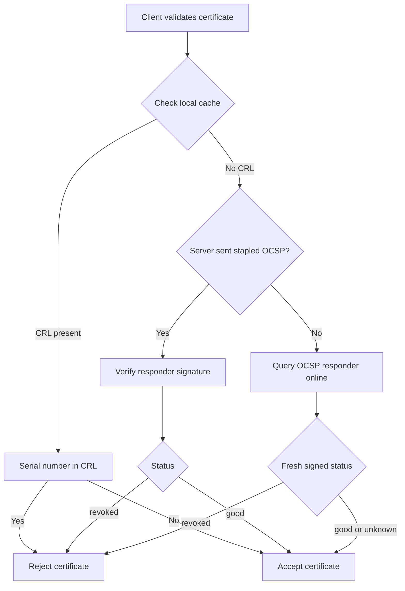

# Revoking a Certificate: CRL, OCSP, and OCSP Stapling

### English

A certificate is a promise that a public key belongs to a named subject and is still trustworthy. Revocation is the mechanism for breaking that promise early — if a private key leaks, or the details in the certificate turn out to be wrong, the issuer must be able to withdraw the certificate before its natural expiry. A certificate that is merely "not yet expired" is not automatically valid; it must also not be revoked. Think of expiry like the printed date on a passport, and revocation like a border authority stamping the passport as cancelled: one is predictable and time-based, the other is an event-driven announcement that stops the document working immediately.

The oldest revocation method is the Certificate Revocation List (CRL). A CRL is a signed list of serial numbers that have been revoked, published periodically on a URL. The client downloads it, caches it, and checks the certificate's serial number against the list. The problem is freshness: if the CA publishes a CRL every 24 hours, a stolen key may still be accepted for nearly a day. CRLs also grow large, and every client has to fetch and parse them.

OCSP (Online Certificate Status Protocol) fixes freshness by asking the CA directly, per certificate. The client sends the certificate's serial number and issuer to an OCSP responder and receives a signed status: good, revoked, or unknown. The trade-off is a network round trip on every validation, which is slow and a privacy leak — the responder learns exactly which sites you visit. OCSP stapling solves that: the web server asks the responder once, then serves the signed status alongside the certificate in the TLS handshake, so clients get a fresh answer without contacting the CA and without revealing what they are browsing.

### 中文

憑證是一個承諾：某把公鑰屬於某個指定主體，而且仍然值得信任。撤銷（revocation）就是提早打破這個承諾的機制——如果私鑰外洩，或者憑證上的資料發現有錯，簽發機構必須在憑證自然到期前把它撤回。憑證「未到期」並不等於仍然有效，它同時必須未被撤銷。可以想像：到期日就像護照上印的日期，撤銷就像入境處在護照上蓋上「已作廢」的印章——一個是按時間推算的，另一個是事件驅動、立即生效的公告。

最舊的做法是憑證撤銷清單（CRL）。CRL 是一份簽署過的清單，列出已被撤銷的序號，並定期發佈在某個 URL 上。客戶端下載後快取，再檢查憑證的序號是否在清單內。問題在於新鮮度：如果 CA 每 24 小時才發佈一次 CRL，被偷走的私鑰可能仍可使用接近一天。CRL 也會愈來愈大，每個客戶端都要下載及解析。

OCSP（Online Certificate Status Protocol）以逐張證書向 CA 即時查詢來解決新鮮度問題。客戶端送出憑證的序號與簽發者，OCSP 回應端（responder）回傳簽署過的狀態：good、revoked 或 unknown，代價是每次驗證都要多一次網絡來回，浪費時間，也洩漏私隱——回應端會知道你在瀏覽哪些網站。OCSP stapling（黏貼）解決了這一點：網站伺服器先向回應端索取一次狀態，然後在 TLS 握手時連同憑證一起送給客戶端，於是客戶端拿到新鮮的狀態，卻不必直接聯絡 CA，也不會洩漏瀏覽紀錄。

## Key Takeaway
Revocation turns "not yet expired" into "still trusted": CRLs are cheap but stale, OCSP is fresh but slow and privacy-revealing, and stapling gives fresh status without a round trip to the CA.

## Related Concepts
- Certificate Authority (CA)
- OCSP Responder
- TLS Handshake
- Certificate Transparency (CT)

## Diagram

