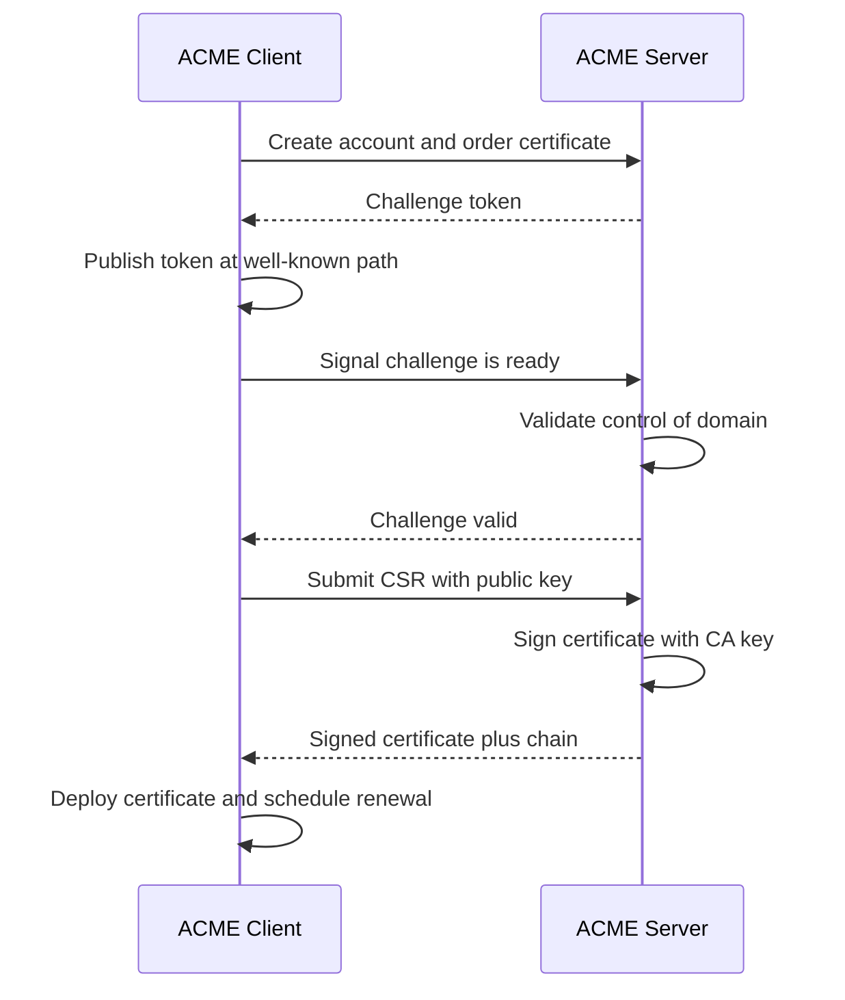

# ACME and Let's Encrypt: Automated Certificate Issuance

### English

Getting a certificate from a traditional certificate authority was a manual, human-heavy process: you generated a key and a Certificate Signing Request (CSR), filled in a web form, waited for an employee to review and approve it, and sometimes waited days. That workflow is fine for a company website but impossible to apply to thousands of servers, short-lived certificates, or containers that come and go in minutes. The bottleneck was never the cryptography — signing a certificate takes milliseconds — it was the human paperwork around it.

ACME (Automatic Certificate Management Environment) is the protocol that removes the humans. Defined in RFC 8555, it defines a small HTTPS-based protocol between a client (such as Certbot or a cloud load balancer) and an ACME server (the CA). The client creates an account, then for each certificate it performs a challenge: it proves to the ACME server that it controls the domain in question, usually by serving a random token at a well-known HTTP path such as `/.well-known/acme-challenge/`. The other common challenge type is DNS-01, where the client creates a TXT record in the domain's DNS zone, which works even for wildcard certificates and servers behind port 80.

Once the challenge passes, the client sends its CSR, the server validates it, signs the certificate, and returns it. Everything after that — renewal, and increasingly short certificate lifetimes (Let's Encrypt issues 90-day certificates and has moved toward shorter) — happens automatically on a schedule. The whole point of short lifetimes is that revocation becomes far less important: if a key is compromised, the window of danger shrinks from a year to weeks. Modern browsers also send a Certificate Transparency timestamp in the Certificate Transparency log so that mis-issuance can be detected by anyone, not just the CA.

### 中文

從傳統憑證授權機構（CA）取得憑證，向來是一個高度依賴人手流程：在網上填表格、提交 Certificate Signing Request（CSR）、等員工審批，有時要等上數日。這對一間公司網站還可以，但絕對無法套用到幾千台伺服器、短期憑證，或者幾分鐘內就生滅的容器。瓶頸從來不是密碼運算——簽署一張憑證只需毫秒——而是周圍的人手文書工作。

ACME（Automatic Certificate Management Environment）是把手工流程移除的協議。RFC 8555 定義了 client（例如 Certbot 或雲端負載平衡器）與 ACME server（即 CA 之間）之間一個建基於 HTTPS 的小型protocol。client 先開立帳戶，接著為每張憑證進行驗證挑戰（challenge）：它向 ACME server 證明自己控制該網域，常見做法是在指定 HTTP 路徑（例如 `/.well-known/acme-challenge/`）提供一段隨機 token。另一種常見類型是 DNS-01，由 client 在網域的 DNS 區域建立 TXT 記錄，適用於萬用字憑證（wildcard）以及無法在 80 埠被存取的伺服器。

挑戰通過後，client 送出 CSR，server 驗證並簽署憑證後回傳。之後的續期（renewal）——以及日漸縮短的憑證有效期（Let's Encrypt 發出 90 日憑證，並已朝更短的方向走）——都會按排程自動進行。短有效期的好處在於大幅降低對撤銷機制的依賴：一旦私鑰被攻破，危險窗口由一年縮短到數星期。現代瀏覽器還會在 Certificate Transparency log 中加入時間戳，讓任何人（而不只是 CA）都能察覺錯誤簽發。

## Key Takeaway
ACME turned certificate issuance from a manual approval workflow into a scripted, domain-verified exchange, which is what makes short-lived, automatically renewed certificates practical at scale.

## Related Concepts
- CSR (Certificate Signing Request)
- DNS-01 Challenge
- Certificate Transparency (CT)
- Let's Encrypt

## Diagram

