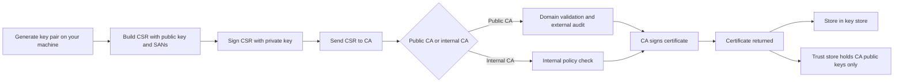

# CSRs, Trust Stores, Key Stores, and Public vs. Internal CAs

### English

A Certificate Signing Request (CSR) is the formal ask you send to a CA: it contains your public key, the domains or identity you want the certificate to cover, a validity period, and a cryptographic signature made with the matching private key. That signature is the proof that you actually hold the private key — the CA never needs to see it. Keeping the private key on your own machine means a CA compromise does not hand the attacker your key material. Most tools also generate a random serial number and Subject Alternative Names (SANs) so that a certificate works with modern browsers, which ignore the old Common Name field.

Two different stores are worth distinguishing. The trust store (or CA bundle) holds the public keys of the CAs you are willing to trust — root and intermediate certificates. It contains nothing secret, and it is usually shipped with the operating system or language runtime. The key store holds your own private keys and certificates, protected by a password or a hardware token. Mixing them up is a common and confusing mistake: adding a certificate to a trust store tells the world "I vouch for this issuer", while adding one to a key store means "here is my own identity".

CAs themselves split into two families. A public CA (such as Let's Encrypt, DigiCert, or Sectigo) is a commercial, audited organisation whose root certificates are pre-installed in billions of devices. To get a certificate from it, you must prove control of the domain — the domain validation or DV check described earlier — but nobody checks who you are as an organisation. An internal or private CA is one you run yourself, inside your own organisation or data centre. It issues certificates to services, developers, and devices that never face the internet, and there is no domain validation because you already know your own systems. The trade-off is that you, not an outside auditor, are responsible for the root key: if your internal root is compromised, every certificate you ever issued is suspect. That is why internal roots are usually held in an offline HSM and protected by a formal key ceremony.

### 中文

Certificate Signing Request（CSR）是你向 CA 發出的正式申請：內含你的公鑰、憑證要涵蓋的網域或身分、有效期限，以及用對應私鑰做出的密碼簽署。該簽署就是你確實持有私鑰的證明——CA 從不需要看到私鑰。把私鑰留在自己機器上，代表即使 CA 被攻破，攻擊者也不會拿到你的金鑰。現有工具通常還會產生隨機序號與 Subject Alternative Names（SAN），令憑證在現代瀏覽器中正常運作，因為舊的 Common Name 欄位已被忽略。

有兩個不同的存放處需要分清楚。信任存放區（trust store，又稱 CA bundle）存放你願意信任之 CA 的公鑰——根憑證與中介憑證。裡面沒有任何祕密，通常由作業系統或語言執行環境預先提供。密鑰存放區（key store）則存放你自己的私鑰與憑證，以密碼或硬件令牌保護。把兩者混淆是很常見的誤解：把憑證加入信任存放區，等於向外界宣告「我為這個簽發者背書」；加入密鑰存放區，意思則是「這是我自己的身分」。

CA 本身可分成兩大類。公共 CA（例如 Let's Encrypt、DigiCert 或 Sectigo）是經審核的商業機構，其根憑證已預先安裝在數十億台裝置上。向它申請憑證，必須證明你控制該網域（即前述的網域驗證 DV），但沒有人會查驗你這間機構的身分。內部或私有 CA 則由你自己營運，設置在自身機構或數據中心之內。它向服務、開發者與裝置簽發憑證，由於你本就更了解自己的系統，因此並無網域驗證。代價在於：若內部根憑證被攻破，你發出過的每一張憑證都會受疑。所以內部根憑證通常存放於離線 HSM，並以正式的 key ceremony 保護。

## Key Takeaway
A CSR proves key possession without exposing the key, trust stores hold the CA public keys you trust while key stores hold your own private material, and internal CAs trade public audit for your own operational responsibility.

## Related Concepts
- Root Certificate and Intermediate CA
- Subject Alternative Name (SAN)
- Hardware Security Module (HSM)
- Key Ceremony

## Diagram

