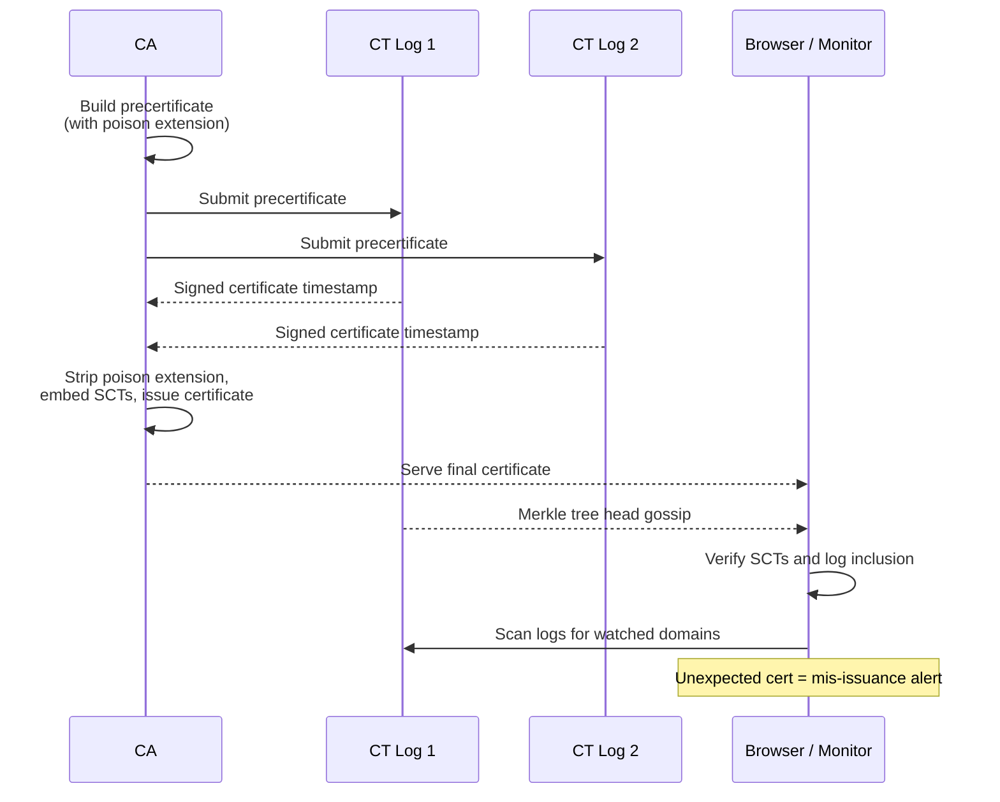

# Certificate Transparency: Making Mis-issuance Visible to Everyone

### English

Consider the worst case for a certificate authority. A CA employee, or an attacker who has compromised a CA's issuance infrastructure, issues a fraudulent certificate for `bank.example.com` and signs it with the CA's real signing key. Every cryptographic check passes: the chain is valid, the signature is correct, the certificate is in date. From the point of view of the browser, the key difference between a legitimate certificate and a fraudulent one is that nobody noticed. If the CA's internal audit does not catch it, the attack can go unnoticed for months.

Certificate Transparency (CT) was designed to close that gap. The idea is that every publicly-trusted certificate must be submitted to a public, append-only log — an append-only log is a specialised database where entries can only be added, never edited or deleted, so the log operator cannot quietly remove evidence. Each log periodically publishes a signed tree hash (a Merkle tree root) that commits to everything in it, and these hashes are gossiped around the internet, so even a dishonest operator cannot hide a consistent history from everyone else.

There is a wrinkle: for a CA to get a certificate signed, it must first publish a **precertificate** to the log. A precertificate is a special form of the certificate carrying a critical "poison" extension (OID 1.3.6.1.4.1.11129.2.4.3) that makes it unusable for TLS by itself. The CA submits the precertificate to several logs, waits for signed certificate timestamps (SCTs, RFC 6962) back, then removes the poison extension and issues the final certificate with the SCTs embedded. This guarantees that the log committed to the certificate *before* anyone could use it — you cannot have a valid certificate that was never logged, and you cannot have a logged precertificate that never became a certificate, because the CA would be wasting a log entry that auditors would notice. The duplicate-submission requirement also means a single log operator cannot censor a certificate.

Why does this matter in practice? Because it makes detection cheap and independent. Anyone can monitor all known logs for the domains they care about. If a certificate appears for `bank.example.com` that nobody requested, that is a strong signal of mis-issuance, and CT monitoring services and tools such as `crt.sh` make it trivial to look up the entire history of a domain's certificates. This changes the economics of an attack: the attacker must obtain a fraudulent certificate, and they must hope nobody is watching, for a period measured in how fast detection propagates — which is now hours, not months. It is a "sunlight as a disinfectant" model rather than a prevention model, and that is precisely the point: prevention was never going to be perfect.

CT is now effectively mandatory rather than optional. Chrome has required CT for certificates since 2018 and expanded the requirement in 2022 to include a certificate's SCTs being present in the certificate itself, not only in a separate log entry. The CA/Browser Forum Baseline Requirements require CAs to submit to at least two CT logs and to embed the returned SCTs, and the ecosystem has converged on specific log sets per certificate type (for example, a "TLS BR" set of logs for server certificates). Alongside CT, the Certification Authority Authorization (CAA) resource record offers the complementary, preventive control: a domain owner can declare in DNS which CAs are allowed to issue for their names, and CAs are required to check it before issuing.

### 中文

想像一下憑證授權機構（CA）最惡劣的情況：某名 CA 員工，或者攻破了 CA 簽發基礎設施的攻擊者，為 `bank.example.com` 惡意簽發一張憑證，並且用該 CA 真正的簽署金鑰簽署。所有密碼學檢查都會通過：憑證鏈有效、簽名正確、憑證仍在有效期內。對瀏覽器而言，合法的憑證與惡意的憑證之間，唯一分別就是「沒有人發現」。若 CA 的內部稽核抓不到，這次攻擊可以潛伏好幾個月。

Certificate Transparency（CT）正是為了補上這個缺口而設計。概念是：每一張公開受信任的憑證都必須提交到一個公開的 append-only log（只可追加的日誌）——這是一種專門的資料庫，記錄只可以加入、不可編輯或刪除，因此日誌營運者無法悄悄抹走證據。每個日誌會定期發佈一個已簽署的樹雜湊（Merkle tree root），把所有內容綁定起來，而這些雜湊值會在互聯網上互相傳播，即使營運者不誠實，也無法對所有人隱瞞一份一致的歷史。

有一個技術細節：CA 要取得簽署，就必須先把 **precertificate**（預憑證）發佈到日誌。預憑證是帶有一個關鍵的「毒」extension（OID 1.3.6.1.4.1.11129.2.4.3）的特殊憑證，令它本身無法用於 TLS。CA 把預憑證提交給多個日誌，等候簽署過的憑證時間戳（SCT，RFC 6962）回來，然後移除毒 extension、把 SCT 嵌進憑證，才發出正式憑證。這保證了日誌是在憑證可以被使用「之前」就已經綁定它：不可能存在一張從未入 log 卻有效的憑證，也不可能存在一份入了 log 卻從未變成憑證的預憑證——因為後者等於浪費了一條 log 記錄，稽核者會察覺。要求向多個日誌重複提交，同時意味住單一日誌營運者無法審查某張憑證。

實務上為何重要？因為它令偵測變得便宜而且獨立。任何人都可以持續監察所有已知日誌，留意自己關心的網域。如果 `bank.example.com` 出現了一張無人要求過的憑證，那就是錯誤簽發的強烈訊號；CT 監察服務與 `crt.sh` 之類工具令查詢某網域全部憑證歷史變得極易。這改變了攻擊的成本效益：攻擊者既要取得惡意憑證，又要寄望無人觀察，而這個時間窗口現在以小時而非以月計。它是「日光作為消毒劑」的模型，而不是預防模型——而這正是重點，因為預防本來就不可能完美。

CT 現在實際上已是強制而非可選。Chrome 自 2018 年起要求 CT，並在 2022 年擴大要求：憑證本身必須嵌有 SCT，而不只是日誌內另有條目。CA/Browser Forum 的 Baseline Requirements 要求 CA 至少提交兩個 CT 日誌並把回傳的 SCT 嵌入憑證，生態亦已就各類憑證收斂到指定的日誌集合（例如伺服器憑證的「TLS BR」日誌組合）。與 CT 互補的是預防性控制——CAA（Certification Authority Authorization）資源記錄：網域擁有人可以在 DNS 內聲明哪些 CA 有權為其網域發證，而 CA 在發證前必須查核。

## Key Takeaway

Certificate Transparency does not stop mis-issuance — it makes it publicly visible within hours, turning certificate fraud from a silent, long-lived crime into a race against automatic monitors.

## Related Concepts
- RFC 6962 (Certificate Transparency) and signed certificate timestamps
- Precertificates and the poison extension
- CT log lists and CA/Browser Forum log requirements
- CAA (RFC 8657) as the complementary preventive control

## Diagram

