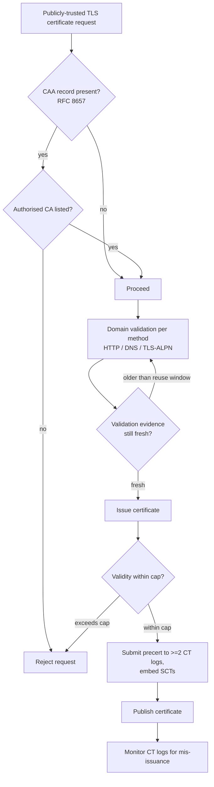

# The CA/Browser Forum Baseline Requirements: Why 200 Days, Not a Year

### English

The CA/Browser Forum (CA/BF) is the body where certificate authorities and browser vendors meet to agree on the rules of the public web PKI. Because no single browser vendor can unilaterally decide what a certificate may look like — the trust store is shared, and a certificate rejected by one browser is effectively broken for everyone — the rules have to be consensus rules. The Baseline Requirements (BRs) are that consensus document: a certificate policy that every publicly-trusted TLS CA must comply with, and that auditors check. The current published version is 2.3.1 (October 2026).

The requirement everybody notices is certificate lifetime. The BRs step validity down in stages: subscriber certificates issued on or after 15 March 2026 may have a validity period of **no more than 200 days** (and should not exceed 199 days); from 15 March 2027 the cap drops to 100 days, and from 15 March 2029 to 47 days. A "short-lived certificate" is defined as one valid for 10 days or less before March 2026, and 7 days or less from that date. This is not arbitrary bureaucracy. It is the direct consequence of the revocation problem: a certificate that lives for a year gives a stolen key a year of undetected usefulness, whereas a certificate that lives for 47 days limits exposure to about seven weeks and makes emergency revocation almost unnecessary.

The other pillar is *validation freshness*. A CA may reuse previously collected domain-validation evidence for a limited window only: from March 2026, 200 days; from March 2027, 100 days; from March 2029, just 10 days. Why? Because validation evidence — the fact that someone proved control of a domain at a point in time — decays. A domain can change hands, a DNS record can be hijacked, an email address can be reassigned. Long-lived reuse of validation data means a CA can be induced to issue for a domain it once knew, long after the world changed. Compressing both the certificate lifetime and the validation reuse window shrinks the "knowledge staleness" of the whole system.

The BRs are equally specific about the cryptography. RSA keys must be at least 2048 bits with a modulus size evenly divisible by 8; ECDSA keys must be on NIST P-256, P-384 or P-521; no other algorithms or key sizes are permitted. Signature algorithms are restricted in the same spirit — and ballot SC-097, effective 15 September 2026, sunsets all remaining uses of SHA-1 signatures in certificates and CRLs, requiring CAs to revoke any unexpired subordinate CA certificate still carrying a SHA-1 signature. SHA-1's collision resistance is long broken; a certificate signed with it can in principle be forged, and CA/BF has spent years removing it from every corner of the ecosystem.

Finally, the BRs define exactly how domain validation must be performed, per method: HTTP challenge, DNS challenge, TLS-ALPN challenge, and so on, each with rules about network perspective, ports, and what counts as corroboration. Recent ballots have closed off the weaker methods (some are deprecated from 2026 and forbidden outright from 2028), and CAA records must be processed per RFC 8657. If you want to know what a compliant CA does, the BRs are the answer; if you want to know what a *specific* CA does, its Certification Practice Statement (CPS) fills in the operational detail.

### 中文

CA/Browser Forum（CA/BF）是憑證授權機構與瀏覽器廠商聚首商議公開網絡 PKI 規則的組織。由於沒有任何單一瀏覽器廠商可以單方面決定憑證應該長甚麼樣——信任存放區是共享的，一張被其中一個瀏覽器拒絕的憑證，實際上對所有人都已經壞掉——規則必須是共識規則。Baseline Requirements（BR）就是那份共識文件：一份所有公開受信任 TLS CA 都必須遵守、並且會受審核的憑證政策。目前公開版本為 2.3.1（2026 年 10 月）。

最為人注目的要求是憑證有效期。BR 以階段方式收緊：由 2026 年 3 月 15 日起簽發的終端實體憑證，有效期**不得超過 200 日**（且建議不超過 199 日）；2027 年 3 月 15 日起降至 100 日；2029 年 3 月 15 日起再降至 47 日。「短期憑證」的定義則是：2026 年 3 月之前為有效期 10 日或以下，之後為 7 日或以下。這並非無理的官僚規定，而是撤銷問題的直接後果：有效期一年的憑證，被偷走的金鑰就有一年未被察覺的可利用時間；有效期 47 日的憑證把曝險期壓到約七個星期，令緊急撤銷幾乎變成多餘。

另一根支柱是 *驗證新鮮度*。CA 只能在一段有限時間內重用先前的網域驗證證據：由 2026 年 3 月起為 200 日，2027 年 3 月起為 100 日，2029 年 3 月起僅得 10 日。為甚麼？因為驗證證據——即有人曾在某個時間點證明過控制某網域這件事——會隨時間失效。網域可以易主，DNS 記錄可以被劫持，電郵地址可以重新分配。長期重用驗證數據，代表 CA 可能因為一段早已過時的記憶而為某網域發證。同時壓縮憑證有效期與驗證重用窗口，等於縮短整個系統的「知識過時程度」。

BR 對密碼演算法同樣有明確要求。RSA 金鑰至少 2048 位，且模數長度須為 8 的整數倍；ECDSA 金鑰必須是 NIST P-256、P-384 或 P-521；不允許其他演算法或金鑰長度。簽署演算法的限制同理——選票 SC-097 由 2026 年 9 月 15 日起生效，完全淘汰憑證與 CRL 中所有餘下的 SHA-1 簽署，並要求 CA 撤銷仍帶有 SHA-1 簽署、未到期的下屬 CA 憑證。SHA-1 的抗碰撞性早已被破解；以它簽署的憑證在理論上可以被偽造，CA/BF 多年來一直逐步將它從整個生態的每個角落清除。

最後，BR 亦逐項界定各種網域驗證方法應如何執行：HTTP challenge、DNS challenge、TLS-ALPN challenge 等等，各自訂明網絡視角、所用埠號，以及甚麼才算互相印證。近期的選票亦關閉了較弱的方法（部分由 2026 年起停用、2028 年起全面禁止），並要求按 RFC 8657 處理 CAA 記錄。若想知道「合規的 CA 應該做甚麼」，答案就在 BR；若想知道「某一家具體 CA 實際如何做」，就要看它的 Certification Practice Statement（CPS）補上營運細節。

## Key Takeaway

Short certificate lifetimes and short validation-reuse windows are not bureaucratic box-ticking — they shrink the time during which a stolen key or a hijacked domain can produce a trusted certificate nobody notices.

## Related Concepts
- CA/Browser Forum Baseline Requirements v2.3.1 (Section 6.3.2 validity, Section 4.2.1 validation reuse)
- Ballot SC-097: SHA-1 signature sunset effective 15 September 2026
- CA/BF audit and Certification Practice Statements
- RFC 8657 (CAA) and RFC 6962 (CT)

## Diagram

