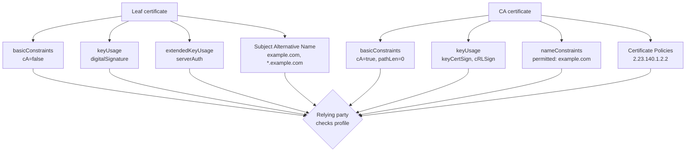

# X.509 v3 Extensions and Certificate Profiles: What Each Field Actually Promises

### English

An X.509 certificate is a signed statement about a public key, and the signature on it is only half the story. The other half is a set of extensions — extra fields carried in the certificate body that tell relying parties how the key may be used, how far the issuer's authority extends, and which policies the issuer claims to follow. Without extensions, a certificate would say "this key belongs to example.com" and nothing more; with them, it can say "this key may sign TLS server certificates for example.com, and this key may only issue certificates for *.example.com, and this CA follows policy X."

The three extensions you will meet first are `basicConstraints`, `keyUsage`, and `extendedKeyUsage`. `basicConstraints` has a boolean `cA` flag that distinguishes a CA certificate from a leaf, and it may carry `pathLenConstraint`, which limits how many intermediate CAs may sit below it — a `pathLenConstraint` of 0 means this CA may sign leaf certificates but no further CAs, which is exactly what an "issuing CA" should be allowed to do. `keyUsage` is a bitmask of permitted cryptographic operations: `digitalSignature` for signing, `keyEncipherment` for RSA key transport, `keyCertSign` for signing subordinate CA certificates, `cRLSign` for signing revocation lists. `extendedKeyUsage` (EKU) is the application-level list: `serverAuth` (1.3.6.1.5.5.7.3.1) for TLS servers, `clientAuth`, `codeSigning`, `emailProtection`, `timeStamping`.

The subtlety that catches people is that "the key may be used" and "the key may be used *for this*" are different claims, and the certificate should express both. A server certificate with `keyUsage = digitalSignature, keyEncipherment` and `extendedKeyUsage = serverAuth` says: use this key to prove server identity, and use it to wrap the TLS session key. A client certificate for mutual TLS would use `clientAuth` instead. It is entirely possible to have a certificate that is cryptographically valid but wrong for the job — the browser will refuse a certificate whose EKU does not permit the requested use, which is why "the certificate works for curl but not for the API client" is a common and confusing symptom.

Other extensions matter at the CA layer. `nameConstraints` limits the namespace a CA may issue into, so a delegated corporate CA might be constrained to `example.com` and `.corp.example.com` only; this is how a large organisation lets many internal teams run their own CAs without any of them being able to issue a certificate for `google.com`. `Subject Alternative Name` (SAN) lists the domains and IPs a certificate is valid for, and `Authority Key Identifier` / `Subject Key Identifier` are the hashes that let path-building software match an issuer to its child reliably. Finally, `Certificate Policies` (OID arc 2.23.140.1.2.1 for domain-validated, .2 for organisation-validated, .3 for individual-validated under the CA/Browser Forum arc) lets a CA publish which validation level it applied, and lets a relying party check that the policy it requires is actually present.

The practical lesson is that a certificate is a *profile*, not just a signature. CA/Browser Forum Baseline Requirements specify an exact profile for each certificate type — which extensions must be present, which must be absent, and with what criticality. Extensions marked critical (such as `basicConstraints` in CA certificates) must be understood by the validator or the certificate is rejected outright.

### 中文

X.509 憑證是一份關於公鑰的簽署聲明，但上面的簽名只講了一半。另一半是一系列 extension（延伸欄位）——放在憑證主體內的額外欄位，用來告訴信賴方（relying party）這把金鑰可以怎樣用、簽發者的權力延伸到哪裡、以及簽發者聲稱遵循哪一套政策。如果沒有 extension，憑證只會說「這把金鑰屬於 example.com」；有了 extension，它還可以說「這把金鑰可為 example.com 簽署 TLS 伺服器憑證，而這把金鑰只能為 *.example.com 簽發憑證，而這間 CA 遵循政策 X」。

最先遇見的三個 extension 是 `basicConstraints`、`keyUsage` 同 `extendedKeyUsage`。`basicConstraints` 內的 `cA` 布林值用來分辨 CA 憑證與終端實體憑證，亦可帶 `pathLenConstraint`，限制其下可以再有多少層中介 CA——`pathLenConstraint` 為 0 代表這間 CA 只可以簽發葉端憑證、不可再簽發 CA 憑證，這正是「簽發 CA」應有的權限。`keyUsage` 是一個位元遮罩，列出容許的密碼操作：`digitalSignature`（簽署）、`keyEncipherment`（RSA 金鑰傳輸）、`keyCertSign`（簽發下屬 CA 憑證）、`cRLSign`（簽發撤銷清單）。`extendedKeyUsage`（EKU）則是應用層面的清單：`serverAuth`（1.3.6.1.5.5.7.3.1）代表 TLS 伺服器、`clientAuth`、`codeSigning`、`emailProtection`、`timeStamping`。

容易令人困惑之處在於：「這把金鑰可以被使用」與「這把金鑰可以被用於 *這個* 用途」是兩個不同的聲明，憑證理應同時表達兩者。一張 `keyUsage = digitalSignature, keyEncipherment` 而 `extendedKeyUsage = serverAuth` 的伺服器憑證意思是：用它證明伺服器身分，並用它包裝 TLS 會話金鑰。用於双向 TLS 的使用者端憑證則改用 `clientAuth`。一張憑證可以完全密碼學有效卻不適合該工作——瀏覽器會拒絕 EKU 不容許該用途的憑證，因此「curl 正常但 API client 不行」是常見又令人費解的症狀。

在 CA 層面，`nameConstraints` 限制某 CA 可發證的命名空間，例如把某企業 CA 限制在 `example.com` 與 `.corp.example.com` 之內；大型機構正是靠它，讓旗下許多內部團隊各自營運 CA 而同時確保沒有任何一方能為 `google.com` 發證。`Subject Alternative Name`（SAN）列出憑證涵蓋的網域與 IP；`Authority Key Identifier` 與 `Subject Key Identifier` 則是雜湊值，讓建構憑證鏈的軟件能可靠地將簽發者與其簽發的憑證配對。最後 `Certificate Policies`（CA/Browser Forum 使用的 OID 弧 2.23.140.1.2.1 為 domain-validated、.2 為 organisation-validated、.3 為 individual-validated）讓 CA 公佈自己採用了哪一級驗證，信賴方亦可檢查自己要求的政策是否真的存在於憑證之中。

實務教訓是：憑證是一份 *profile*，而不只是一個簽名。CA/Browser Forum 的 Baseline Requirements 為每種憑證類型訂明準確的 profile——哪些 extension 必須存在、哪些必須缺席、以及 critical（關鍵）標記如何處理。標記為 critical 的 extension（例如 CA 憑證的 `basicConstraints`）若驗證器看不懂，整張憑證會被直接拒絕。

## Key Takeaway

The signature proves who issued the key; the extensions prove what the key is allowed to do — and a certificate that is cryptographically valid can still be rejected purely because of its extension profile.

## Related Concepts
- RFC 5280 (X.509 Certificate and CRL Profile)
- CA/Browser Forum Baseline Requirements, Section 7.1 (Certificate Profiles)
- Name Constraints and delegated internal CAs
- Certificate Policies and validation-level OIDs

## Diagram

