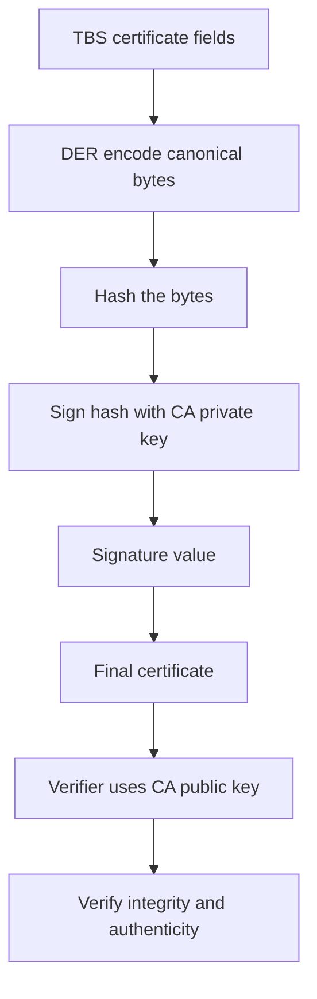

# Certificate Signing Mechanics: What the CA Actually Computes

## English

When a CA signs a certificate, it is not encrypting anything with the subject's key. It takes the DER-encoded bytes of the to-be-signed certificate (the TBS certificate: version, serial number, signature algorithm, issuer, validity, subject, subject public key info, extensions), runs a hash over those bytes, and then signs that hash with the CA's own private key. For RSA this is PKCS#1 v1.5 (or PSS); for ECDSA it is a pair of integers r and s. The result is placed in the signatureValue field, and the whole thing becomes the final certificate. Anyone can verify it with the CA's public key from the chain. This is why the signature covers the TBS bytes and not the outer wrapper: the outer structure contains the signature itself, so it cannot be part of its own input.

A subtle but important consequence: a certificate is a signed statement, not an encrypted message. There is no confidentiality in a certificate. Anyone can read every field, including the subject's public key, SANs, and validity dates. The only thing the signature guarantees is integrity and authenticity: that the holder of the CA's private key approved exactly these bytes. If even one bit of the TBS changes after signing, the signature fails to verify.

When you sign with an intermediate CA, the CA's key is not the root. The verifier builds a chain and checks each signature link: leaf signed by intermediate, intermediate signed by root (or by another intermediate), root trusted locally. Each link uses the same TBS-hash-sign procedure, just with a different signing key. This is why losing an intermediate key is catastrophic: everything it signed becomes suspect, and revocation lists grow quickly.

There is a reason CAs are picky about the TBS encoding. DER (Distinguished Encoding Rules) is canonical: two encoders producing the same logical certificate must produce byte-identical output. If a CA signed a non-canonical encoding, a verifier that re-encodes the TBS before hashing would compute a different hash and reject the signature. This is why ASN.1 libraries and OpenSSL's `-x509` path are strict about DER, and why `openssl asn1parse` and `openssl x509 -text` are useful when debugging a signature mismatch.

A practical check: `openssl verify -CAfile root.pem -untrusted intermediate.pem server.pem` walks the chain and reports whether each signature validates. If it fails, the error usually tells you which link broke: expired intermediate, wrong key usage, or a signature algorithm mismatch. The CA's job is narrow and mechanical: hash the TBS, sign with its key, emit the certificate. Understanding that keeps the rest of PKI much less mysterious.

## 中文

當憑證授權機構（CA）簽署一張憑證時，它並不是用主體（subject）的金鑰去加密任何東西。它會取出「待簽憑證」（TBS certificate：版本、序號、簽章演演算法、簽發者、有效期間、主體、主體公鑰資訊、擴充欄位）的 DER 編碼位元組，對這些位元組做雜湊，然後用 CA 自己的私鑰去簽那個雜湊值。以 RSA 來說，這是 PKCS#1 v1.5（或 PSS）；以 ECDSA 來說，則是兩個整數 r 與 s。結果放進 signatureValue 欄位，整份東西就成為最終憑證。任何人都可以用鏈上的 CA 公鑰來驗證它。這就解釋了為何簽章涵蓋的是 TBS 位元組而不是外層包裝：外層結構本身含有簽章，所以它不可能成為自己輸入的一部分。

一個細微但重要的後果：憑證是一份被簽署的宣告，不是加密訊息。憑證本身沒有機密性。任何人都能讀到每個欄位，包括主體的公鑰、SAN 與有效期間。簽章唯一保證的是完整性與真實性：CA 私鑰的持有者確實批准了這串位元組。簽署之後 TBS 只要有任何一個位元改變，簽章就驗證失敗。

當你用中繼 CA 來簽署時，CA 的金鑰並不是根。驗證者會建構一條鏈，逐環檢查簽章：葉憑證由中繼簽、中繼由根簽（或由另一層中繼簽）、根則在本機被信任。每一環都用同樣的「TBS 雜湊—簽署」程式，只是簽署金鑰不同。這就是為何中繼金鑰外洩是災難性的：它簽過的一切都變得可疑，撤銷清單會迅速膨脹。

CA 對 TBS 編碼如此挑剔是有原因的。DER（Distinguished Encoding Rules）是正規化的：兩個編碼器若要產生同一張邏輯憑證，必須輸出位元完全相同的結果。如果 CA 簽的是非正規編碼，而驗證者在雜湊前重新編碼 TBS，就會算出不同的雜湊而拒絕簽章。這就是為何 ASN.1 函式庫與 OpenSSL 的 `-x509` 路徑對 DER 如此嚴格，也是為何在排查簽章不符時，`openssl asn1parse` 與 `openssl x509 -text` 很有用。

一個實用檢查：`openssl verify -CAfile root.pem -untrusted intermediate.pem server.pem` 會走完整條鏈，回報每一環簽章是否有效。若失敗，錯誤訊息通常會告訴你哪一環斷了：中繼過期、金鑰用途不對，或簽章演演算法不符。CA 的工作其實狹窄而機械：雜湊 TBS、用自己的金鑰簽、輸出憑證。理解這一點，PKI 其餘部分就沒那麼神秘了。

## Key Takeaway

A CA signs the hash of the DER-encoded TBS certificate with its own private key; the signature proves integrity and approval, never confidentiality.

## Related Concepts
- DER encoding
- Digital signature verification

## Diagram

