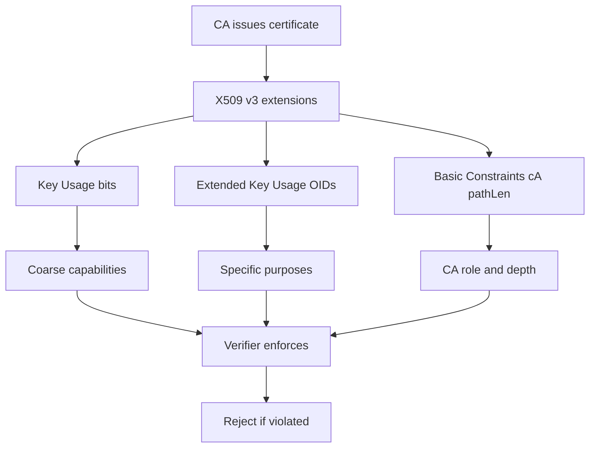

# Key Usage and Extended Key Usage: The Constraints Inside the Certificate

## English

A certificate is not a blank check. X.509 v3 lets the CA attach constraints that tell verifiers what the key may be used for. The two you will meet most often are Key Usage (KU), a bit string, and Extended Key Usage (EKU), a list of object identifiers. KU covers coarse capabilities such as digitalSignature, keyEncipherment, keyCertSign, and cRLSign. EKU is more specific about purpose: serverAuth for TLS server certificates, clientAuth for mutual TLS clients, codeSigning for signed binaries, emailProtection for S/MIME. A certificate can carry both, and a strict verifier checks both.

Why does this matter? Imagine a CA issues an intermediate certificate with keyCertSign set. That intermediate can now sign other certificates, which is exactly what an intermediate should do. Now imagine the same intermediate is issued without keyCertSign: any certificate it signs will be rejected by browsers that enforce the constraint. This is a real defense against a compromised subordinate being abused to mint arbitrary leaf certificates. Similarly, a leaf certificate with only serverAuth should not be accepted as a client certificate, and vice versa.

There are also critical versus non-critical flags. A critical extension must be understood and enforced by the verifier; an unrecognized critical extension causes rejection. KU and EKU are usually marked critical so that a verifier cannot silently ignore them. Basic Constraints, which marks a certificate as a CA (cA=TRUE) and optionally limits the path length, is also critical in CA certificates. Path length is a small integer: pathLenConstraint=0 means the certificate may sign only end-entity certificates, not further intermediates.

In practice you will debug these with `openssl x509 -text -noout -in cert.pem` and look at the `X509v3 Key Usage` and `X509v3 Extended Key Usage` lines. If a TLS handshake fails with a message about inappropriate key usage, the certificate's EKU probably lacks serverAuth, or the private key was used in a way the KU forbids (for example, an ECDSA key with keyEncipherment). Some servers also require the certificate's KU to include digitalSignature for modern TLS 1.3 cipher suites, because the handshake signature is what proves possession.

A useful mental model: KU and EKU are the certificate's job description. The CA is saying not just "this key belongs to this name" but "and here is the only kind of work it is allowed to do." When you generate a CSR, you can request specific EKUs, but the CA decides what to actually put in the final certificate. Always inspect the issued certificate rather than assuming your CSR's requests were honored.

## 中文

憑證不是空白支票。X.509 v3 讓 CA 附加限制，告訴驗證者這把金鑰可以用來做什麼。你最常遇到的兩個是 Key Usage（KU，金鑰用途），一個位元字串，以及 Extended Key Usage（EKU，擴充金鑰用途），一串物件識別碼。KU 涵蓋粗略的能力，例如 digitalSignature、keyEncipherment、keyCertSign 與 cRLSign。EKU 則更精確地描述目的：serverAuth 用於 TLS 伺服器憑證、clientAuth 用於雙向 TLS 使用者端、codeSigning 用於簽署的執行檔、emailProtection 用於 S/MIME。一張憑證可以同時帶有兩者，嚴格的驗證者會兩者都檢查。

為何這很重要？想像某個 CA 簽出一張中繼憑證並設定 keyCertSign。這張中繼現在可以簽其他憑證，這正是中繼該做的事。再想像同一張中繼在簽發時沒有 keyCertSign：它簽出的任何憑證都會被有強制執行此限制的瀏覽器拒絕。這是防止遭入侵的下層憑證被濫用來大量簽發葉憑證的真實防線。同樣地，只帶 serverAuth 的葉憑證不應被接受為使用者端憑證，反之亦然。

還有 critical 與 non-critical 的差別。標為 critical 的擴充欄位必須被驗證者理解並強制執行；無法辨識的 critical 擴充會導致拒絕。KU 與 EKU 通常標為 critical，這樣驗證者就不能默默忽略它們。Basic Constraints 會把憑證標記為 CA（cA=TRUE）並可選擇限制路徑長度，在 CA 憑證中也是 critical。路徑長度是一個小整數：pathLenConstraint=0 表示這張憑證只能簽終端實體憑證，不能再簽下層中繼。

實務上你會用 `openssl x509 -text -noout -in cert.pem` 來排查，檢視 `X509v3 Key Usage` 與 `X509v3 Extended Key Usage` 那幾行。如果 TLS 握手失敗並提到金鑰用途不當，很可能是憑證的 EKU 缺少 serverAuth，或私鑰被用在 KU 禁止的方式（例如一把 ECDSA 金鑰卻標了 keyEncipherment）。有些伺服器在現代 TLS 1.3 加密套件下，也要求憑證的 KU 包含 digitalSignature，因為握手簽章才是證明持有私鑰的依據。

一個好用的心智模型：KU 與 EKU 是憑證的職務說明書。CA 不只是說「這把金鑰屬於這個名字」，還說「而且它只准做這類工作」。當你產生 CSR 時，可以請求特定的 EKU，但最終憑證裡實際放什麼由 CA 決定。永遠檢查簽發出來的憑證，而不是假設你 CSR 的請求被照單全收。

## Key Takeaway

Key Usage and Extended Key Usage are CA-imposed constraints that limit what a certified key may do, and strict verifiers enforce them.

## Related Concepts
- X.509 v3 extensions
- TLS handshake

## Diagram

