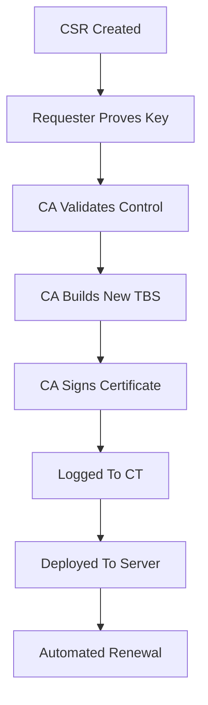

# The Signing Request Lifecycle: From CSR to Issued Certificate to Renewal

## English

A CSR is a proposal, not a certificate. It contains the subject's public key and a self-signature proving the requester holds the matching private key, plus requested attributes such as subject name, SANs, and EKUs. When the CA accepts it, the CA does not copy the CSR verbatim. It builds a new TBS certificate, chooses the serial number, sets validity dates, adds its own issuer name, and applies its own extensions and policy. The CSR's signature is discarded; the certificate gets a fresh signature from the CA's key. This is why the issued certificate's contents can differ from what you asked for: the CA may add or drop SANs, shorten validity, or set different EKUs based on its policy.

Domain validation is the part that proves control. For a DNS name, the CA might ask you to publish a specific TXT record, serve a token at a well-known HTTP path, or respond to a challenge over TLS. These are the ACME challenge types (http-01, dns-01, tls-alpn-01), but the same idea exists in manual and commercial CAs. Only after that proof does the CA sign. For organization validation, the CA additionally checks that the legal entity exists and controls the domain, which is why OV issuance takes longer.

The issued certificate is public. It will be logged to Certificate Transparency (CT) logs, which are append-only Merkle trees of certificates. That means your SANs become visible to anyone monitoring CT. If you are issuing an internal certificate, an internal CA may skip CT logging, but a public CA will not. This is one reason internal hostnames often use a private CA rather than a public one.

Renewal is the quiet part of the lifecycle. Certificates expire, and modern validity periods are short. The correct approach is to automate renewal well before expiry, rotate the key when policy requires it, and deploy the new certificate and chain atomically. A common failure mode is renewing the leaf but forgetting the intermediate changed, or deploying a new certificate before the new private key is in place. Monitoring expiry with a simple check (for example, parsing `notAfter` from the certificate) prevents the classic outage where a site goes down at midnight because nobody renewed.

Finally, keep the private key out of the CSR workflow's public artifacts. The CSR contains only the public key, so it is safe to email or paste into a CA portal; the private key never leaves your control. If you ever see a CSR that contains a private key, something is wrong. The lifecycle is: generate key, build CSR, prove control, receive certificate, deploy with chain, monitor, renew. Each step has its own failure modes, and most production incidents come from the last two steps, not the signing itself.

## 中文

CSR 是一份提案，不是憑證。它包含主體的公鑰，以及一個自簽章來證明請求者持有對應的私鑰，再加上請求的屬性，例如主體名稱、SAN 與 EKU。當 CA 接受它時，CA 並不會原封不動複製 CSR。它會建立新的 TBS 憑證、選擇序號、設定有效期間、填入自己的簽發者名稱，並套用自己的擴充欄位與政策。CSR 的簽章會被丟棄；憑證會取得 CA 金鑰的新簽章。這就是為何簽發出來的憑證內容可能與你要求的不同：CA 可能依其政策增刪 SAN、縮短有效期間，或設定不同的 EKU。

網域驗證是證明控制權的部分。對於 DNS 名稱，CA 可能要求你發布特定的 TXT 記錄、在眾所週知的 HTTP 路徑提供權杖，或透過 TLS 回應挑戰。這些是 ACME 的挑戰類型（http-01、dns-01、tls-alpn-01），但同樣的概念也存在於手動與商業 CA。只有在證明之後，CA 才會簽署。對於組織驗證，CA 還會額外查核法律實體存在且控制該網域，這就是 OV 簽發較慢的原因。

簽發出來的憑證是公開的。它會被記錄到憑證透明度（Certificate Transparency，CT）日誌，那是一棵只可追加的 Merkle 樹。這意味著你的 SAN 會對任何監看 CT 的人可見。若你簽發的是內部憑證，內部 CA 可以跳過 CT 記錄，但公開 CA 不會。這是內部主機名稱通常使用私有 CA 而非公開 CA 的原因之一。

續期是整個生命週期安靜的一環。憑證會過期，而現代有效期間很短。正確做法是在到期前及早自動續期、依政策輪換金鑰，並原子性地部署新憑證與鏈。常見的失敗模式是續了葉憑證卻忘了中繼也換了，或在新私鑰就位前就部署了新憑證。用簡單檢查監控到期（例如從憑證解析 `notAfter`）可避免經典的半夜斷線事故：沒人續期，網站就掛了。

最後，讓私鑰遠離 CSR 流程的公開產物。CSR 只含公鑰，所以可以安全地電郵或貼進 CA 入口網站；私鑰永遠不離開你的掌控。如果你看到一份 CSR 含有私鑰，那一定出了問題。生命週期是：產生金鑰、建立 CSR、證明控制、取得憑證、連鏈部署、監控、續期。每一步都有自己的失敗模式，而大多數生產事故來自最後兩步，而不是簽署本身。

## Key Takeaway

A CSR is a signed proposal; the CA builds a fresh certificate from it, and most real-world failures happen during deployment and renewal rather than signing.

## Related Concepts
- ACME challenges
- Certificate Transparency

## Diagram

