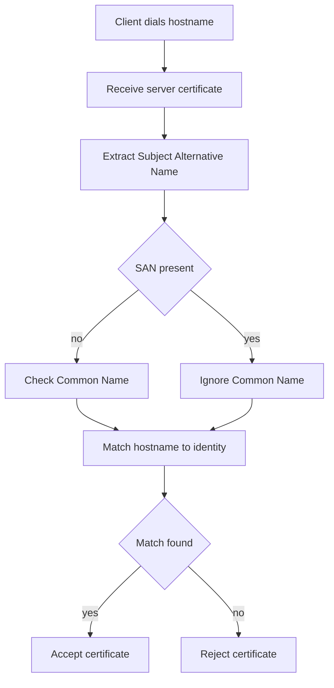

# Hostname Verification: How Clients Decide a Certificate Is Actually Yours

## English

A certificate can be perfectly signed by a trusted CA and still be rejected, because signature validity and identity validity are two separate checks. When a TLS client connects to https://www.example.com, it performs hostname verification: it compares the name it dialled against the identities listed inside the certificate. Those identities live in two places — the Subject Common Name (CN) field, and, since RFC 6125 formalised the rules, the Subject Alternative Name (SAN) extension. Modern browsers ignore CN entirely when a SAN is present, and some ignore CN altogether; this is why a certificate issued for example.com does not automatically cover www.example.com unless that name is explicitly listed.

The SAN extension is a typed list, and the type matters. A DNS name entry matches hostnames; an IP address entry matches literal IPs; wildcards are allowed only in the leftmost label and only as a whole label. So *.example.com matches www.example.com and api.example.com, but it does not match example.com itself (zero labels), nor a.b.example.com (two labels), nor www.example.com.evil.test (the wildcard is anchored to the end of the pattern). A common mistake is assuming a wildcard covers everything under the domain — it covers exactly one label deep.

Matching is done case-insensitively on ASCII labels, and internationalised names must be compared in their A-label (punycode) form, which is why a certificate for bücher.example becomes xn--bcher-kva.example on the wire. Clients also reject names containing embedded NUL bytes or trailing dots in ambiguous ways — these are the raw materials of historic certificate-spoofing bugs, so implementations normalise before comparing.

A practical debugging habit: when a browser says the certificate is invalid but the chain looks fine, dump the SANs and compare them character by character with the URL. Tools like openssl x509 -text -noout -in cert.pem print the SAN list, and openssl s_client -connect host:443 -servername host -verify_hostname host will tell you whether the name check passes. The -servername flag matters because it sends the SNI (Server Name Indication) extension, letting the server pick the right certificate in a shared-hosting setup — without it you may inspect a completely different site's certificate and chase a phantom problem.

Finally, hostname verification is a client-side responsibility, not something baked into the signature. That is why pinning or custom trust logic must still perform the name check explicitly; skipping it is how man-in-the-middle attacks succeed even against a validly signed certificate issued for an attacker-controlled domain.

## 中文

一張憑證即使由受信任的 CA 完美簽署，仍然可能被拒絕，因為「簽章有效」和「身分有效」是兩項獨立的檢查。當 TLS 客戶端連線到 https://www.example.com 時，它會執行主機名稱驗證（hostname verification）：把它所撥接的名稱，與憑證內所列的身分進行比對。這些身分存在於兩個地方——主體通用名稱（Subject Common Name，CN）欄位，以及自 RFC 6125 正式確立規則以來的 Subject Alternative Name（SAN）擴充欄位。現代瀏覽器在 SAN 存在時會完全忽略 CN，有些甚至完全不理會 CN；這就是為何一張簽發給 example.com 的憑證，不會自動涵蓋 www.example.com，除非該名稱被明確列出。

SAN 擴充是一份帶型別的清單，而型別很重要。DNS 名稱項目用於比對主機名稱；IP 位址項目用於比對字面 IP；萬用字元只允許出現在最左邊的標籤，而且必須佔據整個標籤。因此 *.example.com 能比對 www.example.com 和 api.example.com，但不會比對 example.com 本身（零個標籤），也不會比對 a.b.example.com（兩個標籤），更不會比對 www.example.com.evil.test（萬用字元被錨定在模式的末端）。常見的錯誤是以為萬用字元涵蓋網域下的一切——它其實只涵蓋往下一層。

比對時會以 ASCII 標籤進行、不分大小寫，而國際化名稱必須以其 A-label（punycode）形式比較，這就是為何 bücher.example 的憑證在網路上會變成 xn--bcher-kva.example。客戶端也會以明確方式拒絕含有內嵌 NUL 位元組或尾隨點的名稱——這些正是歷史上憑證偽造漏洞的原材料，所以實作會在比對前先做正規化。

一個實用的除錯習慣：當瀏覽器說憑證無效、但憑證鏈看起來沒問題時，把 SAN 列印出來，逐字元與 URL 比對。像 openssl x509 -text -noout -in cert.pem 這類工具會印出 SAN 清單，而 openssl s_client -connect host:443 -servername host -verify_hostname host 會告訴你名稱檢查是否通過。-servername 旗標很重要，因為它會送出 SNI（Server Name Indication）擴充，讓伺服器在共用主機環境中挑選正確的憑證——少了它，你可能檢查到完全另一個網站的憑證，然後追查一個根本不存在的問題。

最後，主機名稱驗證是客戶端的責任，並非內建於簽章之中。這就是為何憑證釘選（pinning）或自訂信任邏輯仍然必須明確執行名稱檢查；跳過它，就是攻擊者即使拿著一張為其控制的網域所簽發的有效憑證，也能成功進行中間人攻擊的原因。

## Key Takeaway

A signature proves who issued a certificate; hostname verification proves it was issued for the name you actually dialled — both checks must pass.

## Related Concepts
- Subject Alternative Name (SAN)
- TLS handshake and SNI

## Diagram

