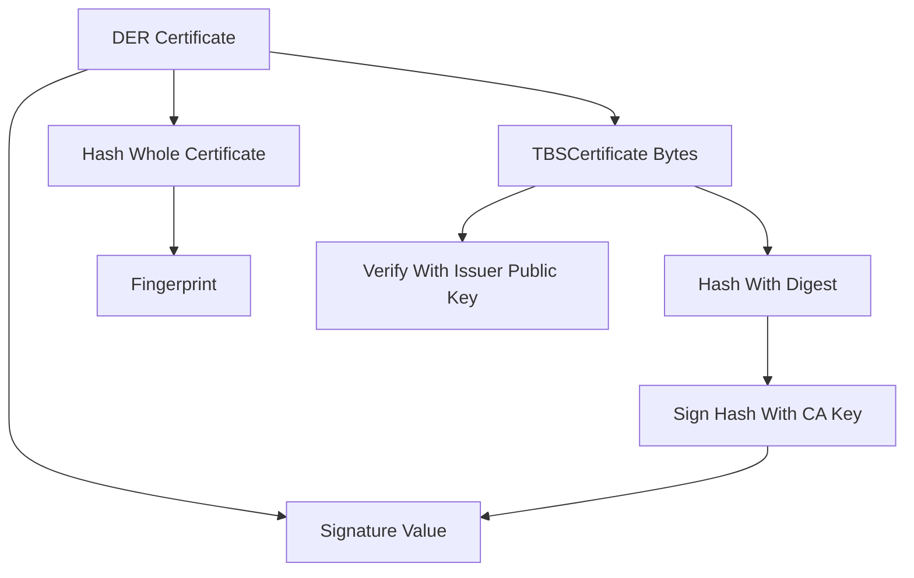

# Reading a Signed Certificate: Decoding the Signature Algorithm and Fingerprints

## English

Once a CA has issued a certificate, the most useful skill is being able to read it back and understand what the issuer actually committed to. The signatureAlgorithm field in an X.509 certificate is not one value but two nested ones: an outer algorithm identifier that describes how the certificate itself was signed (for example sha256WithRSAEncryption or ecdsa-with-SHA256), and, inside the TBSCertificate structure, an inner copy that must match. The acronym TBS stands for "to be signed" — it is the DER-encoded blob of every field except the signature itself. The CA hashes that blob with the named digest and then signs the hash with its private key. Verifying means re-encoding the TBS bytes, hashing them identically, and checking the signature with the issuer's public key.

This is why certificate parsing is byte-exact: you cannot "pretty-print then re-hash" a certificate and expect the signature to verify. Whitespace, field ordering, and DER versus BER encoding all change the bytes. Tools that report a certificate as valid are comparing the original DER, not a re-serialised version. If you ever regenerate a certificate from its human-readable fields, the signature will no longer match — a subtle trap when scripting.

Fingerprints are a different concept from signatures. A fingerprint is simply a hash (commonly SHA-256, sometimes SHA-1 in legacy tooling) of the entire DER-encoded certificate. It is not a signature and proves nothing cryptographically by itself; it is a short, stable identifier you can compare out-of-band. That is why pinning and trust-on-first-use systems use fingerprints: they are compact enough to paste into a config file and stable as long as the certificate is unchanged. Note that a fingerprint changes the moment the certificate is reissued, even if the key pair is identical, because the serial number and validity dates differ.

The public key fingerprint is a third thing again: it hashes only the SubjectPublicKeyInfo, so it stays the same across renewals that reuse the same key pair. This is the value you compare when checking that a new certificate corresponds to the private key you already hold. A quick way to do it is to extract the public key from both the certificate and the private key and hash each; if the two hex strings match, the pair belongs together.

In practice, learn three openssl incantations: openssl x509 -in cert.pem -noout -text to inspect every field including extensions; openssl x509 -in cert.pem -noout -fingerprint -sha256 for the certificate fingerprint; and openssl x509 -in cert.pem -noout -pubkey piped into openssl pkey -pubin -outform DER piped into openssl dgst -sha256 for the public key fingerprint. Being fluent in these turns opaque "certificate error" messages into specific, fixable facts.

## 中文

當 CA 簽發了一張憑證之後，最實用的技能就是能夠把它讀回來，並理解簽發者究竟承諾了什麼。X.509 憑證中的 signatureAlgorithm 欄位並不是單一數值，而是兩個巢狀的數值：一個外層的演算法識別碼，描述憑證本身是如何被簽署的（例如 sha256WithRSAEncryption 或 ecdsa-with-SHA256），以及 TBSCertificate 結構內一份必須與之相符的內層副本。TBS 這個縮寫代表「to be signed」（待簽署）——它是除了簽章本身以外所有欄位的 DER 編碼區塊。CA 會用所指名的摘要演算法對該區塊做雜湊，然後用其私鑰對雜湊值簽章。驗證的意思就是：重新編碼 TBS 位元組、以相同方式雜湊、再用簽發者的公鑰檢查簽章。

這就是為何憑證解析必須位元組精確：你不能「先美化列印、再重新雜湊」一張憑證，還期望簽章能驗證通過。空白、欄位順序，以及 DER 與 BER 編碼的差異，都會改變位元組。那些回報憑證有效的工具，比對的是原始的 DER，而不是重新序列化後的版本。如果你曾經從人類可讀的欄位重新產生一張憑證，簽章就不再相符——這在寫腳本時是個微妙的陷阱。

指紋（fingerprint）與簽章是不同概念。指紋只是對整張 DER 編碼憑證做雜湊（常見為 SHA-256，舊工具則用 SHA-1）。它本身不是簽章，在密碼學上不證明任何事；它只是一個簡短、穩定的識別碼，讓你可以在頻外比對。這就是為何釘選（pinning）與首次使用即信任（trust-on-first-use）系統會使用指紋：它們短到可以貼進設定檔，而且只要憑證不變就保持穩定。要注意的是，憑證一旦重新簽發，指紋就會改變，即使金鑰對完全相同，因為序號與有效日期都不一樣。

公鑰指紋又是第三樣東西：它只對 SubjectPublicKeyInfo 做雜湊，所以在沿用同一金鑰對的續期之間會保持不變。當你要檢查一張新憑證是否對應你手上已有的私鑰時，比對的就是這個值。一個快速做法是：分別從憑證與私鑰中取出公鑰並各自雜湊；如果兩串十六進位字串相同，這對金鑰就屬於彼此。

在實務上，學會三條 openssl 咒語：openssl x509 -in cert.pem -noout -text 用來檢視每個欄位（包括擴充）；openssl x509 -in cert.pem -noout -fingerprint -sha256 取得憑證指紋；以及把 openssl x509 -in cert.pem -noout -pubkey 接到 openssl pkey -pubin -outform DER 再接到 openssl dgst -sha256，取得公鑰指紋。熟悉這些之後，就能把含糊的「憑證錯誤」訊息，轉化成具體、可修正的事實。

## Key Takeaway

A certificate's signature covers the exact DER bytes of its TBS structure, while fingerprints are just hashes used as stable identifiers — never confuse the two.

## Related Concepts
- DER and PEM encoding
- SHA-256 digest

## Diagram

