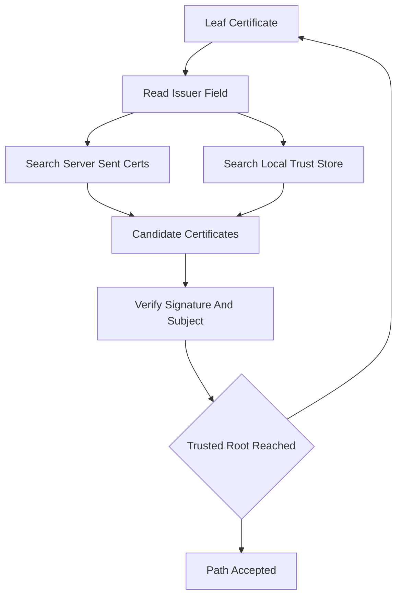

# Cross-Signing and Chain Building: Why the Same Key Can Appear in Two Certificates

## English

A certificate is not a single object floating alone; it is a node in a graph, and the client's job is to find a path from the leaf to a trusted root. The tricky part is that the same public key and subject name can appear in more than one certificate, each signed by a different issuer. This is called cross-signing, and it exists because trust stores update slowly. If a new root CA wants to be trusted by older clients that have never heard of it, it can ask an established CA to sign a certificate containing its own key and name. The result is one key with two certificates: a "self-signed" version that newer clients trust directly, and a "cross-signed" version chained to an older, widely trusted root.

Chain building is a search problem. Given a leaf certificate, the client looks at its issuer field and hunts through the certificates the server sent (and its local trust store) for a certificate whose subject matches and whose key verifies the signature. It repeats until it reaches a certificate it trusts. When multiple candidates exist — exactly the cross-signing situation — the client may pick any valid path, and different clients may pick different ones. That is why a chain that works in one browser can fail in another: one found a path through a trusted root, the other did not.

This is also why servers should send the intermediate certificates but generally not the root. The root is presumed to be in the client's trust store already, and shipping it wastes bytes and can even cause some clients to build a path they would not otherwise have chosen. The intermediate, however, is almost never in a default trust store, so omitting it breaks chain building outright — the classic "browser only receives the server certificate" failure.

A related concept is the AIA (Authority Information Access) extension, which can carry a URL where the issuing certificate can be fetched. Some clients will chase this URL to complete a chain, but many will not, and relying on it is fragile: it introduces a network dependency into what should be a local cryptographic check. Treat AIA as a helpful hint, not a guarantee.

When debugging, openssl verify -CAfile root.pem -untrusted intermediate.pem leaf.pem tells you whether a chain can be built from the pieces you have, and openssl s_client -showcerts shows exactly what the server sends. The mental model to keep is graph traversal with signature checks at each hop: every edge must verify, and the endpoint must be a root you trust.

## 中文

一張憑證不是孤立漂浮的單一物件；它是圖中的一個節點，而客戶端的工作就是找出一條從葉節點通往受信任根節點的路徑。棘手之處在於，同一把公鑰和同一個主體名稱，可能出現在一張以上的憑證裡，各自由不同的簽發者簽署。這稱為交叉簽署（cross-signing），之所以存在，是因為信任儲存庫更新得很慢。如果一個新的根 CA 想被那些從未聽過它的舊客戶端信任，它可以請一個既有的 CA 為一張包含它自己金鑰與名稱的憑證簽章。結果就是同一把金鑰擁有兩張憑證：一張「自簽」版本，較新的客戶端直接信任它；以及一張「交叉簽署」版本，鏈結到一個較舊、被廣泛信任的根。

憑證鏈建構是一個搜尋問題。給定一張葉憑證，客戶端會查看它的簽發者欄位，並在伺服器送來的憑證（以及本機信任儲存庫）中尋找一張主體相符、且其金鑰能驗證簽章的憑證。它會重複這個過程，直到抵達一張它信任的憑證。當存在多個候選時——正是交叉簽署的情況——客戶端可能挑選任何一條有效路徑，而不同客戶端可能挑到不同的路徑。這就是為何一條在某個瀏覽器可用的鏈，在另一個瀏覽器卻會失敗：一個找到了通往受信任根的路徑，另一個則沒有。

這也是為何伺服器應該送出中繼憑證，但通常不要送根憑證。根憑證被假定早已在客戶端的信任儲存庫中，送出它既浪費位元組，甚至可能導致某些客戶端建構出一條它們原本不會選擇的路徑。然而，中繼憑證幾乎從不在預設信任儲存庫中，所以省略它會直接破壞鏈建構——這正是典型的「瀏覽器只收到伺服器憑證」故障。

一個相關的概念是 AIA（Authority Information Access）擴充，它可以攜帶一個可取得簽發憑證的 URL。有些客戶端會去追這個 URL 以完成鏈，但許多不會，而依賴它是脆弱的：它把網路相依性引入了本應是本地密碼學檢查的過程。把 AIA 當成有用的提示，而不是保證。

除錯時，openssl verify -CAfile root.pem -untrusted intermediate.pem leaf.pem 會告訴你能否用你手上的片段建構出一條鏈，而 openssl s_client -showcerts 會確切顯示伺服器送了什麼。要記住的心智模型是：帶有簽章檢查的圖形走訪——每一條邊都必須驗證通過，而終點必須是你信任的根。

## Key Takeaway

Certificates form a graph, not a list, and cross-signing lets one key be reachable through multiple trust paths — so chain building is a search, not a lookup.

## Related Concepts
- Cross-signing
- Trust store

## Diagram

