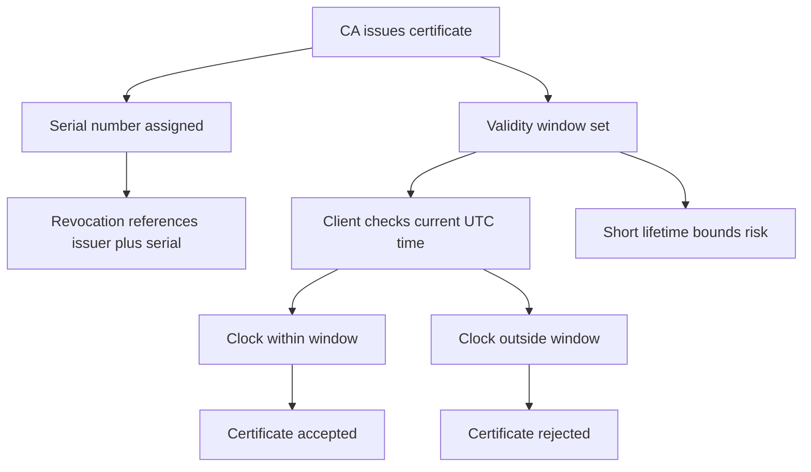

# Certificate Serial Numbers, Validity Windows, and the Clock as a Security Boundary

## English

Every X.509 certificate carries a serial number, a unique integer assigned by the issuing CA. In practice most CAs use a large random value (often 64 to 160 bits) rather than a simple counter, because a predictable serial number makes it easier to guess or precompute a matching certificate for a collision-style attack. The serial number is what revocation systems reference: a CRL entry or an OCSP response identifies the certificate by issuer plus serial, not by the full certificate body. That is why two certificates with the same subject name but different serials are treated as entirely different objects, even if their public keys are identical.

Validity is expressed as two timestamps, notBefore and notAfter, and they are checked in UTC. Clients reject a certificate if the current time falls outside that window, which means the local clock is a security control. A device whose clock drifted backward a year will reject a perfectly valid certificate as 'not yet valid'; a device with a clock far in the future will report 'expired'. This is a common cause of mysterious failures on embedded devices, virtual machines restored from old snapshots, and laptops with dead CMOS batteries.

The window is also deliberately short in modern practice. Browser-driven rules now cap publicly trusted TLS certificate lifetimes at 200 days for certificates issued on or after 2026-03-15, dropping to 100 days on 2027-03-15 and 47 days on 2029-03-15 — a trend toward shorter windows, because a shorter window bounds how long a mis-issued or compromised certificate stays dangerous without any revocation check succeeding. Revocation is best-effort — soft-fail OCSP, cached CRLs, offline clients — so expiry is the only enforcement that always works. Short lifetimes convert a revocation problem into a renewal problem, which automation can solve.

There is a subtlety: notAfter is inclusive in most implementations, and the comparison is done against the verifying party's clock, not the CA's. A CA might issue a certificate valid from 10:00:00Z, and a client whose clock reads 09:59:59Z will reject it. This is why issuers often backdate notBefore by a small margin (minutes to an hour) to absorb clock skew — a practice called backdating, and it is explicitly permitted within limits by the CA/Browser Forum rules.

Finally, serial numbers and validity are covered by the CA's signature, so they cannot be edited after issuance. If you change a single byte of the serial or the dates, the signature verification fails. That is the whole point: the fields you rely on for freshness and identity are frozen by the same cryptographic seal that protects the public key.

## 中文

每張 X.509 憑證都帶有一個序號（serial number），由簽發的憑證授權機構（CA）指派的唯一整數。實務上大多數 CA 會用一個很大的隨機值（通常 64 至 160 位元），而不是簡單的遞增計數器，因為可預測的序號會令人更容易猜測或預先計算出一張相符的憑證，從而在碰撞式攻擊中派上用場。弔銷系統正是以序號作參照：CRL 條目或 OCSP 回應是以「簽發者 + 序號」來識別憑證，而不是靠整份憑證內容。這就是為何兩張主體名稱相同但序號不同的憑證，會被視為完全不同的物件，即使它們的公鑰一模一樣。

有效期限以兩個時間戳表示：notBefore 與 notAfter，並以 UTC 檢查。若當前時間落在這個區間之外，客戶端就會拒絕該憑證，這意味著本機時鐘本身就是一道安全控制。時鐘倒退了一年的裝置，會把一張完全有效的憑證判斷為「尚未生效」；時鐘遠超未來的裝置則會回報「已過期」。這是嵌入式裝置、由舊快照還原的虛擬機器，以及 CMOS 電池耗盡的手提電腦上，種種神秘故障的常見成因。

在現代實務中，這個有效期視窗亦刻意收窄。由瀏覽器推動的規則，現時把公開信任的 TLS 憑證壽命上限限制在 200 天（適用於 2026-03-15 或之後簽發的憑證），並會在 2027-03-15 降至 100 天、2029-03-15 降至 47 天，趨勢是越來越短，因為較短的視窗能限制一張誤發或被入侵的憑證，在沒有任何弔銷檢查成功的情況下仍具危險性的時間。弔銷本質上是盡力而為——軟失敗的 OCSP、快取的 CRL、離線客戶端——所以到期是唯一永遠有效的強制手段。短壽命把「弔銷問題」轉化為「續期問題」，而續期可以靠自動化來解決。

這裡有個微妙之處：在大多數實作中 notAfter 是包含在內的，而比較是用驗證一方的時鐘，而非 CA 的時鐘。CA 可能簽發一張由 10:00:00Z 起生效的憑證，而時鐘讀數為 09:59:59Z 的客戶端會拒絕它。這就是為何簽發者經常把 notBefore 往前推一點（由數分鐘至一小時）以吸收時鐘偏差——這種做法稱為回填日期（backdating），而 CA/Browser Forum 的規則在限度內明確允許這樣做。

最後，序號與有效期限都被 CA 的簽章所覆蓋，所以簽發之後無法修改。若你改動序號或日期中的任何一個位元組，簽章驗證就會失敗。這正是重點所在：你賴以判斷新鮮度與身份的欄位，與保護公鑰的那道密碼學封印，被凍結在一起。

## Key Takeaway

Serial numbers give each certificate a unique revocation handle, while the notBefore/notAfter window turns the client's clock into an enforced security boundary that no revocation system can substitute for.

## Related Concepts
- Certificate Revocation
- Clock Skew in TLS

## Diagram

