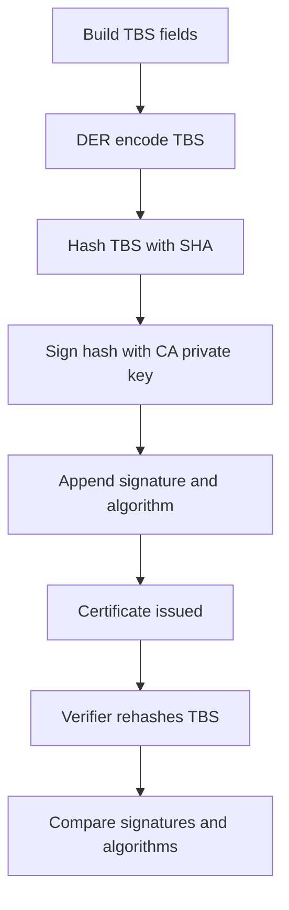

# What the CA's Signature Actually Commits To: TBS Bytes, Hashing, and Signature Algorithms

## English

When people say a certificate is 'signed', the precise claim is that the CA computed a cryptographic signature over a specific byte string called the TBS (to-be-signed) portion of the certificate, and appended that signature plus an algorithm identifier. The TBS is everything in the certificate except the signature field itself: version, serial number, issuer name, validity, subject name, subject public key info, and all extensions. The outer structure is a DER-encoded ASN.1 SEQUENCE containing tbsCertificate, signatureAlgorithm, and signatureValue.

The signing process is roughly: take the DER encoding of the TBS, hash it with a cryptographic hash (commonly SHA-256, sometimes SHA-384 or SHA-512), then apply the CA's private key using a signature scheme. The scheme depends on the key type. For RSA keys this is typically RSASSA-PKCS1-v1_5 or RSASSA-PSS; for ECDSA it is ECDSA over a named curve such as P-256 with SHA-256. The resulting signature bytes go into the signatureValue BIT STRING, and the algorithm identifier is echoed in both the TBS and the outer signatureAlgorithm field.

That echo is a real verification rule, not decoration. A verifier must check that the inner signature algorithm inside the TBS matches the outer one, because a mismatch would allow a class of attacks where an attacker swaps the outer algorithm while leaving the signed inner one intact. RFC 5280 requires these to be consistent, and modern libraries enforce it. This is also why re-encoding a certificate with a different ASN.1 encoder can break verification: DER is canonical, but only if the encoder follows the rules exactly.

Because the signature covers the TBS byte-for-byte, any change to any field invalidates it. You cannot add an extension, change the subject alternative names, extend the validity, or swap the public key without the CA's private key. This is what makes a certificate a tamper-evident statement rather than a mutable data record. It also means the CA does not need to keep your certificate secret — it is public and can be copied freely; only the signature matters for integrity.

One practical consequence: the signature algorithm tells you which hash and which public-key scheme were used, and old combinations are deprecated. SHA-1 signatures on certificates are rejected by modern browsers because chosen-prefix collisions became practical. MD5 was broken much earlier. When you read a certificate and see 'sha256WithRSAEncryption' or 'ecdsa-with-SHA256', that string is the CA telling you exactly what mathematical operation it performed over the TBS bytes — and it is that operation your client must reproduce to trust the certificate.

## 中文

當人們說一張憑證被「簽署」了，準確的說法是：CA 對一份特定的位元組串——稱為憑證中「待簽署部分」（TBS，to-be-signed）——計算了密碼學簽章，然後把該簽章連同演算法識別碼附加在後面。TBS 就是憑證中除了簽章欄位本身以外的所有內容：版本、序號、簽發者名稱、有效期限、主體名稱、主體公鑰資訊，以及所有擴展。外層結構是一個 DER 編碼的 ASN.1 SEQUENCE，內含 tbsCertificate、signatureAlgorithm 與 signatureValue。

簽署過程大致如下：先取得 TBS 的 DER 編碼，用密碼學雜湊（常見為 SHA-256，有時是 SHA-384 或 SHA-512）計算摘要，再用 CA 的私鑰套用某種簽章方案。方案取決於金鑰類型：RSA 金鑰通常用 RSASSA-PKCS1-v1_5 或 RSASSA-PSS；ECDSA 則是基於具名曲線（例如 P-256）配合 SHA-256 的 ECDSA。產生的簽章位元組會放進 signatureValue 這個 BIT STRING，而演算法識別碼則同時出現在 TBS 內與外層的 signatureAlgorithm 欄位中。

這個「雙重出現」是實實在在的驗證規則，不是裝飾。驗證者必須檢查 TBS 內部的簽章演算法與外層是否一致，因為不一致會容許一類攻擊：攻擊者替換外層演算法，而保留已簽署的內層演算法不變。RFC 5280 要求兩者必須一致，而現代程式庫亦會強制執行。這也是為何用不同的 ASN.1 編碼器重新編碼一張憑證，可能導致驗證失敗：DER 是規範化的，但前提是編碼器嚴格依循規則。

由於簽章逐位元組覆蓋 TBS，任何欄位的改動都會令簽章失效。你不能在沒有 CA 私鑰的情況下新增擴展、更改主體別名、延長有效期，或替換公鑰。這正是憑證成為「可偵測篡改的陳述」而非「可隨意修改的資料紀錄」的原因。這也意味著 CA 不必對你的憑證保密——它是公開的，可以自由複製；只有簽章對完整性有意義。

一個實務後果是：簽章演算法告訴你用了哪種雜湊與哪種公鑰方案，而舊的組合已被淘汰。現代瀏覽器會拒絕憑證上的 SHA-1 簽章，因為選擇前綴碰撞已變得可行。MD5 更早就被攻破。當你讀取一張憑證並看到「sha256WithRSAEncryption」或「ecdsa-with-SHA256」，那串字就是 CA 在告訴你，它對 TBS 位元組執行了哪一個數學運算——而你的客戶端必須重現該運算，才能信任這張憑證。

## Key Takeaway

A certificate signature is a hash-and-sign operation over the exact DER bytes of the TBS, so every field is frozen by the CA's private key and the algorithm identifier must match inside and outside the signed region.

## Related Concepts
- ASN.1 DER Encoding
- Digital Signature Algorithms

## Diagram

