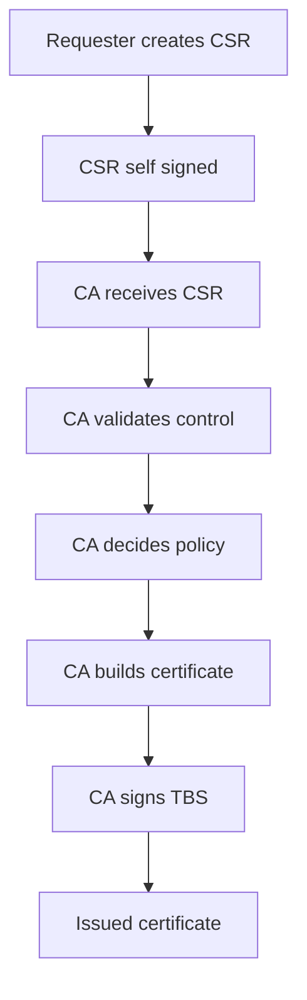

# Signing Is Not Issuing: How the CA Decides What to Put in the Certificate

## English

There is a useful mental split between the cryptographic act of signing and the policy act of issuing. Signing is mechanical: given a TBS byte string and a private key, produce a signature. Issuing is judgment: decide whether this requester is entitled to the names they asked for, whether the requested extensions are allowed, and whether the resulting certificate should exist at all. A CA that signs whatever it is handed without checking is a broken CA, even if every signature it produces is cryptographically perfect.

The CSR you submit contains your public key and a set of requested subject fields plus requested extensions, all self-signed with your private key. That self-signature only proves you hold the private key corresponding to the public key in the request — it proves nothing about who you are or whether you control the domain. The CA performs separate validation: for domain-validated certificates, typically by having you publish a token at a well-known HTTP path, by a DNS TXT record, or by responding to a challenge over TLS. Only after that check does the CA decide the subject alternative names are legitimate.

Crucially, the CA does not have to copy your CSR verbatim. It may rewrite fields, drop extensions it does not support, add extensions it requires (for example, authority information access pointing at its OCSP responder, or certificate policies identifiers), and set the serial number and validity itself. Many CAs ignore most of the CSR subject entirely and construct the certificate from their own validated data. This is why a CSR with a wrong organization name can still produce a certificate with the correct one, and why a CSR asking for an exotic extension may yield a certificate without it.

This separation also explains why the CSR's self-signature is not what protects the final certificate. The CSR signature protects the request in transit and proves key possession; the issued certificate is protected by the CA's signature over the CA's chosen TBS. If an attacker intercepts your CSR, they cannot use it to obtain a certificate for a domain they do not control, because the CA's validation step is independent of the CSR contents. They could only cause a denial of service by submitting it themselves, which is why some CAs rate-limit and log requests.

In short, think of the CSR as an application form and the certificate as the approved document. The form is signed by the applicant to prove the key is theirs; the document is signed by the authority to prove the claims have been checked. Confusing these two signatures is one of the most common conceptual errors when learning PKI, and it leads people to expect a CSR to behave like a certificate when it never can.

## 中文

把「簽署」這個密碼學動作與「簽發」這個政策動作分開來看，會很有用。簽署是機械性的：給定一份 TBS 位元組串與一把私鑰，產出一個簽章。簽發則是判斷：決定申請人是否有權使用他們所要求的名稱、所要求的擴充套件是否獲準，以及最終這張憑證是否應該存在。一間來者不拒、收到什麼就簽什麼的 CA，即使它產生的每個簽章在密碼學上都完美無瑕，仍然是一間壞掉的 CA。

你提交的 CSR 包含你的公鑰、一組要求的主體欄位，以及要求的擴充套件，全部由你的私鑰自我簽署。這個自簽章只能證明你持有與請求中公鑰對應的私鑰——它完全不能證明你是誰，也不能證明你控制該網域。CA 會另行執行驗證：對於網域驗證型憑證，通常是要求你在一個 well-known 的 HTTP 路徑釋出權杖、設定 DNS TXT 紀錄，或透過 TLS 回應挑戰。只有在該檢查透過之後，CA 才會認定主體別名是合法的。

關鍵在於，CA 不必原封不動照抄你的 CSR。它可以改寫欄位、丟棄它不支援的擴充套件、加入它要求的擴充套件（例如指向其 OCSP 回應器的 authority information access，或 certificate policies 識別碼），並自行設定序號與有效期限。許多 CA 完全忽略 CSR 主體的大部分內容，改以自己驗證過的資料來建構憑證。這就是為何一份組織名稱寫錯的 CSR，仍可產出一張名稱正確的憑證；也是為何一份要求冷門擴充套件的 CSR，可能換來一張沒有該擴充套件的憑證。

這個分離也解釋了為何 CSR 的自簽章不是保護最終憑證的東西。CSR 的簽章保護請求在傳輸中的完整性，並證明金鑰持有；而簽發出來的憑證，則由 CA 對其所選 TBS 的簽章來保護。若攻擊者擷取了你的 CSR，他們不能藉此為自己並不控制的網域取得憑證，因為 CA 的驗證步驟獨立於 CSR 內容之外。他們最多隻能自己提交而造成阻斷服務，這就是為何部分 CA 會對請求做速率限制與記錄。

簡而言之，把 CSR 想成申請表，把憑證想成批核檔案。申請表由申請人簽署，以證明金鑰屬於自己；檔案則由機關簽署，以證明所述內容已被核實。混淆這兩個簽章，是學習 PKI 時最常見的概念錯誤之一，會令人誤以為 CSR 可以像憑證那樣運作——而它永遠不能。

## Key Takeaway

The CSR signature proves key possession to the CA, but the issued certificate is the CA's own statement after independent validation, which is why the CA may rewrite, add, or drop fields from your request.

## Related Concepts
- Certificate Issuance Policy
- Domain Validation Methods

## Diagram

