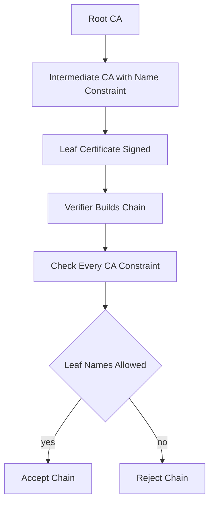

# Name Constraints and Other Path-Building Constraints: Limits That Travel With a Certificate

## English

Most people think of a certificate as a single leaf plus a chain, but a CA can embed rules inside a certificate that restrict what *other* certificates below it are allowed to say. The best-known example is the X.509 name constraints extension, defined in RFC 5280. A name constraint on an intermediate CA says something like: 'any certificate I sign must only contain names under .example.com' or 'must not contain any IP addresses.' When a client builds a chain, it must check every certificate in the chain against the constraints imposed by every CA above it. If a subordinate CA signs a certificate for evil.example.net while its own name constraint only permits .example.com, a compliant verifier must reject that leaf — even if the leaf's signature is perfectly valid and the chain reaches a trusted root.

This matters because the signature on a certificate only proves 'this CA said this.' It does not prove 'this CA was allowed to say this.' Name constraints are the mechanism that lets an organization hand out a limited signing capability without handing out a universal one. A university might run an internal CA with a name constraint of .university.edu so that even if that CA's key is stolen, the attacker cannot use it to sign certificates for bank.com. The signature would be cryptographically valid, but the constraint check would fail.

In practice, name constraints have a checkered history. Browsers and TLS libraries have not always enforced them consistently, and some have historically ignored them for certain name types, which is why public CAs are generally discouraged from issuing constrained intermediates to third parties. Apple's trust store, for instance, has at times rejected certificates that rely on name constraints in ways that other stores accept. The lesson is that a constraint is only as strong as the weakest verifier in the ecosystem — and in a system with millions of clients, the weakest verifier is the one that matters.

Related constraints exist beyond names. The basic constraints extension (with the cA boolean) says whether a certificate is allowed to sign other certificates at all; a leaf certificate with cA=false cannot legitimately act as a CA. The path length constraint says how many intermediate CAs may appear below this one before you hit a leaf. Policy constraints and the certificate policies extension let a CA declare which policy OIDs apply to the certificates it issues, which is mostly relevant in government and enterprise PKI. Each of these is a promise the verifier is supposed to enforce, not a promise the signer is forced to keep — the CA could always violate its own constraints, and the only defense is that clients check.

For anyone building or operating a private PKI, the practical takeaway is: constrain early and constrain narrowly. If you only ever need to issue certificates for internal hostnames, put a name constraint on the intermediate so that a compromise cannot be leveraged against the public internet. Then test that your actual clients enforce it — because the whole point of a constraint is that it holds even when everything else has gone wrong.

## 中文

大部分人以為憑證就是一張 leaf 加一條鏈，但其實 CA 可以在憑證裡面嵌入規則，限制它下面所簽發的憑證可以寫什麼。最出名的例子是 X.509 的 name constraints 擴展，定義於 RFC 5280。一張中繼 CA 憑證上的 name constraint 意思大概是：「凡是我簽的憑證，只能包含 .example.com 之下的名字」，或者「不可以包含任何 IP 位址」。當客戶端建立憑證鏈時，它必須逐張檢查鏈上每一張憑證，是否符合上面每一層 CA 所施加的限制。如果一張下層 CA 憑證的 name constraint 只准 .example.com，但它居然簽了一張 evil.example.net 的憑證，合規的驗證程式必須拒絕這張 leaf——即使 leaf 的簽章完全正確、鏈也接得上受信任的根憑證。

這件事的重要性在於：憑證上的簽章只證明「這個 CA 說過這樣的話」，並不證明「這個 CA 有權說這樣的話」。Name constraints 就是讓我們可以只授出有限簽發權、而不必授出萬能簽發權的機制。例如一所大學可以運行內部 CA，並在憑證上加上 .university.edu 的 name constraint，那麼即使該 CA 的私鑰被偷，攻擊者也無法用它去簽 bank.com 的憑證。簽章在密碼學上仍然有效，但限制檢查會失敗。

實際上，name constraints 的歷史並不光彩。瀏覽器和 TLS 函式庫對它的執行並不總是貫徹，某些實作在某些名字類型上曾經直接忽略它，所以公眾 CA 一般都不願意向第三方簽發帶有限制的中繼憑證。例如 Apple 的信任儲存庫有時會拒絕一些其他儲存庫接受的、依賴 name constraints 的憑證。教訓是：一條限制的強度，只等於生態系統中最弱的驗證者——而在一個有幾百萬客戶端的系統裡，最弱的那個才是關鍵。

除了名字之外，還有其他限制。basic constraints 擴展（帶 cA 布林值）說明該憑證是否有權簽發其他憑證；cA=false 的 leaf 憑證不能合法地當 CA 用。path length constraint 則規定這張憑證下面最多可以有幾層中繼 CA 才到 leaf。policy constraints 和 certificate policies 擴展讓 CA 宣告它所簽發的憑證適用哪些政策 OID，這在政府與企業 PKI 中比較相關。以上每一項都是驗證者「應該」執行的承諾，而不是簽發者「被迫」遵守的承諾——CA 隨時可以違反自己的限制，唯一的防線就是客戶端會檢查。

對於建立或營運私有 PKI 的人來說，實務上的結論是：越早限制、限制得越窄越好。如果你只需要為內部主機名簽憑證，就在中繼憑證上加上 name constraint，令它一旦被攻破也不能被用來對付公眾互聯網。然後要實測你真正的客戶端會否執行這條限制——因為限制的全部意義，就是在其他一切都出錯的時候，它仍然守得住。

## Key Takeaway

A certificate's signature proves the CA said something, not that it was allowed to — name constraints and basic constraints are the rules a verifier must enforce on the CA's behalf.

## Related Concepts
- X.509 v3 Extensions
- Path Building and Chain Validation

## Diagram

