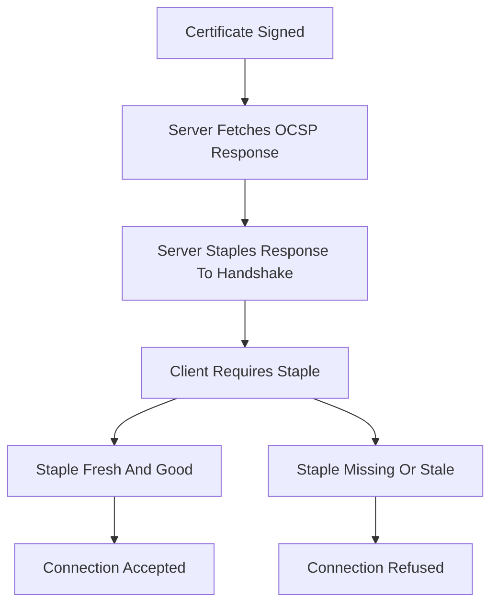

# OCSP Must-Staple and the Revocation Gap: Why 'Signed' Is Not the Same as 'Still Trusted'

## English

It is tempting to think that once a certificate is signed, the trust decision is finished. It is not. A signed certificate is a claim about the past — 'at the moment of signing, this key belonged to this name' — and the CA can later change its mind by revoking the certificate. The whole revocation apparatus (CRLs, OCSP, OCSP stapling) exists to let clients learn about that change of mind. But in practice, revocation checking is fragile: soft-fail clients treat 'could not reach the OCSP responder' as 'probably fine,' and many browsers have moved toward not performing live OCSP at all because of privacy and latency concerns.

That is the gap that OCSP Must-Staple is designed to close. Must-Staple is a certificate extension (originally proposed in RFC 7633) that tells the client: 'when you connect to me, the server MUST include a stapled OCSP response proving my certificate is still valid; if it doesn't, treat me as invalid.' The server operator is essentially promising to keep a fresh, signed 'still good' note from the CA and present it on every TLS handshake. If the certificate is later revoked, the CA stops issuing fresh 'good' responses, the staple goes stale or becomes 'revoked,' and any Must-Staple-aware client will refuse the connection.

The subtlety is what 'Must-Staple' actually enforces. It does not force the client to contact the CA — it forces the client to require that the server has done so and is presenting the result. That converts a soft-fail, best-effort check into a hard-fail, server-side responsibility. It also neatly sidesteps the privacy problem of live OCSP: the client never talks to the CA, so the CA never learns which user is visiting which site. The cost is operational: your server must fetch and rotate stapled responses before they expire, and if it ever fails to do so, clients that enforce Must-Staple will see a broken site. Getting the staple refresh wrong is a self-inflicted outage.

Adoption has been uneven. Some browsers and CDNs support it; some have deprioritized it in favor of shorter certificate lifetimes and Certificate Transparency as the primary defenses against mis-issuance. The broader trend is that the industry is treating revocation as a problem to be minimized rather than solved: if certificates only live for a few weeks, the window in which a revoked-but-not-yet-expired certificate could be abused shrinks. That is a different strategy from Must-Staple, and the two are complementary rather than competing.

For anyone operating a service, the practical questions are: do you actually check revocation on the client side, or do you assume someone else does? Does your server staple OCSP responses, and are they refreshed reliably? And do you know how your clients behave when the stapled response is missing or stale? A certificate that is 'signed and valid' is only half the story; the other half is whether the ecosystem can still find out that it should no longer be trusted.

## 中文

人很容易以為一張憑證簽好了，信任判斷就完成了。其實不是。一張已簽發的憑證是關於過去的聲明——「在簽發那一刻，這條金鑰屬於這個名字」——而 CA 日後可以透過吊銷來改變主意。整套吊銷機制（CRL、OCSP、OCSP stapling）存在的目的，就是讓客戶端得知這個改變。但實務上，吊銷檢查非常脆弱：soft-fail 的客戶端會把「連不上 OCSP 回應者」當成「應該沒問題」，而不少瀏覽器因為隱私和延遲的考慮，已經趨向完全不進行即時 OCSP 查詢。

OCSP Must-Staple 正是為了填補這個缺口。Must-Staple 是一個憑證擴展（最初在 RFC 7633 提出），它對客戶端說：「你連上我時，伺服器必須附上一份 OCSP staple 回應，證明我的憑證仍然有效；如果沒有，就當我無效。」伺服器營運者等於承諾：每次 TLS 握手都要帶著一份由 CA 簽發、仍然新鮮的「仍然良好」證明。若憑證日後被吊銷，CA 就不再發出新的「良好」回應，staple 會過期或變成「已吊銷」，任何認識 Must-Staple 的客戶端都會拒絕連線。

微妙之處在於 Must-Staple 真正強制的是什麼。它不強制客戶端去聯絡 CA——它強制客戶端要求伺服器已經聯絡過 CA，並把結果呈現出來。這就把一個 soft-fail、盡力而為的檢查，變成一個 hard-fail、由伺服器承擔的責任。它同時巧妙地避開了即時 OCSP 的隱私問題：客戶端從不與 CA 通話，CA 也就永遠不知道哪個用戶在訪問哪個網站。代價是營運上的：伺服器必須在 staple 過期前取得並輪換新的回應，一旦失敗，會執行 Must-Staple 的客戶端就會看到網站壞掉。Staple 更新搞錯，就是自己造成的停機。

採用情況參差。部分瀏覽器和 CDN 支援，部分則把它排在較低優先級，轉而倚重更短的憑證有效期和 Certificate Transparency 作為對抗誤簽的主要防線。整體趨勢是：業界把吊銷視為一個要盡量縮小的問題，而不是要徹底解決的問題——如果憑證只活幾星期，那麼「已被吊銷但尚未過期」的憑證可被濫用的窗口就會縮小。這與 Must-Staple 是兩種不同策略，兩者互補而非競爭。

對任何營運服務的人來說，實務問題是：你在客戶端真的會檢查吊銷嗎，還是假設別人會檢查？你的伺服器有 staple OCSP 回應嗎，更新可靠嗎？你又是否知道客戶端在 staple 缺失或過期時會怎樣？「已簽發且有效」只是故事的一半；另一半是整個生態系統還能不能得知它已不應再被信任。

## Key Takeaway

Revocation is where a signed certificate can quietly stop being trustworthy, and OCSP Must-Staple is one way to turn a best-effort check into a hard requirement.

## Related Concepts
- OCSP Stapling
- Certificate Revocation

## Diagram

