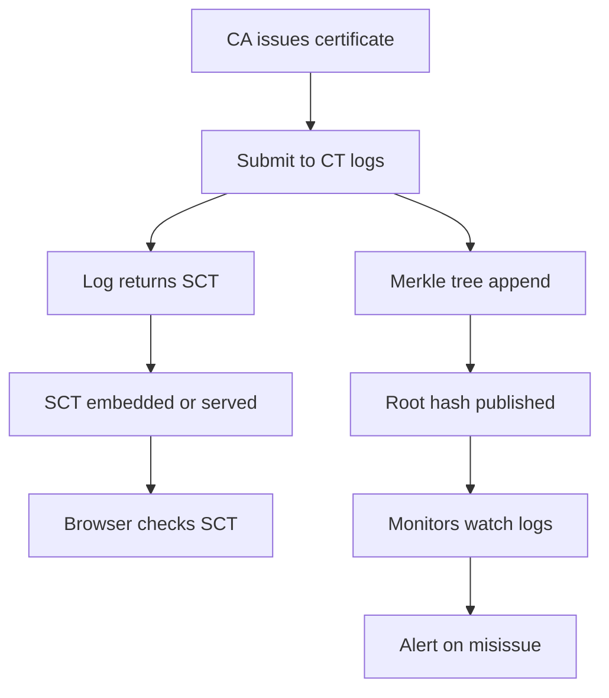

# Certificate Transparency Logs as an Audit Trail: What a Signature Cannot Prove on Its Own

## English

A CA's signature proves that the CA signed something. It does not prove that the CA signed only what it was supposed to sign. If a CA is compromised, or if it mis-issues a certificate for a domain it has no business issuing for, the resulting certificate looks exactly like a legitimate one — same format, same signature algorithm, same chain. There is no bit in the certificate that says 'this one is the bad one.' Certificate Transparency (CT), specified in RFC 6962, is the industry's answer to that structural blind spot: it makes issuance itself observable.

The core idea is a public, append-only log. When a CA issues a certificate, it submits it to one or more CT logs, and each log returns a signed promise (an SCT, or Signed Certificate Timestamp) that the certificate will be included in the log within a bounded time. The SCT can be embedded in the certificate itself, delivered via a TLS extension during the handshake, or included in an OCSP response. Modern browsers require SCTs for publicly trusted certificates, which means a mis-issued certificate either has to be logged (and therefore visible to anyone watching) or has to be presented without valid SCTs (and therefore rejected by browsers).

The log is not a simple list; it is a Merkle tree, and its root hash is periodically published. That lets anyone — a domain owner, a researcher, a competitor — verify that a given certificate is in the log without trusting the log operator, and lets the log prove it has not quietly rewritten history. Domain owners can subscribe to monitors that watch the logs for certificates matching their domains, so a mis-issuance for their name shows up as an alert rather than as a silent problem discovered months later. This is the difference between 'trust the CA to behave' and 'watch the CA behave.'

What CT does not do is prevent mis-issuance. It does not stop a compromised CA from signing a bad certificate. What it does is make the bad certificate detectable, and — because browsers refuse unlogged certificates — make it expensive to hide. The threat model shifts from 'can the CA be trusted?' to 'can the CA hide what it did?' That is a meaningful shift, because hiding is much harder than misbehaving. It also creates a public record that is useful for incident response: when a CA is compromised, responders can look at the logs and see exactly what was issued and when.

For operators, the practical implications are small but real. You may see SCTs in your certificate's extensions; you may need to configure your TLS terminator to send SCTs via the extension if they are not embedded. You can and probably should run a monitor for your own domains — it is cheap, and it turns a silent compromise into a visible event. The deeper lesson is that signatures alone are a local guarantee; CT adds a global one, by making the act of signing a public, auditable event.

## 中文

CA 的簽章證明 CA 簽過某些東西，但不證明它只簽過應該簽的東西。如果 CA 被入侵，或者它為某個不該由它簽發的網域誤簽了一張憑證，那張憑證看起來和合法憑證一模一樣——同樣格式、同樣簽章演算法、同樣的鏈。憑證裡沒有任何一個 bit 寫著「這一張是壞的」。Certificate Transparency（CT，定義於 RFC 6962）就是業界對這個結構性盲點的回答：它令簽發行為本身變得可觀察。

核心概念是一個公開、只可追加的日誌。當 CA 簽發憑證時，它會把憑證提交到一個或多個 CT log，每個 log 回傳一個已簽署的承諾（SCT，Signed Certificate Timestamp），保證該憑證會在限定時間內被納入 log。SCT 可以嵌入憑證本身、在握手時透過 TLS 擴展傳送，或包含在 OCSP 回應中。現代瀏覽器要求公開受信任的憑證必須有 SCT，這意味著一張誤簽的憑證，要麼必須被記錄（因此任何監察者都看得見），要麼在不帶有效 SCT 的情況下呈現（因此被瀏覽器拒絕）。

Log 不是簡單的清單，而是一棵 Merkle tree，其 root hash 會定期公開。這讓任何人——網域持有人、研究者、競爭對手——都可以在不信任 log 營運者的前提下，驗證某張憑證是否在 log 裡，也讓 log 可以證明自己沒有偷偷改寫歷史。網域持有人可以訂閱 monitor，監察 log 中出現的、符合自己網域的憑證，於是針對自己名字的誤簽會變成一個警報，而不是幾個月後才被發現的沉默問題。這就是「信任 CA 會乖乖」與「監察 CA 有沒有乖乖」的分別。

CT 做不到的是防止誤簽。它不能阻止一個被入侵的 CA 簽出一張壞憑證。它能做的是令壞憑證可被偵測，並且——因為瀏覽器拒絕未記錄的憑證——令隱藏變得代價高昂。威脅模型因此由「CA 是否可信？」轉為「CA 能否隱藏自己做過的事？」這是一個有意義的轉變，因為隱藏遠比做壞事困難。它同時創造了一份公開記錄，對事故應變很有用：當某個 CA 被入侵，應變人員可以查看 log，確切知道簽發了什麼、何時簽發。

對營運者而言，實務影響不大但真實。你可能會在憑證擴展中看到 SCT；如果 SCT 沒有嵌入憑證，你可能需要設定 TLS 終結點透過擴展傳送。你可以、也大概應該為自己的網域運行 monitor——成本很低，卻能把一場無聲的入侵變成一個看得見的事件。更深的教訓是：簽章本身只是局部保證；CT 透過把簽發行為變成公開、可審計的事件，加上了一層全局保證。

## Key Takeaway

A signature proves a CA signed something, but only Certificate Transparency makes the act of signing publicly observable and therefore auditable.

## Related Concepts
- Certificate Transparency
- Merkle Trees

## Diagram

