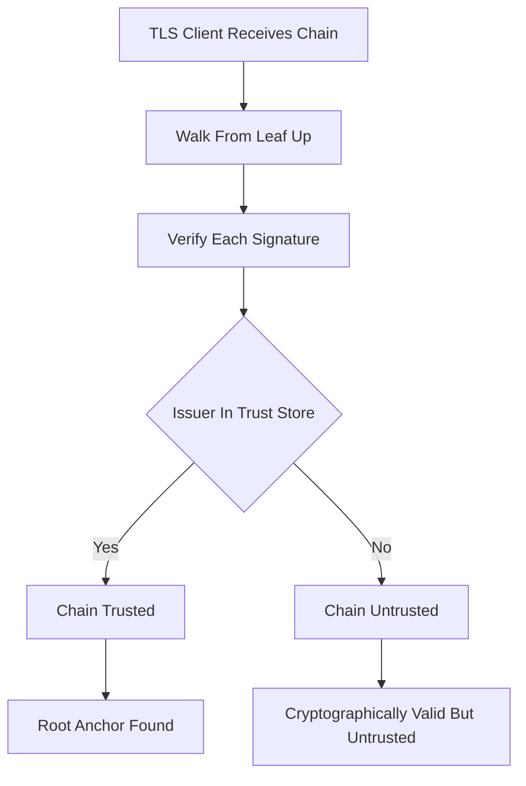

# The Trust Store: Where Verification Actually Begins on Your Machine

## English

When a browser or an operating system says a certificate is 'valid', it is not consulting some universal authority on the internet. It is consulting a local list called a trust store — a bundled set of root CA certificates that ships with the OS or browser and is updated periodically. On Linux distributions this is often a package like ca-certificates that populates a directory such as /etc/ssl/certs; on Windows it lives in the system certificate store managed by certutil or the Certificates MMC snap-in; on macOS it is the Keychain; and browsers like Firefox historically maintained their own independent store (NSS) rather than using the OS one. This is why the exact same server can be 'trusted' in Chrome on one laptop and rejected by curl on a server: they are reading different trust stores with different contents and different update cadences.

The trust store is deliberately small and curated. It contains only root certificates, never intermediates or leaf certificates, because a root is the anchor that a chain must terminate at. When a TLS client receives a chain, it walks from the leaf up through each intermediate, verifying each signature, until it reaches a certificate whose issuer is present in the trust store. If no such anchor is found, the chain is 'untrusted' even if every signature mathematically checks out. This distinction — cryptographically valid versus trusted — is the single most common source of confusion in PKI troubleshooting.

Adding a certificate to the trust store is a serious act. Anyone who can write to the trust store can mint certificates for any domain, because a client will happily accept anything signed by a root it trusts. This is precisely the mechanism behind corporate TLS inspection appliances: the IT department installs its own root CA into every managed device's trust store, then intercepts outbound HTTPS, re-signs traffic on the fly, and the browser sees a valid chain ending at the corporate root. From the browser's perspective nothing is wrong; from a security perspective, a man-in-the-middle is by design.

Practical consequences follow. If you run an internal service with certificates from a private CA, every client that must connect needs that private root installed — otherwise you get errors like 'unable to get local issuer certificate'. Tools differ in how they find the store: OpenSSL reads a default CA bundle path defined by your distribution (for example /etc/ssl/certs/ca-certificates.crt on Debian and Ubuntu), overridable with the SSL_CERT_FILE and SSL_CERT_DIR environment variables or per command with the -CAfile or -CApath flags; `openssl version -d` reports the OpenSSL install directory, not the bundle path; curl has its own --cacert option; Python's requests library uses certifi unless told otherwise. Knowing which store a given tool consults is often the entire fix.

Finally, trust stores expire and rotate. Root certificates have long lifetimes but not infinite ones, and CAs do get removed — sometimes for compromise, sometimes for policy violations. When a root is distrusted, every chain that terminates at it stops validating on updated clients, which is why cross-signing exists as a migration path. The trust store is therefore not a static fact of nature but a living, versioned policy document that each vendor maintains independently.

## 中文

當瀏覽器或作業系統說某張憑證「有效」，它並不是去查詢互聯網上某個普世權威，而是查閱本機一份叫「信任儲存庫」（trust store）的清單——一組隨作業系統或瀏覽器附帶、並會定期更新的根憑證授權（root CA）憑證。在 Linux 發行版上，這通常是 ca-certificates 之類的套件，把憑證放進 /etc/ssl/certs 之類的目錄；在 Windows 上，它位於由 certutil 或「憑證」MMC 嵌入式管理單元所管理的系統憑證存放區；在 macOS 上是 Keychain；而 Firefox 等瀏覽器歷史上一直維護自己獨立的 NSS 儲存庫，而非使用作業系統那一份。這就解釋了為何同一部伺服器，在某部手提電腦的 Chrome 上「受信任」，卻被伺服器上的 curl 拒絕：兩者讀取的是內容與更新節奏都不同的信任儲存庫。

信任儲存庫刻意保持精簡且經過策劃。它只包含根憑證，永不包含中繼或葉憑證，因為根就是憑證鏈必須終止的錨點。當 TLS 客戶端收到一條鏈，它會由葉憑證向上逐層走過每個中繼憑證、驗證每個簽章，直到抵達一張其簽發者存在於信任儲存庫中的憑證。若找不到這樣的錨點，即使每個簽章在數學上都正確，這條鏈仍屬「不受信任」。這種「密碼學上有效」與「受信任」之間的區別，是 PKI 疑難排解中最常見的混淆來源。

把憑證加入信任儲存庫是極其嚴肅的行為。任何能寫入信任儲存庫的人，都能為任何網域簽發憑證，因為客戶端會欣然接受由它所信任之根所簽署的任何東西。這正是企業 TLS 檢查設備背後的機制：IT 部門把自家根 CA 安裝到每部受管裝置的信任儲存庫，然後攔截對外 HTTPS，即時重新簽署流量，瀏覽器便看到一條有效、終止於企業根的鏈。從瀏覽器角度一切正常；從安全角度，這是一個刻意設計的中間人。

實務後果隨之而來。若你運行使用私有 CA 憑證的內部服務，每個需要連線的客戶端都必須安裝該私有根，否則會出現「unable to get local issuer certificate」之類的錯誤。不同工具尋找儲存庫的方式各異：OpenSSL 讀取由發行版定義的預設 CA bundle 路徑（例如 Debian 與 Ubuntu 上的 /etc/ssl/certs/ca-certificates.crt），可用 SSL_CERT_FILE 與 SSL_CERT_DIR 環境變數覆寫，或以 -CAfile、-CApath 旗標逐次指定；`openssl version -d` 回報的是 OpenSSL 的安裝目錄，而非 bundle 路徑；curl 有自家的 --cacert 選項；Python 的 requests 程式庫除非另行指定，否則使用 certifi。知道某個工具查閱哪個儲存庫，往往就是整個修復方案。

最後，信任儲存庫會過期與輪替。根憑證壽命很長但並非無限，而 CA 也確實會被移除——有時因為被入侵，有時因為違反政策。當某個根被撤銷信任，所有終止於它的鏈在已更新的客戶端上都會停止驗證，這正是交叉簽署作為遷移路徑存在的原因。因此信任儲存庫並非大自然的靜態事實，而是一份活的、有版本的政策文件，由每個廠商獨立維護。

## Key Takeaway

A certificate is only 'valid' relative to a specific local trust store, so knowing which store your tool reads is often the whole debugging story.

## Related Concepts
- Trust store
- Root CA anchor

## Diagram

