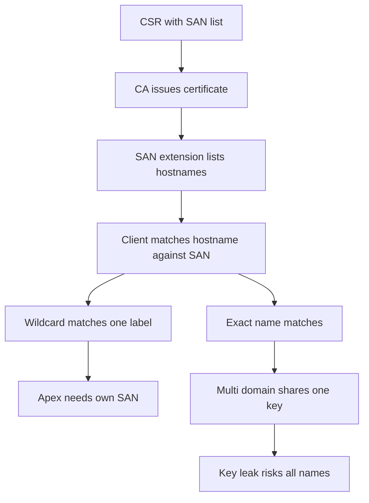

# Wildcards, SANs, and Multi-Domain Certificates: What One Signature Can Cover

## English

A single certificate can legitimately cover many hostnames, and understanding how that works prevents both outages and over-broad credentials. The modern mechanism is the Subject Alternative Name (SAN) extension: an X.509 v3 field that lists every hostname (and optionally IP address) the certificate is valid for. Modern clients ignore the legacy Common Name (CN) field entirely for hostname matching and look only at SANs, which is why a certificate with a correct CN but no SAN will still fail in every current browser. When you request a certificate, your CSR's SAN list is what the CA copies into the issued certificate — the CN is essentially decorative at this point.

A wildcard certificate uses an asterisk in a SAN entry, such as *.example.com. The crucial rule — codified in RFC 6125 and enforced by all major clients — is that a wildcard matches exactly one label. So *.example.com matches www.example.com and api.example.com, but does not match a.b.example.com, and does not match example.com itself (the bare apex has zero labels where the wildcard expects one). This trips people up constantly: they buy a wildcard, then discover the apex domain still needs its own SAN entry or a separate certificate. Some CAs will include both *.example.com and example.com in one certificate, but that is a choice, not a guarantee.

Multi-domain certificates (sometimes marketed as SAN certificates or UCC certificates) simply put several unrelated names in one SAN list — for example shop.example.com, example.net, and mail.example.org. This is convenient because one certificate and one key serve many services, but it concentrates risk: if the private key leaks, every name on the list is compromised at once, and every name appears in Certificate Transparency logs together, publicly linking those properties. Security-conscious operators often prefer separate certificates per service so that blast radius and rotation are independent.

There are hard limits and policy rules. CAs cap the number of SAN entries per certificate (the exact number varies by CA and product), and the CA/Browser Forum Baseline Requirements impose constraints on wildcard issuance, including that wildcards generally may not be issued for certain reserved or public-suffix-style names. Wildcards also cannot span a public suffix: *.co.uk would be rejected because co.uk is a registry-controlled suffix, not a domain anyone may wildcard over. This is why wildcard certificates are only issued at the level of a registrable domain or below.

Operationally, wildcards interact badly with some automation. HTTP-01 challenges in ACME require serving a token at a specific path on the exact hostname being validated, which is impossible to do for a name you have not yet been issued, so wildcard issuance typically requires DNS-01 validation instead — proving control by publishing a TXT record. That in turn means your DNS provider's API becomes part of your certificate security posture. Choosing between a wildcard and an explicit SAN list is really a trade-off between operational convenience and the precision of what a single stolen key would unlock.

## 中文

一張憑證可以合法涵蓋多個主機名稱，理解其運作方式既能避免服務中斷，也能避免憑證權限過寬。現代機制是「主體替代名稱」（Subject Alternative Name，SAN）擴充欄位：一個 X.509 v3 欄位，列出該憑證有效的所有主機名稱（以及可選的 IP 位址）。現代客戶端在主機名稱比對時完全忽略舊式的「通用名稱」（Common Name，CN）欄位，只看 SAN，因此一張 CN 正確但沒有 SAN 的憑證，在當前所有瀏覽器中仍然會失敗。當你申請憑證時，CSR 中的 SAN 清單就是 CA 複製到已簽發憑證裡的內容——CN 在此階段基本上只是裝飾。

萬用字元憑證在 SAN 項目中使用星號，例如 *.example.com。關鍵規則——載於 RFC 6125 並由所有主要客戶端執行——是萬用字元只匹配恰好一個標籤。所以 *.example.com 匹配 www.example.com 與 api.example.com，但不匹配 a.b.example.com，也不匹配 example.com 本身（裸頂級網域在萬用字元期望有一個標籤的位置上只有零個標籤）。這經常令人踩坑：人們買了萬用字元憑證，才發現頂級網域仍需自己的 SAN 項目或另一張憑證。有些 CA 會在同一張憑證中同時包含 *.example.com 與 example.com，但那是選擇，不是保證。

多網域憑證（有時以 SAN 憑證或 UCC 憑證的名義行銷）只是把數個互不相關的名稱放進同一份 SAN 清單——例如 shop.example.com、example.net 與 mail.example.org。這很方便，因為一張憑證與一把金鑰可服務多個服務，但它集中了風險：若私鑰外洩，清單上每個名稱同時失守，而且每個名稱會一起出現在憑證透明度（Certificate Transparency）日誌中，公開地把這些資產連結起來。注重安全的營運者往往偏好每個服務各自一張憑證，讓爆炸半徑與輪替彼此獨立。

此外有硬性上限與政策規則。CA 對每張憑證的 SAN 項目數設有上限（具體數目因 CA 與產品而異），而 CA/Browser Forum 的基線要求對萬用字元簽發施加限制，包括萬用字元一般不得針對某些保留名稱或公共後綴式名稱簽發。萬用字元也不能跨越公共後綴：*.co.uk 會被拒絕，因為 co.uk 是註冊管理機構控制的後綴，不是任何人可以對其使用萬用字元的網域。這就是萬用字元憑證只能在可註冊網域層級或其下簽發的原因。

在營運上，萬用字元與某些自動化機制配合不佳。ACME 的 HTTP-01 挑戰要求在正在驗證的確切主機名稱上、於特定路徑提供一個權杖，對於尚未獲簽發的名稱根本不可能做到，因此萬用字元簽發通常需要改用 DNS-01 驗證——透過發佈 TXT 記錄來證明控制權。這反過來意味著你的 DNS 供應商 API 成為憑證安全態勢的一部分。在萬用字元與明確 SAN 清單之間取捨，本質上是在營運便利與「單一被竊金鑰會解鎖多少東西」的精確度之間做選擇。

## Key Takeaway

A wildcard matches exactly one label and never the bare apex, and every name sharing one certificate shares one key and one blast radius.

## Related Concepts
- Subject Alternative Name
- ACME DNS-01 challenge

## Diagram

