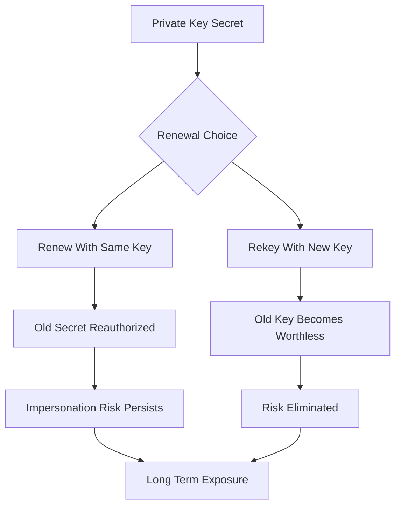

# Key Rotation, Renewal, and Rekeying: Why Reusing a Private Key Is a Smell

## English

Renewal and rekeying are not the same thing, and conflating them is a common source of long-term risk. Renewal means obtaining a new certificate — new serial number, new validity window — that certifies the same public key. Rekeying means generating a fresh private key and having the CA certify the new public key instead. Many renewal workflows, especially automated ones, quietly reuse the existing key because it is simpler: you skip generating a key, and you can keep the same CSR structure. But every reuse extends the lifetime of a secret that may already have been exposed in ways you cannot detect.

The threat model is the reason. A private key that has been copied to a backup tape, cached in a container image layer, read by a compromised CI runner, or logged by a misconfigured debug setting is compromised whether or not anyone exploited it. If you renew with the same key, the new certificate simply re-authorizes that possibly-leaked secret for another validity period. If you rekey, the old key becomes worthless the moment the new certificate is deployed — an attacker holding the old key can no longer impersonate you, even though the old certificate might technically still be within its validity window. This is why best practice is to rekey at every renewal unless there is a specific, documented reason not to.

Perfect Forward Secrecy (PFS) is a related but distinct concept worth separating. PFS is negotiated at the TLS layer through ephemeral key exchange (ECDHE), meaning the session keys are derived fresh for each connection and are not recoverable from the server's long-term private key. So even if your certificate's key leaks, recorded past traffic cannot be decrypted from it alone. But PFS does not help with impersonation: an attacker with your leaked private key can still stand up a server that presents a valid certificate for your domain and intercept new connections. Rekeying is what closes that impersonation window.

Automation frameworks handle this differently and it matters. ACME clients that support key rollover will generate a new key pair at renewal time; some default to reusing the key for compatibility with pinning. If you use certificate pinning — where clients hard-code a hash of the public key or certificate — rekeying will break every pinned client unless you have planned a pin rotation with backup pins published in advance. This is exactly why pinning and short-lived automated certificates are often considered in tension, and why many teams pin to a public key in an intermediate or use pin sets rather than a single leaf key.

Finally, the private key's storage lifecycle deserves as much attention as the certificate's. Keys should be generated on the machine or HSM that will use them where possible, never transmitted in plaintext, and stored with restrictive file permissions. When you do rekey, the old key should be destroyed rather than archived indefinitely, and any HSM or key management system should be updated atomically with the certificate deployment so there is never a window where the served certificate and the served key disagree — a mismatch that produces the classic 'certificate and key do not match' handshake failure.

## 中文

續期（renewal）與換鑰（rekeying）不是同一回事，把兩者混為一談是長期風險的常見來源。續期是指取得一張新憑證——新序號、新有效期間——但認證的是同一把公鑰。換鑰是指產生一把全新的私鑰，讓 CA 改為認證新的公鑰。許多續期流程，尤其是自動化的，會悄悄重用既有金鑰，因為這樣更簡單：省去產生金鑰的步驟，也能沿用同樣的 CSR 結構。但每一次重用，都在延長一個可能已以你無法偵測的方式外洩之秘密的壽命。

威脅模型正是原因所在。一把曾被複製到備份磁帶、快取在容器映像層、被淪陷的 CI runner 讀取，或被設定錯誤的除錯設定記錄下來的私鑰，無論有沒有人利用過，都應視為已外洩。若你以同一把金鑰續期，新憑證只是把這個可能外洩的秘密再授權一個有效期間。若你換鑰，舊金鑰在新憑證部署的那一刻就變得一文不值——持有舊金鑰的攻擊者再無法冒充你，即使舊憑證在技術上仍在有效期內。這就是為何最佳實務是每次續期都換鑰，除非有具體且已記錄在案的理由不這樣做。

「完全前向保密」（Perfect Forward Secrecy，PFS）是相關但不同的概念，值得分開理解。PFS 在 TLS 層透過臨時金鑰交換（ECDHE）協商，意即工作階段金鑰對每個連線新鮮導出，無法從伺服器的長期私鑰復原。因此即使你憑證的金鑰外洩，單憑它也無法解密已錄下的過往流量。但 PFS 對冒充毫無幫助：持有你外洩私鑰的攻擊者，仍可架起一部伺服器，出示你網域的有效憑證並攔截新連線。換鑰才是關上那扇冒充之窗的手段。

自動化框架對此處理各異，而這很重要。支援金鑰輪替的 ACME 客戶端會在續期時產生新的金鑰對；有些為了與憑證釘選（pinning）相容而預設重用金鑰。若你使用憑證釘選——客戶端硬編碼公鑰或憑證的雜湊——換鑰會中斷每一個已釘選的客戶端，除非你已規劃好釘選輪替，並預先發佈備用釘選。這正是為何釘選與短命的自動化憑證常被視為存在張力，也是為何許多團隊選擇釘選中繼憑證中的公鑰，或使用釘選集合而非單一葉金鑰。

最後，私鑰的儲存生命週期值得與憑證本身同等的關注。金鑰應盡可能在將使用它的機器或 HSM 上產生，絕不以明文傳輸，並以嚴格的檔案權限儲存。當你換鑰時，舊金鑰應被銷毀而非無限期歸檔，而任何 HSM 或金鑰管理系統都應與憑證部署原子性地一併更新，確保永遠不會出現所服務的憑證與所服務的金鑰不一致的窗口——這種不匹配會產生經典的「certificate and key do not match」握手失敗。

## Key Takeaway

Renewal re-authorizes a key; rekeying retires it — and only rekeying closes the impersonation window left by a leaked private key.

## Related Concepts
- Perfect Forward Secrecy
- Certificate pinning

## Diagram

