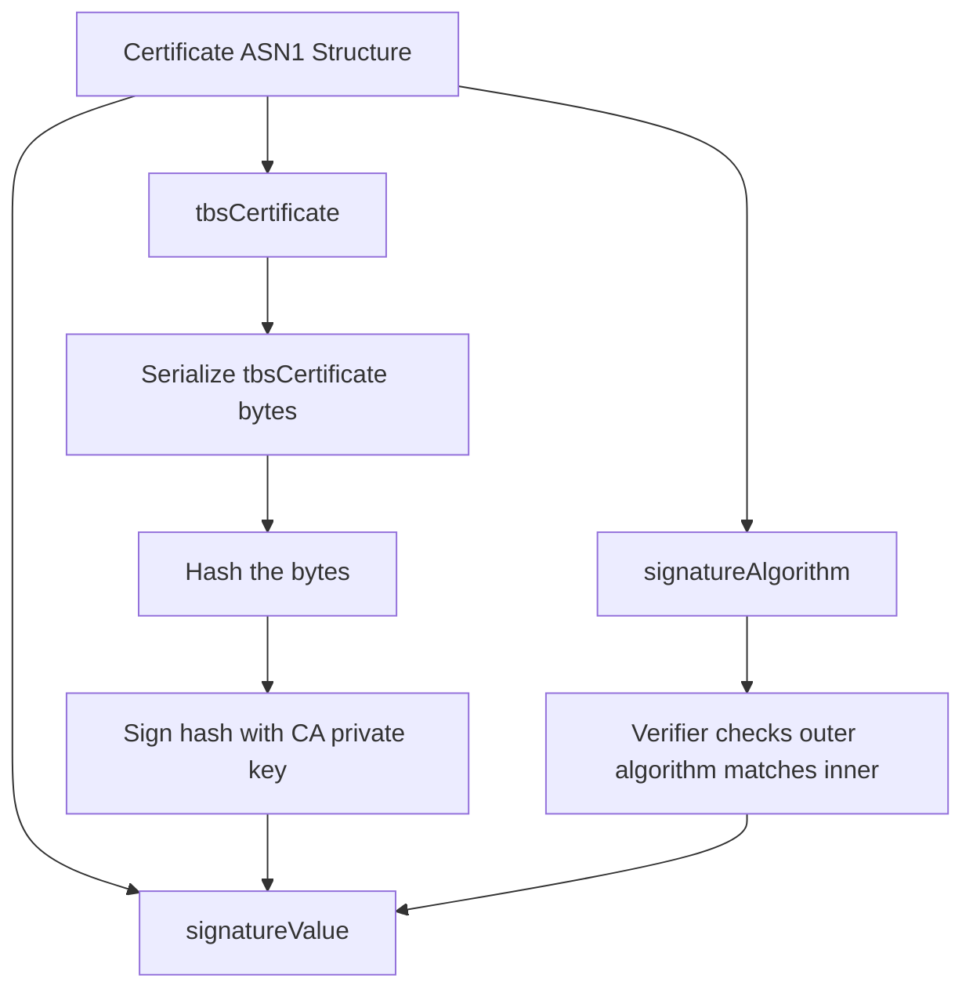

# The Signature Is Over the TBS, Not the Whole Certificate

## English

When people say "the CA signs the certificate," it is tempting to imagine the CA taking the finished certificate file and stamping a seal onto the bottom of it. That picture is wrong in an interesting way. In X.509, the certificate is a small ASN.1 structure with exactly three top-level parts: tbsCertificate ("to be signed"), signatureAlgorithm, and signatureValue. The CA serializes only the tbsCertificate — the block that contains the version, serial number, issuer name, validity dates, subject name, public key, and extensions — and hashes those exact bytes. That hash is then signed with the CA's private key, and the resulting signatureValue is appended. The signatureAlgorithm field sits outside the signed block, which is why a verifier must check that the outer algorithm identifier matches the one recorded inside tbsCertificate; if they disagree, the certificate is malformed and should be rejected. This structure means the signature covers the serial number, the validity window, the subject's public key, and every extension such as keyUsage, extendedKeyUsage, subjectAltName, and nameConstraints. Change a single byte of any of those and the hash changes and the signature fails. The practical consequence is that "the CA signed it" is a statement about a very specific byte string, not about a file. If you re-encode a certificate — say, converting between DER and PEM, or re-serializing through a library that reorders attributes — the tbsCertificate bytes can change even though the semantic content is identical, and the signature will no longer verify. This is why certificate tooling is obsessive about preserving exact encodings. It is also why you can inspect a certificate's signature with a command like `openssl x509 -in cert.pem -text -noout` and see both the algorithm and the raw signature bytes, but you cannot "re-sign" a certificate without the CA's private key. The signature is a cryptographic commitment to a precise serialization, and every field inside tbsCertificate is part of that commitment.

## 中文

當人們說「CA 簽署了憑證」時，很容易想像成 CA 拿著已完成的憑證檔案，在底部蓋上一個印章。這個畫面其實錯得很有意思。在 X.509 裡，憑證是一個小型的 ASN.1 結構，頂層只有三個部分：tbsCertificate（「待簽署」）、signatureAlgorithm 和 signatureValue。CA 只會序列化 tbsCertificate 這一個區塊——也就是包含版本、序號、簽發者名稱、有效期限、主體名稱、公鑰與擴充欄位的那一塊——並對這些確切的位元組做雜湊。接著用 CA 的私鑰對該雜湊簽署，再把產生的 signatureValue 附加在後面。signatureAlgorithm 欄位位於被簽署區塊之外，這就是為什麼驗證者必須檢查外層的演算法識別碼是否與 tbsCertificate 內記錄的相符；若兩者不一致，該憑證即屬格式錯誤，應予拒絕。這樣的結構意味著簽章涵蓋了序號、有效期間、主體的公鑰，以及每一個擴充欄位，例如 keyUsage、extendedKeyUsage、subjectAltName 和 nameConstraints。只要更動其中任何一個位元組，雜湊就會改變，簽章驗證便會失敗。實務上的結論是：「CA 簽了它」講的是某個非常特定的位元組字串，而不是某個檔案。如果你重新編碼一張憑證——比如在 DER 與 PEM 之間轉換，或透過會重排屬性的函式庫重新序列化——即使語意內容完全相同，tbsCertificate 的位元組也可能改變，簽章就再也驗不過。這就是憑證工具為何對保留確切編碼如此執著。這也是為什麼你可以用 `openssl x509 -in cert.pem -text -noout` 這類指令檢視憑證的簽章，看到演算法與原始簽章位元組，卻無法在沒有 CA 私鑰的情況下「重新簽署」一張憑證。簽章是對某個精確序列化的密碼學承諾，而 tbsCertificate 裡的每一個欄位都屬於這個承諾的一部分。

## Key Takeaway

A certificate signature covers the exact bytes of the tbsCertificate block, so any re-encoding that changes those bytes invalidates the signature even if the meaning is identical.

## Related Concepts
- ASN.1 DER encoding
- Digital signature verification

## Diagram

