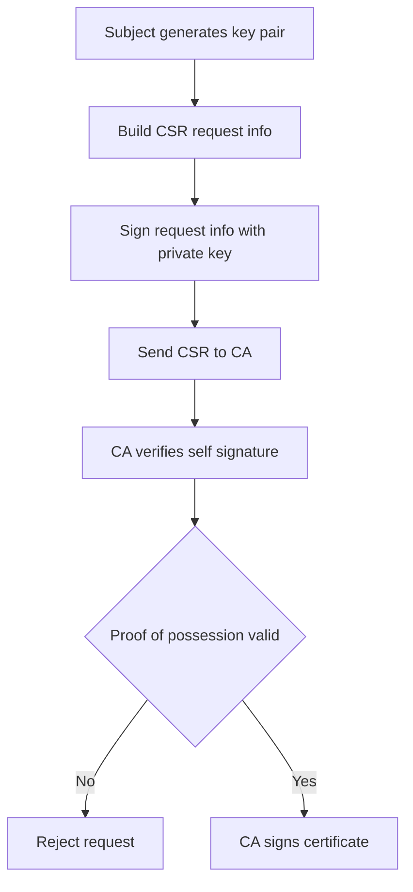

# Why You Cannot Sign a Certificate Without Holding the Key It Describes

## English

A common beginner mistake is to assume that anyone can take a CSR, add fields, and sign the result with any convenient key. The CA can absolutely add fields — that is what "signing is not issuing" is about — but it cannot sign a certificate that describes a public key it does not possess the matching private key for, and more importantly, the CA cannot sign on behalf of a subject without the subject proving key possession. That proof is the entire point of the CSR's self-signature. When you generate a CSR, your tooling creates a signature over the CSR's certificationRequestInfo using the private key that corresponds to the public key inside the request. The CA verifies that signature before doing anything else. If verification fails, the request is rejected. This is called proof of possession, and it prevents an attacker from requesting a certificate for someone else's public key — for example, copying a target's public key out of an existing certificate and asking a CA to bind it to a hostname the attacker controls. Without proof of possession, that attack would let the attacker obtain a certificate whose public key the victim holds the private key for, which is a confusing and dangerous state. The same principle applies to the CA's own signing key. The CA's certificate is signed by its parent CA, and the parent verified the child CA's proof of possession at some earlier point. This is why the trust hierarchy is not just a chain of signatures but a chain of verified key possessions. It also explains why a CA cannot "re-sign" an existing certificate with a new validity date: doing so would require producing a new tbsCertificate, which changes the bytes, which requires a fresh signature — and the CA can produce that signature only if it is willing to assert that the subject still controls the key, which is exactly the assertion a renewal is supposed to re-establish. The signature is not a rubber stamp on a document; it is a cryptographic statement that a specific key pair is bound to a specific identity, made by an entity that has verified the binding.

## 中文

初學者常見的誤解，是以為任何人都可以拿一份 CSR、加上一些欄位，然後用任何方便的金鑰把它簽起來。CA 當然可以加欄位——「簽署不等於簽發」講的就是這件事——但它不能簽發一張描述著自己並不持有對應私鑰之公鑰的憑證；更重要的是，CA 不能在主體未證明金鑰持有的情況下，代替主體簽署。這份證明正是 CSR 自我簽章的全部意義。當你產生 CSR 時，你的工具會用請求內公鑰所對應的私鑰，對 CSR 的 certificationRequestInfo 產生一份簽章。CA 在做任何事之前會先驗證這份簽章；驗證失敗就拒絕請求。這稱為持有證明（proof of possession），它能阻止攻擊者替別人的公鑰申請憑證——例如從既有的憑證中複製目標的公鑰，再要求 CA 把它綁到攻擊者控制的網域名稱上。若沒有持有證明，這種攻擊就能讓攻擊者取得一張憑證，而其公鑰的私鑰卻握在受害者手中，形成一種混亂又危險的狀態。同樣的原則也適用於 CA 自己的簽署金鑰。CA 的憑證是由其上層 CA 簽署的，而上層 CA 在某個更早的時點已驗證過下層 CA 的持有證明。這就是為什麼信任階層不只是簽章的鏈，更是「已驗證之金鑰持有」的鏈。這也解釋了為什麼 CA 不能把一張既有憑證「重新簽署」成新的有效期限：這麼做需要產生新的 tbsCertificate，位元組隨之改變，就得有全新的簽章——而 CA 唯有願意斷言主體仍掌控該金鑰，才能產生那份簽章，而這正是續期本應重新確立的主張。簽章不是文件上的橡皮圖章，而是一個密碼學陳述：某個特定金鑰對已被綁定到某個特定身分，且是由一個已驗證過該綁定的實體所做出。

## Key Takeaway

A CSR's self-signature proves the requester holds the private key, which is why a CA cannot bind a public key to an identity without the key holder's participation.

## Related Concepts
- Proof of possession
- Public key binding

## Diagram

