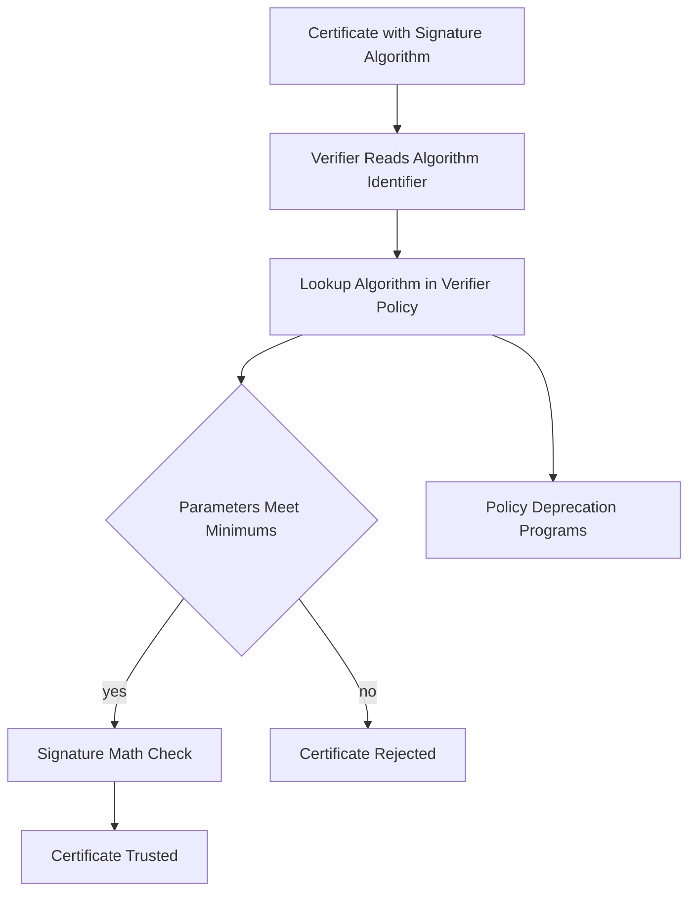

# Signature Algorithms Age: Why Old Signatures Stop Being Acceptable

## English

A certificate signed in 2012 with SHA-1 is still, cryptographically speaking, a valid signature today — the bytes have not changed and the math still checks out. But most modern clients will reject it anyway. This is because certificate verification is not a pure cryptographic check; it is a policy check that combines cryptography with a set of rules about which algorithms are still considered safe. SHA-1 collisions were demonstrated publicly, and browser and OS vendors progressively deprecated SHA-1 signatures in certificates, which is why the CA/Browser Forum Baseline Requirements now mandate SHA-256 or stronger for publicly trusted certificates. The same story is playing out with RSA key sizes: 1024-bit RSA was once standard and is now rejected by essentially every trust store, and 2048-bit is the current floor with 3072-bit and 4096-bit increasingly common. Signature algorithm agility is therefore a real operational concern, not a theoretical one. When a trust store decides that an algorithm is no longer acceptable, every certificate in the chain that uses it becomes untrusted at once — including root and intermediate CA certificates, which is why root programs run multi-year deprecation programs with cross-signed replacements. The practical lesson is that the algorithm identifier inside a certificate is not just metadata; it is a policy hook. A verifier looks up the algorithm in its own configuration, checks whether the parameters (key size, curve, hash) meet its minimums, and rejects the certificate if they do not. This is also why "the signature verifies" and "the certificate is trusted" are different statements: the first is math, the second is math plus policy. When you are choosing what to sign with — whether you are a CA, an internal PKI operator, or someone generating a self-signed certificate for testing — pick algorithms that will still be acceptable in five years, not just today, because reissuing a large fleet of certificates under time pressure is exactly the kind of work that produces outages.

## 中文

一張在 2012 年以 SHA-1 簽署的憑證，從密碼學的角度來說，今天仍然是有效的簽章——位元組沒有改變，數學也依然成立。但大多數現代用戶端還是會拒絕它。這是因為憑證驗證並不是單純的密碼學檢查，而是一種政策檢查，把密碼學與一套「哪些演算法仍被視為安全」的規則結合起來。SHA-1 的碰撞已被公開展示，瀏覽器與作業系統廠商逐步淘汰憑證中的 SHA-1 簽章，這也是為什麼 CA/Browser Forum 的 Baseline Requirements 如今要求公開信任的憑證必須使用 SHA-256 或更強的演算法。同樣的故事也發生在 RSA 金鑰長度上：1024 位元 RSA 曾是標準，如今幾乎被所有信任儲存庫拒絕；2048 位元是目前的下限，3072 位元與 4096 位元則日益常見。因此，簽章演算法的可替換性是個真實的營運課題，而非理論問題。當某個信任儲存庫判定某演算法不再可接受時，鏈上所有使用該演算法的憑證會在同一時間失效——包括根 CA 與中繼 CA 的憑證，這就是為什麼根憑證計畫會推動為期數年的淘汰計畫，並搭配交叉簽署的替代憑證。實務上的教訓是：憑證內的演算法識別碼不只是中介資料，它是一個政策掛鉤。驗證者會在自己的設定中查詢該演算法，檢查參數（金鑰長度、曲線、雜湊）是否符合其最低要求，不符合就拒絕該憑證。這也是為什麼「簽章驗證通過」與「憑證受信任」是兩個不同的陳述：前者是數學，後者是數學加上政策。當你在選擇要用什麼來簽署時——不論你是 CA、內部 PKI 營運者，或只是為了測試而產生自簽憑證——請挑選五年後仍會被接受的演算法，而不只是今天可用，因為在時間壓力下重新簽發大批憑證，正是最容易造成服務中斷的那種工作。

## Key Takeaway

Certificate trust is math plus policy, so an algorithm that still verifies can still be rejected once trust stores retire it.

## Related Concepts
- Algorithm agility
- Trust store policy

## Diagram

