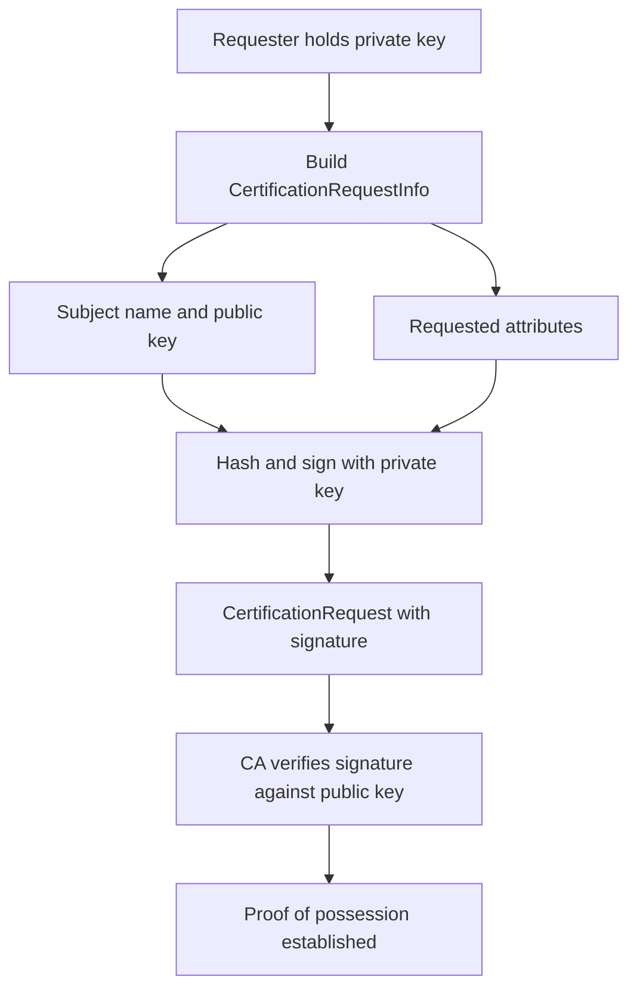

# Proof of Possession: How a CSR Proves You Own the Private Key

## English

A certificate binds a public key to a name, but a public key on its own proves nothing about who holds it. Anyone can copy a public key out of an existing certificate and paste it into a new signing request. So before a CA signs anything, it needs evidence that the requester actually controls the matching private key. That evidence is called proof of possession (PoP), and in the CSR format it is built in structurally: the CSR contains the public key and a set of attributes, and then a signature over all of that, produced with the private key. The CA verifies that signature against the embedded public key. If it verifies, the requester must have had the private key at the moment of signing. This is why you can never build a valid CSR from a certificate alone — the certificate gives you the public half, but signing the request requires the secret half.

The signature in a CSR covers a structure called the CertificationRequestInfo, which holds the subject name, the subject public key, and any requested attributes. That blob is hashed and signed, and the resulting signature plus the algorithm identifier are wrapped into the outer CertificationRequest. This is the same pattern you see everywhere in PKI: sign the data, then ship the data and the signature together. Because the signature is over the request contents, nobody can take your signed CSR and swap the public key or change the subject name without invalidating it. Tampering breaks the math, not just a checksum.

Proof of possession is not the same as proof of identity. A CSR proves you hold a key; it says nothing about whether you own the domain name in the subject. That second question is answered by a different mechanism — domain validation, where the CA asks you to publish a token at a URL, add a DNS TXT record, or respond to an email sent to an address at the domain. In automated issuance protocols the ACME server hands out a challenge, and the client proves control of the identifier separately from the CSR signature. Keeping these two proofs mentally separate clears up a lot of confusion: the CSR answers "do you have the key?" and validation answers "is this name yours?"

There is a subtle attack that PoP defends against. Imagine a CA that signs whatever public key you hand it without checking for a private key. An attacker could take the public key from a legitimate certificate for a bank, submit it in a CSR for a domain they control, and end up with a certificate that shares a key pair with the bank's. That is dangerous because some clients and protocols key off the public key — for example, certificate pinning by public key hash, or HPKP-style policies, or SSH-style known-key trust. If two certificates share a key, compromising one private key potentially affects trust decisions made about the other. Requiring PoP makes it much harder to obtain a certificate for a key you do not control.

In practice you rarely think about this because your tooling does it for you. When you run openssl req -new -key server.key -out server.csr, OpenSSL reads the private key, derives the public key, builds the request, and signs it in one go. If you try to generate a CSR from an existing certificate using something like openssl x509 -x509toreq, the tool will ask you for the private key, precisely because it needs to produce that signature. When you inspect a CSR with openssl req -in server.csr -noout -verify, the verify flag re-checks the self-signature and reports whether it is valid. A CSR that fails that check should be treated as malformed and never sent to a CA.

## 中文

憑證的作用是把一個公鑰繫結到某個名稱，但公鑰本身並不能證明誰持有它。任何人都可以由既有憑證中複製公鑰，貼進新的簽署請求裡。所以 CA 在簽署任何東西之前，需要證據顯示申請人確實控制對應的私鑰。這個證據稱為持有證明（proof of possession，PoP），而在 CSR 格式中它是結構性地內建的：CSR 內含公鑰與一組屬性，然後是對整段內容的簽章，而這個簽章是用私鑰產生的。CA 會用內嵌的公鑰去驗證這個簽章。若驗證透過，申請人在簽署那一刻必定持有私鑰。這就是為何你無法單憑一張憑證造出有效的 CSR — 憑證只給你公開的那一半，但要簽署請求就必須有秘密的那一半。

CSR 裡的簽章覆蓋的結構叫 CertificationRequestInfo，內含主體名稱、主體公鑰，以及任何請求的屬性。這個資料塊會被雜湊並簽署，產生的簽章加上演算法識別碼再包進外層的 CertificationRequest。這個模式在整個 PKI 中隨處可見：先簽資料，再把資料與簽章一起送出。由於簽章是針對請求內容，沒有人能把你的已簽 CSR 換掉公鑰或改掉主體名稱而不使簽章失效。竄改會破壞數學，而不只是破壞校驗和。

持有證明不等於身分證明。CSR 證明你持有金鑰，卻完全沒說你是否擁有主體裡的那個網域名稱。第二個問題由另一套機制回答 — 網域驗證，CA 會要求你在某個 URL 釋出權杖、加入 DNS TXT 記錄，或回覆寄到該網域地址的電郵。在自動化簽發協定中，ACME 伺服器發出挑戰，客戶端要另外證明對識別碼的控制權，與 CSR 簽章分開。把這兩種證明在腦中分清楚，可以解開很多混亂：CSR 回答「你有金鑰嗎？」，驗證回答「這個名字是你的嗎？」

PoP 防禦一種微妙的攻擊。想像一個 CA 不檢查私鑰就簽下你遞交的任何公鑰。攻擊者可以從某家銀行的合法憑證中取出公鑰，放進自己控制網域的 CSR，最後得到一張與銀行共用金鑰對的憑證。這很危險，因為有些客戶端與協定是以公鑰為判斷依據 — 例如以公鑰雜湊做憑證釘選（certificate pinning），或 SSH 那種 known-key 信任。若兩張憑證共用一把金鑰，洩漏其中一把私鑰可能同時影響對另一張憑證的信任判斷。要求 PoP 讓攻擊者更難取得自己不控制之金鑰的憑證。

實務上你很少需要想這件事，因為工具會替你做。當你執行 openssl req -new -key server.key -out server.csr，OpenSSL 會讀取私鑰、推導公鑰、組出請求並一次完成簽署。若你試圖由既有憑證產生 CSR，例如用 openssl x509 -x509toreq，工具會向你要私鑰，正是因為它需要產生那個簽章。當你用 openssl req -in server.csr -noout -verify 檢視 CSR 時，verify 旗標會重新檢查自我簽章並回報是否有效。驗證失敗的 CSR 應視為格式錯誤，絕不該送交 CA。

## Key Takeaway

A CSR's self-signature is proof that the requester holds the private key, which is a completely separate question from whether they own the domain name.

## Related Concepts
- Certificate Signing Request
- Domain Validation

## Diagram

