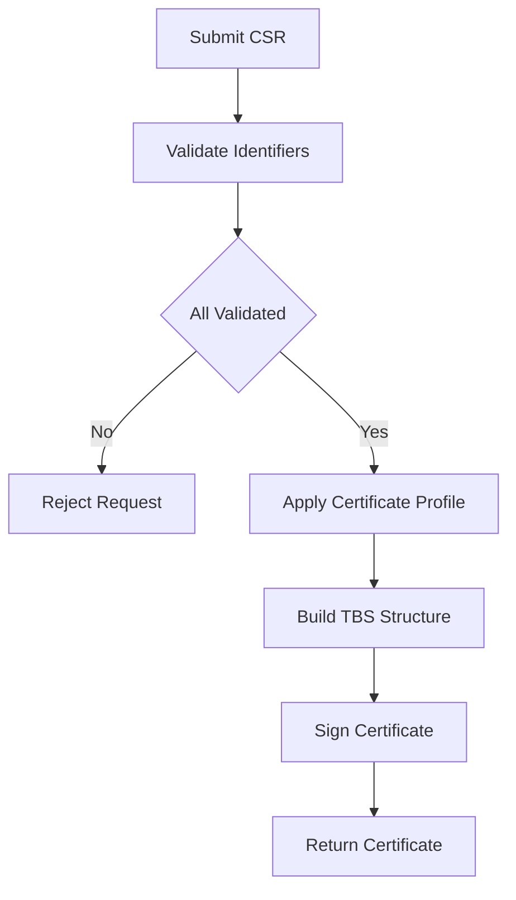

# What Actually Happens Inside the CA Between CSR and Certificate

## English

From the outside, certificate signing looks like a black box: you submit a CSR, wait a moment, and a certificate comes back. Inside the CA, though, signing is the last step of a pipeline, and most of the interesting work happens before any cryptography. The first stage is validation: confirming the requester controls every identifier in the request. For a domain, that means a challenge response — a file at a well-known path, a DNS record, or a token served over an existing TLS connection. For an organization-validated certificate, it means checking business registration documents against public records, a human-driven process that can take days. Only once every identifier is validated does the request move to issuance.

The next stage is policy enforcement. The CA does not simply copy the CSR's subject and extensions into a certificate. It rebuilds them according to its own certificate profile — a template that specifies exactly which fields are allowed, which extensions must appear, and what values they may take. The requester's key usage requests in the CSR are advisory at best; the CA decides. If the CSR asks for an extension the profile does not permit, the CA may silently drop it, reject the request outright, or return an error. This is why you sometimes receive a certificate that looks subtly different from what you asked for. The CA is the authority, not the CSR.

After the profile is applied, the CA constructs the to-be-signed (TBS) structure: the serial number, issuer name, validity window, subject name, public key, and extensions, all in a strict ASN.1 encoding. The serial number is chosen by the CA, typically a large random value, and must be unique per issuer. The validity window is set by policy — modern public CAs are constrained by browser rules on maximum lifetimes, and the notBefore is usually backdated slightly to tolerate clock skew between the CA and the world. The issuer name is the CA's own distinguished name, matching the subject of its issuing certificate exactly, so that clients can chain the new certificate upward.

Then the CA hashes the TBS and signs it with its private key. For a public CA, that private key typically lives inside a hardware security module (HSM), a tamper-resistant device that performs the signing operation without ever exposing the key material. The CA sends the TBS to the HSM, receives the signature back, and assembles the final certificate by appending the signature algorithm identifier and the signature bits to the TBS. The private key never leaves the device, which is why compromising a CA requires physically attacking an HSM rather than just stealing a file.

Finally, the issued certificate is logged and published. For publicly trusted certificates, that means submitting to Certificate Transparency logs, which produce signed receipts (SCTs) that get embedded in the certificate or delivered via TLS extension. The CA also records the issuance in its own databases for audit, billing, and revocation. The certificate is then returned to the requester, usually bundled with intermediate certificates so the requester can serve a complete chain. Every one of these steps — validation, profiling, serial assignment, HSM signing, CT logging — is a place where the CA's policies shape the output, which is why two CAs given identical CSRs can return noticeably different certificates.

## 中文

從外面看，憑證簽署像個黑箱：你送出 CSR，等一會兒，憑證就回來了。但在 CA 內部，簽署只是流程的最後一步，大部分有趣的工作都發生在任何密碼學運算之前。第一階段是驗證：確認申請人控制請求中的每一個識別碼。對網域而言，就是挑戰回應 — 在某個 well-known 路徑放檔案、加 DNS 記錄，或透過既有 TLS 連線提供權杖。對組織驗證憑證而言，就是拿商業登記文件去比對公開紀錄，這是人工流程，可能要花好幾天。只有每個識別碼都驗證通過，請求才會進入簽發階段。

下一階段是政策執行。CA 不會單純把 CSR 的主體與擴充欄位複製進憑證。它會依自己的憑證設定檔（certificate profile）重建 — 那是一份範本，明確規定哪些欄位可用、哪些擴充必須出現、可以取什麼值。申請人在 CSR 裡要求的 key usage 頂多只是建議；決定權在 CA。若 CSR 要求設定檔不允許的擴充，CA 可能默默丟棄、直接拒絕，或回傳錯誤。這就是為何你有時收到的憑證，跟你要的看起來有微妙差異。權威是 CA，不是 CSR。

套用設定檔之後，CA 會組出待簽結構（to-be-signed，TBS）：序號、簽發者名稱、有效期間、主體名稱、公鑰與擴充，全部以嚴格的 ASN.1 編碼。序號由 CA 挑選，通常是大型隨機值，且對每個簽發者必須唯一。有效期間由政策決定 — 現代公開 CA 受瀏覽器規則限制最長壽命，而 notBefore 通常會稍微往前調，以容忍 CA 與外界之間的時鐘偏差。簽發者名稱是 CA 自己的識別名稱，必須與其簽發憑證的主體完全一致，客戶端才能把新憑證往上串鏈。

接著 CA 對 TBS 做雜湊，並用自己的私鑰簽署。對公開 CA 而言，那把私鑰通常存放在硬體安全模組（hardware security module，HSM）裡 — 那是防竄改的裝置，執行簽署運算卻從不暴露金鑰材料。CA 把 TBS 送進 HSM，取回簽章，再把簽章演算法識別碼與簽章位元接在 TBS 後面，組成最終憑證。私鑰從不離開裝置，這就是為何入侵 CA 需要實體攻擊 HSM，而不是偷一個檔案那麼簡單。

最後，簽發出的憑證會被記錄與公開。對公開信任的憑證而言，就是提交到憑證透明度（Certificate Transparency）日誌，產生已簽收據（SCT），再嵌入憑證或透過 TLS 擴充傳遞。CA 也會把簽發記錄進自己的資料庫，以供稽核、計費與撤銷。憑證隨後回傳給申請人，通常連同中繼憑證一起打包，讓申請人能提供完整鏈。這每一步 — 驗證、設定檔套用、序號指派、HSM 簽署、CT 記錄 — 都是 CA 政策形塑輸出的地方，這就是為何兩家 CA 拿到完全相同的 CSR，可能回傳明顯不同的憑證。

## Key Takeaway

Signing is only the final step of issuance; validation, profile enforcement, serial assignment, HSM signing, and CT logging all happen inside the CA and shape what the certificate actually says.

## Related Concepts
- Certificate Profile
- Hardware Security Module

## Diagram

