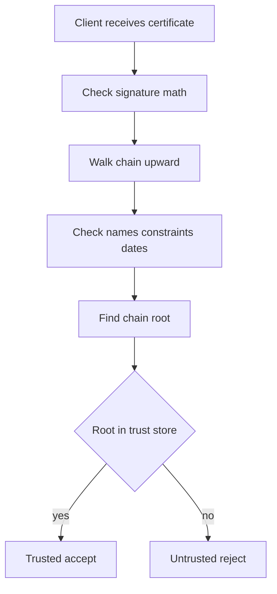

# Signing a Certificate Is Not the Same as Being Trusted to Sign It

## English

Here is a fact that surprises many people: anyone can sign a certificate. The signing operation is just a hash and a private key. If you generate a key pair, write a certificate with your own name as issuer, and sign it with your own key, you have produced something that is cryptographically valid — the signature verifies perfectly against the public key inside. What you have not produced is a certificate that browsers will accept. Cryptographic validity and trust are two different things, and conflating them is the source of endless confusion.

Trust comes from a separate mechanism: the trust store. Every operating system, browser, and language runtime ships with a set of root certificates it has decided to trust. When a client receives a server certificate, it does not just check that the signature is mathematically sound. It walks the chain upward, checking at each step that the issuer's signature is valid, that the names and constraints line up, that validity dates are current, and that the final root is one of the roots in its store. If the chain terminates at a root the client has never heard of, verification fails with an error like "unable to get local issuer certificate" or "self-signed certificate in certificate chain". The math was fine; the trust was not.

This is why a certificate you sign yourself works perfectly in a test environment where you have explicitly added your root to the trust store, and fails everywhere else. It is also why internal corporate CAs work: the IT department pushes its root certificate to every managed device, so the chain terminates at something the device trusts. The certificate itself is unremarkable; the trust store is what makes it powerful. Conversely, if a public root CA is removed from a major trust store — which happens when a CA violates browser requirements — every certificate it ever issued stops working overnight, even though none of the signatures changed.

The distinction also explains why the same certificate can behave differently on different machines. A certificate issued by a small CA might be trusted on one platform and rejected on another, depending on whether that platform's trust store includes the CA's root. A certificate from a corporate internal CA works on company laptops and fails on a personal phone. A self-signed certificate works in curl if you pass the right flag, and fails in a browser unless you click through a warning. The certificate is identical in every case; only the set of roots being consulted differs.

So when you are designing a system, ask two separate questions. First, is the signature valid and does the chain build correctly? That is a question about the certificate. Second, will the client's trust store accept the root at the top of that chain? That is a question about the client. For public-facing services, the answer to the second question usually means using a publicly trusted CA. For internal services, it may mean distributing your own root. For development, it may mean adding a local root to your test environment. Getting this wrong is the single most common reason a certificate "does not work" even though it looks perfectly fine when you inspect it.

## 中文

有個事實常令人意外：任何人都可以簽署憑證。簽署運算不過是一個雜湊加一把私鑰。若你產生一對金鑰，寫一張以自己為簽發者的憑證，再用自己的金鑰簽它，你已經造出在密碼學上有效的東西 — 簽章對憑證內的公鑰驗證完全透過。你沒造出的，是瀏覽器會接受的憑證。密碼學上的有效性與信任是兩回事，把兩者混為一談正是無盡混亂的來源。

信任來自另一套機制：信任儲存區（trust store）。每個作業系統、瀏覽器與語言執行環境都隨附一組它決定信任的根憑證。當客戶端收到伺服器憑證，它不只看簽章在數學上是否正確。它會沿著鏈往上走，在每一步檢查簽發者的簽章是否有效、名稱與限制是否吻合、有效日期是否仍在範圍內，以及最終的根是否在它的儲存區裡。若鏈終止在一個客戶端從未聽過的根，驗證就會失敗，錯誤訊息類似「unable to get local issuer certificate」或「self-signed certificate in certificate chain」。數學沒問題；信任有問題。

這就是為何你自己簽的憑證，在你明確把自家根加進信任儲存區的測試環境中運作完美，在其他地方卻處處失敗。這也是企業內部 CA 可行的原因：IT 部門把它的根憑證推送到每一臺受管裝置，於是鏈終止在裝置信任的東西上。憑證本身平平無奇；是信任儲存區讓它變得有力。反過來說，若某個公開根 CA 被某大型信任儲存區移除 — 當 CA 違反瀏覽器要求時就會發生 — 它簽發過的所有憑證會在一夜之間失效，即使沒有任何簽章改變。

這個區別也解釋了為何同一張憑證在不同機器上行為不同。由小型 CA 簽發的憑證，可能在某個平臺上被信任、在另一個平臺上被拒絕，取決於該平臺的信任儲存區是否包含該 CA 的根。企業內部 CA 的憑證在公司筆電上可用，在個人手機上失敗。自簽憑證在 curl 裡加上正確旗標就能用，在瀏覽器裡除非你點過警告否則失敗。憑證在每個情境都一模一樣；不同的只是被查詢的根集合。

所以設計系統時，要問兩個分開的問題。第一，簽章是否有效、鏈是否能正確建立？這是關於憑證的問題。第二，客戶端的信任儲存區是否接受鏈頂端的根？這是關於客戶端的問題。對公開服務而言，第二個問題的答案通常意味著使用公開信任的 CA。對內部服務而言，可能意味著派發自家的根。對開發環境而言，可能意味著把本機根加進測試環境。搞錯這件事，就是憑證「不能用」卻在你檢視時看起來完全正常的最常見原因。

## Key Takeaway

Anyone can produce a cryptographically valid signature, but a certificate only works when the chain terminates at a root the client's trust store already accepts.

## Related Concepts
- Trust Store
- Self-Signed Certificate

## Diagram

