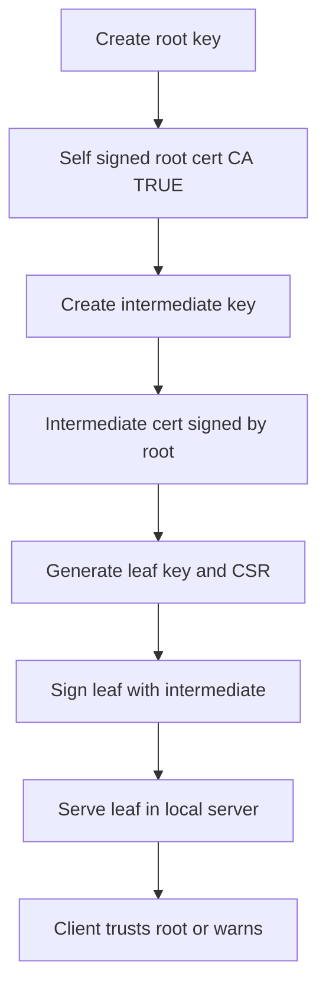

# Certificate Signing with a Local Test CA: Practising the Whole Flow Without a Public CA

## English

The fastest way to understand certificate signing is to run a miniature CA on your own machine. Tools like OpenSSL's `ca` subcommand, `cfssl`, or `step-ca` let you create a root key and root certificate, then sign CSRs against it. The root certificate is self-signed — the issuer and subject are the same entity — which is exactly why browsers do not trust it by default: nothing outside your machine has vouched for it. When you import that root into your operating system or browser trust store, you are manually performing the one act that public CAs perform through audits and contracts: declaring 'I accept this key as an authority.'

A practical lab looks like this. First, create a root private key and a self-signed root certificate with the basic constraints extension marked critical and `CA:TRUE`. Second, create a separate intermediate key and certificate, signed by the root, also with `CA:TRUE` but ideally with a path length constraint so it cannot spawn endless sub-CAs. Third, generate a leaf key and CSR for something like `test.local`, and sign it with the intermediate. You now have a three-level hierarchy you built yourself, and you can inspect every field because you wrote it.

Serving that leaf certificate in a local web server (nginx, Caddy, or a tiny Python TLS server) will still produce a warning unless the client trusts your root. That warning is the lesson: TLS clients do not check that a chain is internally consistent only — they check that the chain terminates in a certificate present in their trust store. A perfectly valid signature from an unknown root is cryptographically sound but socially meaningless.

Use this setup to experiment with the things that are hard to observe on the public internet. Sign a certificate with the wrong hostname and watch hostname verification fail. Omit the intermediate from the served chain and watch the client fail to build a path. Backdate a certificate's `notBefore` or shorten its validity and observe the clock checks. Because you control the CA, you can also deliberately mis-issue and see how clients react, which makes abstract rules concrete.

Finally, tear it down and rebuild it from scratch a second time without looking at notes. The sequence — root key, root cert, intermediate key, intermediate cert, leaf key, leaf CSR, leaf cert, chain file — is the skeleton of every PKI you will ever touch, and repeating it builds the muscle memory that makes production incidents easier to diagnose.

## 中文

要最快理解憑證簽署，就是自己在電腦上跑一個迷你 CA。OpenSSL 的 `ca` 子命令、`cfssl` 或 `step-ca` 等工具，可以讓你建立根金鑰與根憑證，再拿 CSR 去給它簽。根憑證是自簽的——發行者與主體是同一個實體——這正是瀏覽器預設不信任它的原因：你的機器以外，沒有任何東西為它背書。當你把這個根憑證匯入作業系統或瀏覽器的信任儲存區，你其實是親手做出公開 CA 靠稽核與合約才能完成的那個動作：宣告「我接受這把金鑰作為權威」。

一個實作練習長這樣。第一，建立根私鑰，以及一張自簽根憑證，並把 basic constraints 擴充標為 critical、設為 `CA:TRUE`。第二，另外建立一把中繼金鑰與憑證，由根簽發，同樣是 `CA:TRUE`，但最好加上路徑長度限制，讓它不能無限生出下層 CA。第三，為 `test.local` 之類的名字產生葉節點金鑰與 CSR，再用中繼簽發。你現在有一個自己搭建的三層階層，而且每個欄位都是你寫的，所以可以逐一檢視。

把這張葉憑證放進本機的網頁伺服器（nginx、Caddy 或一個小型的 Python TLS 伺服器），用戶端除非信任你的根，否則還是會跳警告。那個警告就是重點：TLS 用戶端不是只檢查鏈在內部是否一致——它還要求整條鏈要終止於信任儲存區裡存在的憑證。一張由未知根簽出的憑證，簽章在密碼學上完全正確，但在社會意義上毫無份量。

用這個環境去實驗那些在公開網際網路上很難觀察的事。簽一張主機名錯誤的憑證，看主機名驗證怎麼失敗。故意不在伺服器送出的鏈裡放中繼憑證，看用戶端如何建不出路徑。把憑證的 `notBefore` 往前調或縮短有效期，觀察時鐘檢查的反應。因為 CA 是你自己的，你也可以刻意錯發憑證，看看用戶端怎麼反應，抽象的規則就會變得具體。

最後，把整套拆掉，不看筆記再從頭重建一次。這個順序——根金鑰、根憑證、中繼金鑰、中繼憑證、葉金鑰、葉 CSR、葉憑證、鏈檔案——就是每一個 PKI 的骨架，反覆練會形成肌肉記憶，日後處理生產事故時會輕鬆得多。

## Key Takeaway

Running a local test CA and importing its root into your trust store teaches the difference between a valid signature and a trusted one faster than any diagram.

## Related Concepts
- Trust store
- Intermediate CA

## Diagram

