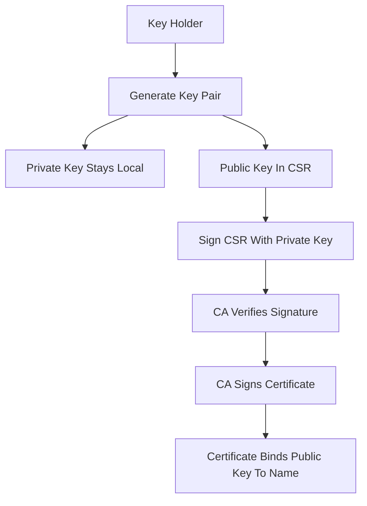

# Signing Server-Side vs. Signing Client-Side: Where the Private Key Must Never Go

## English

A common mental mix-up is thinking the CA needs your private key to sign your certificate. It does not. A certificate signing request carries your public key plus a signature made with your private key; the CA verifies that signature, which proves you hold the matching private key, and then issues a certificate binding that public key to a name. The private key never leaves your machine. This is the single most important operational rule in PKI: if anyone, including a CA, asks you to upload a private key for ordinary TLS issuance, something is wrong.

The reason is asymmetric cryptography. Your private key signs; your public key verifies. The CA's own private key signs the certificate; anyone holding the CA's public key (which is inside the CA's certificate, which is in your trust store) can verify it. Two different keys, two different roles, two different directions. Confusing them leads to the classic mistake of trying to 'sign with the public key' or 'encrypt with the private key' as if the operations were interchangeable — they are not, and describing them that way causes real bugs.

There is a legitimate exception worth knowing: some managed hosting or CDN products offer to generate the key pair on their infrastructure and handle renewal automatically. That is not the CA taking your key; it is a hosting provider acting as the key holder, with the CA still only seeing a CSR. The distinction matters when you audit a vendor: ask who holds the private key at rest, who can export it, and what happens at renewal. If the answer is 'the platform generates and stores it and you cannot export it', that is a defensible model for many use cases, but it is a different trust decision from holding the key yourself.

On the client side, the mirror image applies. In mutual TLS (mTLS), the client also presents a certificate and proves possession of a private key, and the server verifies it against a CA it trusts. Here the client's private key must stay on the client. A common anti-pattern is shipping one shared client certificate and key inside a mobile app binary; anyone who downloads the app can extract it, and the 'authentication' becomes a shared secret with extra steps. Per-device keys, generated on the device and never exported, are the correct pattern.

A useful habit is to ask, for every key you encounter, three questions: who generated it, where is it stored at rest, and who can read it. If the answers are 'me, on my disk with restrictive permissions, only me', the key is under your control. If any answer is 'a third party', you have made a trust delegation, and you should be able to say why. Signing is a proof of possession; the whole design collapses if possession is shared.

## 中文

一個常見的觀念混淆，是以為 CA 需要你的私鑰才能簽發憑證。其實不需要。憑證簽署請求裡帶的是你的公鑰，加上一段用你私鑰做出的簽章；CA 驗證那段簽章，就證明你持有對應的私鑰，然後才簽出一張把該公鑰綁到某個名字上的憑證。私鑰從頭到尾沒有離開你的機器。這是 PKI 最重要的一條營運鐵律：如果任何人——包括 CA——在一般 TLS 簽發流程中要求你上傳私鑰，那一定有問題。

原因是非對稱密碼學。私鑰用來簽，公鑰用來驗。CA 自己的私鑰用來簽憑證；任何持有 CA 公鑰的人（公鑰就在 CA 的憑證裡，而該憑證在你的信任儲存區）都可以驗證。兩把不同的金鑰、兩種不同的角色、兩個不同的方向。把它們搞混，就會出現經典錯誤：以為可以「用公鑰簽章」或「用私鑰加密」，好像這些操作可以互換——它們不能，這樣描述會造成真實的程式錯誤。

有一個值得知道的合理例外：某些代管主機或 CDN 產品會提議在他們的基礎設施上產生金鑰對，並自動處理續期。那不是 CA 拿走你的金鑰，而是代管商自己擔任金鑰持有者，CA 仍然只看到 CSR。當你稽核供應商時，這個區別很重要：要問私鑰在靜態儲存時由誰持有、誰能匯出、續期時會發生什麼。如果答案是「平台產生並儲存，你無法匯出」，對很多用途來說這是站得住腳的模式，但那是與自己持鑰不同的信任決定。

在用戶端那邊，情況正好相反。在雙向 TLS（mTLS）中，用戶端也要出示憑證並證明持有私鑰，伺服器再拿它去對自己信任的 CA 驗證。這裡用戶端的私鑰必須留在用戶端。常見的反模式，是把同一組用戶端憑證與金鑰打包進手機 App 的執行檔裡；任何人下載 App 都能把它抽出來，「認證」就變成多繞幾步的共用密碼。正確做法是每台裝置各自產生金鑰、留在裝置上、永不匯出。

一個好習慣：遇到每一把金鑰，都問三個問題——誰產生的、靜態儲存在哪裡、誰能讀取。如果答案是「我、在我磁碟上、權限收緊、只有我能讀」，金鑰就在你掌控之下。如果任何一個答案是「第三方」，你就做了一次信任委託，而且應該說得出理由。簽署是持有證明；一旦持有被共用，整個設計就崩了。

## Key Takeaway

The CA signs with its own private key and never needs yours; a CSR only proves you hold the matching key, so any request to upload a private key for ordinary issuance is a red flag.

## Related Concepts
- Proof of possession
- Mutual TLS

## Diagram

