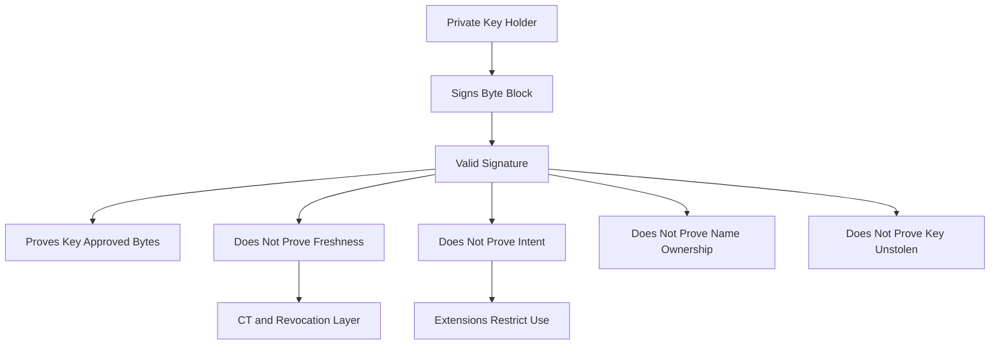

# What a Signature Does Not Tell You: Freshness, Intent, and the Limits of 'Signed'

## English

A valid signature on a certificate proves a narrow, precise thing: the holder of a particular private key approved a particular block of bytes. It does not prove the certificate is recent, that the name inside it is currently assigned to you, that the key has not been stolen, or that the issuer intended this exact use. Understanding these limits is what separates someone who can read a certificate from someone who can reason about a PKI incident.

Freshness is the clearest gap. A signature has no timestamp baked into the cryptography; validity comes from the `notBefore` and `notAfter` fields, which are simply data covered by the signature. A certificate signed five years ago and one signed yesterday look identical in structure. Certificate Transparency addresses part of this by publishing certificates to append-only logs with timestamps, so mis-issuance becomes visible, but CT is an audit mechanism layered on top, not something the signature itself provides. Revocation is the other half: a signature remains mathematically valid after a key is compromised, which is why CRLs, OCSP, and short lifetimes exist.

Intent is subtler. The signature says the CA approved these bytes; the extensions say what the certificate may be used for. Key usage and extended key usage restrict whether a certificate can act as a TLS server, a client, a code-signing key, or a CA. Without those constraints, a certificate issued for one purpose could be reused for another. This is why a well-run CA refuses to issue a certificate whose requested extensions do not match the validated request, and why clients check extensions rather than trusting the name alone.

Name binding has its own gap. The signature binds a public key to a subject name, but the CA's verification of that name is a policy process, not a cryptographic one. Domain validation proves control of a DNS name at a moment in time; it does not prove the entity behind it is who you think. Organisation validation adds identity checks, but the certificate still only asserts what the CA checked, under its own rules. When you see a padlock, you are seeing 'a trusted CA followed its procedures for this name', not 'this website is honest'.

Practically, this means you should never treat 'the signature verifies' as the end of the question. Ask: is the certificate inside its validity window, is the chain anchored in my trust store, do the extensions permit this use, has revocation been checked or is the lifetime short enough to make it moot, and does the name match what I intended to reach? Each is a separate check, and each can fail independently. The signature is the foundation, not the whole building.

## 中文

憑證上一個有效的簽章，只證明一件狹窄而精確的事：某把特定私鑰的持有者，同意了某一段特定的位元組。它不證明這張憑證是新的、不證明裡面的名字現在仍屬於你、不證明金鑰沒被偷、也不證明發行者意圖讓它作這個用途。理解這些限制，正是「會讀憑證」與「能推理 PKI 事故」之間的差別。

新鮮度是最明顯的缺口。簽章的密碼學裡沒有內建時間戳；有效期來自 `notBefore` 與 `notAfter` 兩個欄位，而它們只是被簽章涵蓋的資料。五年前簽的憑證與昨天簽的憑證，結構上看起來一模一樣。憑證透明度（Certificate Transparency）部分補上了這點：它把憑證發布到只可追加、帶時間戳的日誌，讓錯誤簽發變得可見；但 CT 是疊在上面的稽核機制，不是簽章本身提供的東西。撤銷是另一半：金鑰外洩之後，簽章在數學上依然有效，這正是 CRL、OCSP 與短有效期存在的理由。

意圖更微妙。簽章表示 CA 同意了這些位元組；擴充欄位則表示這張憑證可以被用來做什麼。key usage 與 extended key usage 限制它能否當 TLS 伺服器、用戶端、程式碼簽署金鑰或 CA。沒有這些限制，為某用途簽發的憑證就可能被挪作他用。這就是為什麼管理良好的 CA 會拒絕簽發擴充欄位與已驗證請求不符的憑證，也是為什麼用戶端要檢查擴充欄位，而不是只信名字。

名字綁定也有缺口。簽章把公鑰綁到主體名稱，但 CA 對該名稱的驗證是政策流程，不是密碼學流程。網域驗證只證明某個時間點對某個 DNS 名稱有控制權；它不證明背後那個實體就是你想的那個人。組織驗證加上身分查核，但憑證仍然只斷言「CA 依自己的規則查過什麼」。當你看到鎖頭圖示，你看到的是「某個受信任的 CA 依程序處理了這個名字」，不是「這個網站很誠實」。

實務上，這代表你絕不該把「簽章驗證通過」當成問題的終點。要問：憑證在有效期內嗎？鏈是否錨定在我的信任儲存區？擴充欄位允許這個用途嗎？撤銷檢查過了嗎，還是有效期短到不必檢查？名字符合我原本要連的目標嗎？每一項都是獨立檢查，每一項都可以單獨失敗。簽章是地基，不是整棟建築。

## Key Takeaway

A signature only proves a key holder approved some bytes; freshness, permitted use, name ownership, and revocation status are separate checks that can each fail on their own.

## Related Concepts
- Certificate Transparency
- Revocation checking

## Diagram

