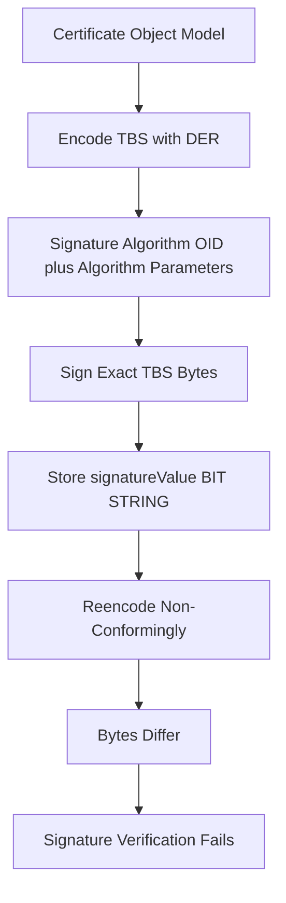

# Encoding the Signature: BIT STRING, NULL Parameters, and Why Byte-Exactness Matters

## English

A certificate is not a bag of text fields; it is an ASN.1 structure encoded with DER (Distinguished Encoding Rules), a canonical binary format where every value has exactly one legal byte representation. The signature lives in a field called signatureValue, typed as a BIT STRING, and the algorithm identifier sits in a separate field called signatureAlgorithm. The subtle trap is that these two fields must agree exactly, and the algorithm identifier itself is a SEQUENCE of an OID plus optional parameters. The parameters field depends on the algorithm: for the rsaEncryption algorithm identifier it is conventionally an explicit ASN.1 NULL (RFC 4055 section 5); for RSASSA-PSS it must be present and carries RSASSA-PSS-params rather than a NULL (RFC 4055 section 3.1); and for ECDSA the parameters field is normally absent entirely (RFC 5758 section 3.2). If a certificate is re-encoded into a different but semantically equivalent ASN.1 representation — which only a non-conforming or lossy encoder will produce, since DER admits one encoding per value — the bytes change and the signature no longer verifies, even though every human-readable field looks identical.

This is why tooling that 'cleans up' a certificate is dangerous. Converting PEM to DER and back is safe only if the base64 payload is passed through untouched, because PEM is just base64 of the DER bytes wrapped in BEGIN/END lines. But if you parse a certificate into an object model and then serialise it again, a conforming DER serializer must reproduce the identical bytes for the identical input — that is what DER's canonicality guarantees. Different bytes only appear if the encoder is non-conforming (BER instead of DER) or lossy (dropping or normalising fields it did not preserve faithfully), for example a different length encoding, a different ordering of SET OF members, or a normalised string type. The signature is computed over the exact TBS bytes as they appeared, so any re-encoding that changes those bytes invalidates it. A useful mental model: the signature is a wax seal pressed onto a specific sheet of paper, not onto the sentences written on it.

A practical way to see this is to compare a certificate's DER bytes before and after any transformation. Hashing the DER file with something like sha256sum gives a fingerprint you can compare. If two files that 'should be the same certificate' produce different hashes, you have an encoding difference, not a signature difference. This is also why certificate fingerprints are quoted over DER and never over PEM: PEM carries line breaks and header text that are not part of the signed object at all.

There is a second-order consequence for interoperability. Some older or sloppy implementations emit the rsaEncryption algorithm identifier without the NULL parameter. Most verifiers tolerate this, but strict ones reject it, and the resulting certificate may verify in one stack and fail in another. When you debug 'this certificate works in curl but not in my Java client', encoding-level differences in the algorithm identifier and in string types (PrintableString versus UTF8String for a common name) are frequent culprits. Inspecting the raw ASN.1 with a dumper, rather than only the pretty-printed summary, is often the fastest route to the answer.

## 中文

憑證並不是一堆文字欄位的集合，而是一個用 ASN.1 結構描述、再以 DER（Distinguished Encoding Rules，可辨識編碼規則）編碼的二進位物件。DER 是一種正規化格式：每一個值只有唯一一種合法的位元組表示法。簽章本身存放在名為 signatureValue 的欄位，型別是 BIT STRING；而演算法識別碼則放在另一個名為 signatureAlgorithm 的欄位。微妙之處在於：這兩個欄位必須完全一致，而演算法識別碼本身又是一個 SEQUENCE，內容是 OID 加上可選的參數。參數欄位視演算法而定：對 rsaEncryption 演算法識別碼，慣例上是一個明確的 ASN.1 NULL（RFC 4055 第 5 節）；對 RSASSA-PSS，參數欄位必須存在，而且載的是 RSASSA-PSS-params，不是 NULL（RFC 4055 第 3.1 節）；對 ECDSA 則通常完全省略參數欄位（RFC 5758 第 3.2 節）。如果你把憑證重新編碼成另一種語意等價、但位元組不同的 ASN.1 表示法——而只有不符合規範或有損失的編碼器才會產生這種結果，因為 DER 對每個值只容許一種編碼——位元組就變了，簽章便無法通過驗證，即使所有人類可讀的欄位看起來一模一樣。

這就是為何「幫你整理乾淨」憑證的工具很危險。PEM 轉 DER 再轉回來之所以安全，前提是 base64 內容原封不動地搬過去——PEM 只不過是把 DER 位元組做 base64 再包上 BEGIN/END 標頭。但如果你把憑證解析成物件模型、再序列化出來，一個符合規範的 DER 序列化器必須為相同的輸入重現完全相同的位元組——這正是 DER 正規性所保證的。位元組之所以會出現差異，只可能是編碼器不符合規範（例如用了 BER 而非 DER），或者編碼過程有損失（例如遺漏了欄位，或將它們正規化），例如不同的長度編碼方式、SET OF 成員的不同排序，或把字串型別正規化。簽章是對「當時那串 TBS 位元組」計算的，所以任何改變了那些位元組的重新編碼都會令簽章失效。一個好用的比喻：簽章是壓在某一張特定紙張上的火漆印，而不是壓在紙上那些句子上。

想親眼看到這件事，可以比較任何轉換前後的 DER 位元組。用 sha256sum 之類的工具對 DER 檔案取雜湊，就得到可比較的指紋。如果兩個「應該是同一張憑證」的檔案產生不同雜湊，你面對的是編碼差異，而非簽章差異。這也是為何憑證指紋一律以 DER 計算、絕不以 PEM 計算：PEM 的換行與標頭文字根本不屬於被簽署的物件。

這件事還有第二層互通用後果。某些較舊或較馬虎的實作，在輸出 rsaEncryption 演算法識別碼時會漏掉 NULL 參數。多數驗證器會容忍，但嚴格的驗證器會直接拒絕，於是同一張憑證可能在一個堆疊上通過、在另一個堆疊上失敗。當你排查「這張憑證在 curl 可以用，在我那個 Java 客戶端卻不行」時，演算法識別碼的編碼差異，以及字串型別（common name 用 PrintableString 還是 UTF8String）的差異，都是常見元兇。直接觀察原始 ASN.1 結構，而不是只看美化後的摘要，往往是最快找到答案的路。

## Key Takeaway

A signature is bound to the exact DER bytes of the TBS: a conforming DER re-encode reproduces those bytes byte-for-byte, so any actual change to them — whether from a non-conforming encoder or from lossy re-serialisation — breaks verification even when every visible field is unchanged.

## Related Concepts
- ASN.1 DER encoding
- TBS certificate bytes

## Diagram

