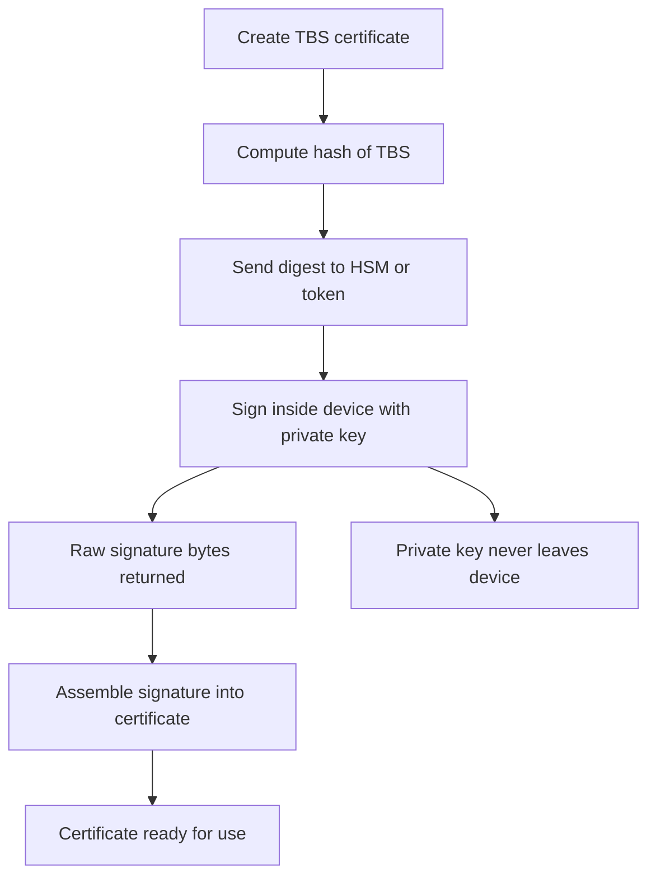

# Signing With a Hardware Token or HSM: Where the Key Lives and What Leaves the Box

## English

In every signing flow there is a moment when a hash of the TBS is turned into a signature using a private key. The security question is not 'which algorithm' but 'where does that private key physically live'. On a laptop the key might be a file readable by your user account; in a serious CA it lives inside an HSM (Hardware Security Module), a tamper-resistant appliance whose whole purpose is to perform signing operations without ever exporting the key material. The signature comes out; the key does not. Some HSMs are certified to standards such as FIPS 140-2 or FIPS 140-3 at particular security levels, which is a statement about physical and logical protections, not about the certificates they produce.

The practical consequence is that the signing API changes shape. Instead of reading a PEM private key and calling a library function, you send the digest or the TBS bytes to a device and ask it to sign, receiving raw signature bytes back. Many HSMs expose this through PKCS#11, a vendor-neutral C API, so tools that speak PKCS#11 can use any compliant device. You then need to assemble the signature into the certificate structure yourself, because the device has no idea what an X.509 certificate is — it only knows 'sign this digest with key handle 42 using RSA-PSS'.

A smaller-scale version of the same idea is a smart card or USB token holding a personal signing key. The key is generated on the device and marked non-exportable; the host machine can request signatures but cannot copy the key out. This is why a stolen laptop does not necessarily mean a stolen signing key, and why revocation of such a key requires physically revoking the token or asking the CA to revoke the certificate. It also explains a common operational headache: if the token is lost, the certificate must be revoked, because there is no backup copy of the key to restore.

For a test CA on your own machine, the pragmatic choice is a software key with restrictive file permissions, ideally inside an encrypted volume, and ideally a passphrase-protected key file. That is weaker than an HSM but honest about its threat model: it protects against casual access and accidental commits, not against an attacker with root. The important discipline is to keep the signing key separate from the certificate and from the CSR, and to keep it out of version control and out of build artefacts entirely.

One more wrinkle: HSMs and tokens often enforce their own algorithm policies. A device may refuse SHA-1 signatures, refuse keys below a certain size, or require a specific padding mode. When a signing request fails with an opaque device error, the cause is frequently a policy mismatch rather than a bug in your code. Reading the device's audit log, if it has one, is usually more informative than reading your application's stack trace.

## 中文

在每一個簽署流程裡，都存在一個時刻：TBS 的雜湊值被某把私鑰轉換成簽章。真正的安全問題不是「用哪種演算法」，而是「那把私鑰實體上放在哪裡」。在筆記型電腦上，金鑰可能只是一個你的使用者帳戶讀得到的檔案；在認真的 CA 裡，金鑰住在 HSM（Hardware Security Module，硬體安全模組）之內——一台防篡改的設備，它的存在意義就是執行簽署運算而永不匯出金鑰材料。出來的只有簽章，金鑰不會出來。部分 HSM 會依 FIPS 140-2 或 FIPS 140-3 的特定安全等級取得認證，那是對其物理與邏輯防護的聲明，與它簽出的憑證本身無關。

實際後果是簽署 API 的形狀改變了。你不再讀取 PEM 私鑰再呼叫函式庫函式，而是把摘要或 TBS 位元組送進裝置、要求它簽署，然後拿回原始簽章位元組。許多 HSM 透過 PKCS#11 這個廠商中立的 C 語言 API 提供服務，所以會說 PKCS#11 的工具就能用任何相容裝置。接著你要自己把簽章組裝進憑證結構，因為裝置根本不知道什麼是 X.509 憑證——它只知道「用編號 42 的金鑰、以 RSA-PSS 簽這個摘要」。

同一個概念的小型版本，就是搭載個人簽署金鑰的智慧卡或 USB token。金鑰在裝置內生成並標記為不可匯出；主機能請求簽章，卻無法把金鑰複製出來。這就是為何筆記型電腦被偷不一定等於簽署金鑰被偷，也是為何這類金鑰的撤銷需要實體撤銷 token 或請 CA 撤銷憑證。它也解釋了一個常見的維運頭痛問題：token 遺失就必須撤銷憑證，因為金鑰沒有備份可還原。

若是在自己機器上跑測試 CA，務實做法是用軟體金鑰、加上嚴格的檔案權限，最好放在加密磁碟區內，並且最好有密碼保護。這比 HSM 弱，但對其威脅模型是誠實的：它能防 casual 存取與誤入版本控制，防不了已取得 root 的攻擊者。重要的紀律是：把簽署金鑰與憑證、與 CSR 分開存放，並且完全不要讓它進入版本控制或建置產物。

還有一個小陷阱：HSM 與 token 往往有自己的演算法政策。裝置可能拒絕 SHA-1 簽章、拒絕低於某個長度的金鑰、或要求特定填充模式。當簽署請求以一個看不懂的裝置錯誤失敗時，原因常常是政策不匹配，而不是你的程式有 bug。若裝置有稽核日誌，讀它通常比讀應用程式的堆疊追蹤更有用。

## Key Takeaway

The decisive design question in certificate signing is where the private key physically resides, and HSMs or tokens change the API from 'read key and sign' to 'send digest, receive signature'.

## Related Concepts
- Hardware Security Module
- PKCS#11

## Diagram

