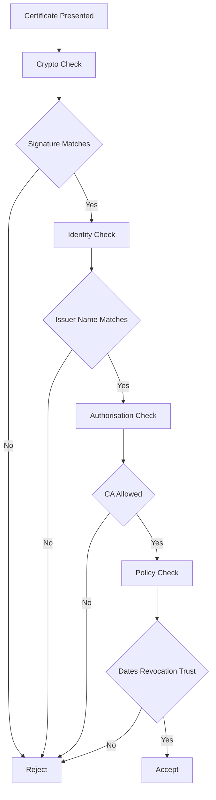

# Verifying a Signature Yourself: The Four Checks Behind 'Certificate Is Valid'

## English

When a TLS client accepts a certificate, it is not doing one check but a small pipeline of checks, and understanding the pipeline makes debugging far easier. The first is cryptographic: take the issuer's public key, recompute the hash over the TBS bytes using the algorithm named in signatureAlgorithm, and compare with the decrypted signatureValue. If that fails, nothing else matters — the certificate was altered or signed by a different key than the one you are testing against. The second is identity: does the issuer name in this certificate match the subject name of the certificate you believe issued it? A valid signature from a key that does not belong to the claimed issuer is still a failure.

The third check is authorisation: is the issuer actually allowed to sign this kind of certificate? That is where basic constraints (isCA) and key usage (keyCertSign) come in, along with name constraints that may forbid certain namespaces. A signature can be mathematically perfect and still be rejected because the signing certificate was not permitted to act as a CA, or because the subject name falls outside a permitted subtree. The fourth check is policy: validity dates against the current clock, revocation status, and whether the chain terminates in a root that the local trust store actually contains.

You can reproduce most of this by hand. Extract the issuer's certificate, extract the public key from it, and use OpenSSL's verify subcommand on the leaf with the issuer supplied as an untrusted certificate (`-untrusted issuer.pem`). Note that this alone will not produce a successful verification: the issuer is only an intermediate, and OpenSSL has no trusted anchor for it, so the run ends with an error such as 'unable to get local issuer certificate'. You must either point OpenSSL at a trust anchor explicitly (`-CAfile issuer.pem`, treating the issuer as the trusted root) or add `-partial_chain` so that the supplied untrusted certificate can act as the trust anchor for a partial chain. With verbose output (`-verbose`) you can see each step of chain building. To look even closer, dump the TBS portion and the signature separately and check that the bytes you are hashing are exactly the ones the CA signed — this is where re-encoding mistakes show up as spurious failures.

A common beginner confusion is treating 'the signature verifies' as 'the certificate is trustworthy'. Verification only proves that whoever holds the issuer's private key approved these exact contents. It says nothing about whether that issuer should be trusted, whether the name is one you meant to connect to, or whether the certificate has since been revoked. Those are separate questions answered by the trust store, by hostname matching, and by revocation checking respectively.

In practice, error messages collapse these four checks into one line, which is why 'certificate verify failed' is so unhelpful. The productive habit is to ask, in order: does the signature verify against the named issuer, is the issuer a CA, is the chain complete up to a trusted root, and are the dates and revocation status acceptable? Answering them one at a time turns a vague failure into a specific, fixable defect.

## 中文

當 TLS 客戶端接受一張憑證時，它做的不是單一檢查，而是一條小小的檢查流水線；理解這條流水線，除錯會容易得多。第一關是密碼學檢查：拿簽發者的公鑰，用 signatureAlgorithm 指名的演算法對 TBS 位元組重新計算雜湊，再與解密後的 signatureValue 比對。這一關若失敗，其他都不用談——憑證被改過，或是被另一把金鑰簽的，而不是你正在測試的那把。第二關是身分：這張憑證裡的簽發者名稱，是否與你相信簽發了它的那張憑證的主體名稱相符？用一把不屬於所宣稱簽發者的金鑰做出的有效簽章，仍然是失敗。

第三關是授權：簽發者到底有沒有資格簽這種憑證？這就輪到 basic constraints（isCA）與 key usage（keyCertSign）上場，還有可能禁止某些命名空間的 name constraints。一個簽章可以在數學上完美無瑕，卻因為簽發憑證不被允許擔任 CA，或因為主體名稱落在允許子樹之外而被拒絕。第四關是政策：有效日期對照目前時鐘、撤銷狀態，以及鏈條是否終止於本機信任儲存庫確實包含的根憑證。

這四關大多可以手工重現。取出簽發者的憑證、從中取出公鑰，然後用 OpenSSL 的 verify 子命令，把簽發者當作 untrusted 憑證一併供給（`-untrusted issuer.pem`），對 leaf 做驗證。要留意的是，單靠這樣並不會驗證成功：簽發者只是中間憑證，OpenSSL 手上並沒有屬於它的信任錨點，所以結果會以類似 'unable to get local issuer certificate' 的錯誤收場。你必須明確指定信任錨點（`-CAfile issuer.pem`，把簽發者當成受信任的根），或者加上 `-partial_chain`，讓你提供的 untrusted 憑證可以作為部分鏈條的信任錨點。加上詳細輸出（`-verbose`），就能看到鏈條建立的每一步。想看得更細，可以把 TBS 部分與簽章分開傾印，確認你正在雜湊的位元組正是 CA 當初簽的那串——重新編碼的錯誤就是在這裡現形為莫名其妙的失敗。

初學者常見的混淆，是把「簽章通過驗證」當成「這張憑證值得信任」。驗證只證明：持有簽發者私鑰的一方，批准了這些確切的內容。它完全沒說那個簽發者應不應該被信任、這個名字是不是你想連上的那一個、或這張憑證後來有沒有被撤銷。那些是另外的問題，分別由信任儲存庫、主機名比對、撤銷檢查來回答。

實務上，錯誤訊息往往把這四關壓成一行，這就是為何「certificate verify failed」如此沒用。有生產力的習慣是依序自問：簽章對所指名的簽發者是否通過？該簽發者是不是 CA？鏈條是否完整地接到受信任的根？日期與撤銷狀態是否可接受？一次回答一個，就能把模糊的失敗變成具體、可修的缺陷。

## Key Takeaway

A certificate 'validating' is really four independent checks — signature, issuer identity, signing authority, and policy — and separating them turns vague errors into specific fixes.

## Related Concepts
- Chain building
- Trust store

## Diagram

