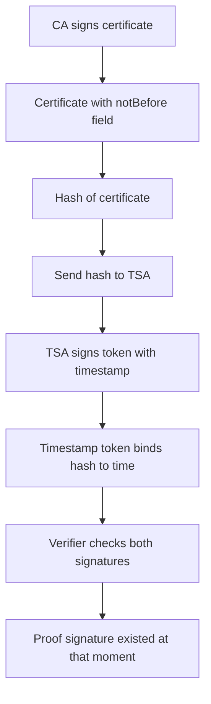

# Time-Stamping the Signature: How a Certificate Proves When It Was Made

## English

A certificate's validity window tells you when it may be used, but it does not, by itself, prove when it was actually signed. This matters because a CA's signing key might be compromised at some later date, and an attacker who obtains that key could mint a certificate with a backdated notBefore field. The defence is a timestamp: a trusted Time-Stamping Authority (TSA) can sign a token that binds a hash of the certificate to a specific moment. The token is itself a signed structure, so a verifier can check that the CA's signature on the certificate existed before the TSA's key was compromised. The relevant standard is RFC 3161, which defines the Time-Stamp Protocol; the token is a CMS SignedData object wrapping a TSTInfo structure. Without a trusted timestamp, the best you can say is that the certificate claims a notBefore date, which is a self-asserted field and therefore not a proof of anything. In practice, long-lived signatures (code signing, document signing, PDFs) rely on RFC 3161 tokens precisely because the signing key's own certificate may expire long before the signed artefact stops mattering. The lesson is that a signature is only as trustworthy as the evidence that it existed at a particular moment, and that evidence has to come from somewhere other than the signer.

## 中文

一張憑證的有效期（notBefore 與 notAfter）只告訴你「這段時間內可以使用」，但本身並不證明它究竟是哪一刻被簽署的。這一點很重要，因為 CA 的簽署金鑰可能在某個較晚的時間點被洩漏；一旦攻擊者取得該金鑰，就可以鑄造一張把 notBefore 往回填的憑證。防禦手段就是時間戳（timestamp）：由受信任的時間戳授權機構（TSA, Time-Stamping Authority）簽發一個 token，把憑證的雜湊值綁定到某個具體時刻。這個 token 本身也是被簽署的結構，所以驗證者可以檢查「CA 對該憑證的簽章」是否早於「TSA 金鑰被洩漏」的時刻就已經存在。相關標準是 RFC 3161，它定義了時間戳協定（Time-Stamp Protocol）；token 是一個 CMS SignedData 物件，內含 TSTInfo 結構。沒有可信時間戳的話，你最多只能說「憑證聲稱了一個 notBefore 日期」——那是自我聲明的欄位，本身不構成任何證明。在實務上，長壽命的簽章（程式碼簽章、文件簽章、PDF）正是依賴 RFC 3161 token，因為簽署金鑰本身的憑證，往往在被簽署的產物仍然重要之前就已經過期。教訓是：一個簽章的可信度，取決於「它在某個時刻確實存在」的證據，而這份證據必須來自簽署者以外的地方。

## Key Takeaway

A signature proves authorship, but only a trusted timestamp proves the signature existed before the signer's key was compromised or expired.

## Related Concepts
- RFC 3161 Time-Stamp Protocol
- Non-repudiation in long-lived signatures

## Diagram

