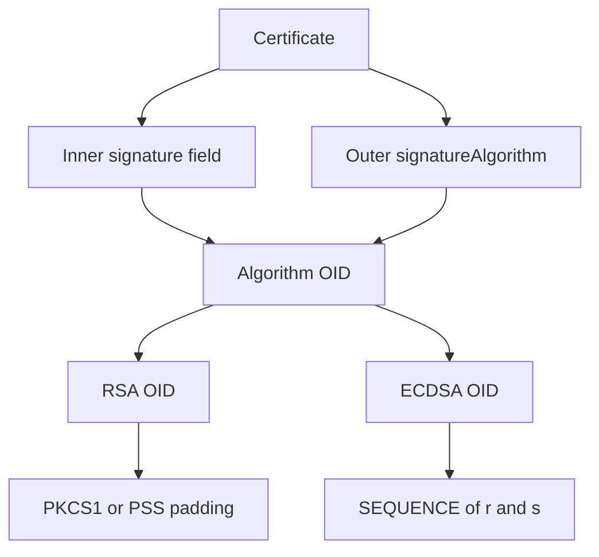

# The Signature Algorithm Inside the Certificate: What the OID Actually Selects

## English

Every X.509 certificate carries two algorithm identifiers: one in the tbsCertificate (the inner signature field) and one in the outer signatureAlgorithm. These must agree, and the pair selects exactly how the CA's signature was produced. The identifier is an ASN.1 Object Identifier (OID), a dotted-decimal string that names a specific algorithm. For example, sha256WithRSAEncryption is 1.2.840.113549.1.1.11, and ecdsa-with-SHA256 is 1.2.840.10045.4.3.2. The OID does not merely say "RSA" or "ECDSA"; it fixes the hash function, the padding scheme, and the encoding of the signature value. When the algorithm is RSA-based, the signature field is a BIT STRING whose contents are an OCTET STRING containing the PKCS#1 v1.5 or PSS encoded block. When it is ECDSA, the BIT STRING wraps an ASN.1 SEQUENCE of two INTEGERs, r and s. This is why a verifier cannot simply hash the TBS bytes and compare: it must first parse the algorithm OID, then apply the matching padding and encoding rules. A common mistake is to assume that any RSA key can verify any RSA signature; in fact, an RSA-PSS signature will not verify under a PKCS#1 v1.5 rule, even with the same key and hash. The OID is the contract that tells the verifier exactly which mathematical recipe to follow.

## 中文

每一張 X.509 憑證都帶有兩個演算法識別碼：一個在 tbsCertificate 內（內層的 signature 欄位），另一個在外層的 signatureAlgorithm。兩者必須一致，而這一對識別碼就決定了 CA 的簽章究竟是用什麼方式產生的。這個識別碼是一個 ASN.1 物件識別碼（OID, Object Identifier），也就是以點分隔的數字字串，用來指名某個特定演算法。例如 sha256WithRSAEncryption 是 1.2.840.113549.1.1.11，而 ecdsa-with-SHA256 是 1.2.840.10045.4.3.2。OID 不只是說「RSA」或「ECDSA」而已；它同時固定了雜湊函數、填充（padding）方案，以及簽章值的編碼方式。當演算法是 RSA 系列時，signature 欄位是一個 BIT STRING，其內容是一個 OCTET STRING，裡面裝著 PKCS#1 v1.5 或 PSS 編碼後的區塊。當演算法是 ECDSA 時，BIT STRING 包住的是一個 ASN.1 SEQUENCE，內含兩個 INTEGER：r 與 s。這就是為什麼驗證者不能只是把 TBS 位元組雜湊後直接比對：它必須先解析演算法 OID，再套用對應的填充與編碼規則。常見的錯誤是以為「任何 RSA 金鑰都能驗證任何 RSA 簽章」；事實上，RSA-PSS 簽章在 PKCS#1 v1.5 的規則下是驗不過的，即使金鑰與雜湊都相同。OID 就是那份契約，告訴驗證者該遵循哪一套數學配方。

## Key Takeaway

The algorithm OID inside a certificate is not a label but a full recipe: it fixes the hash, the padding, and the byte encoding the verifier must use.

## Related Concepts
- ASN.1 Object Identifiers
- RSA-PSS versus PKCS#1 v1.5 padding

## Diagram

