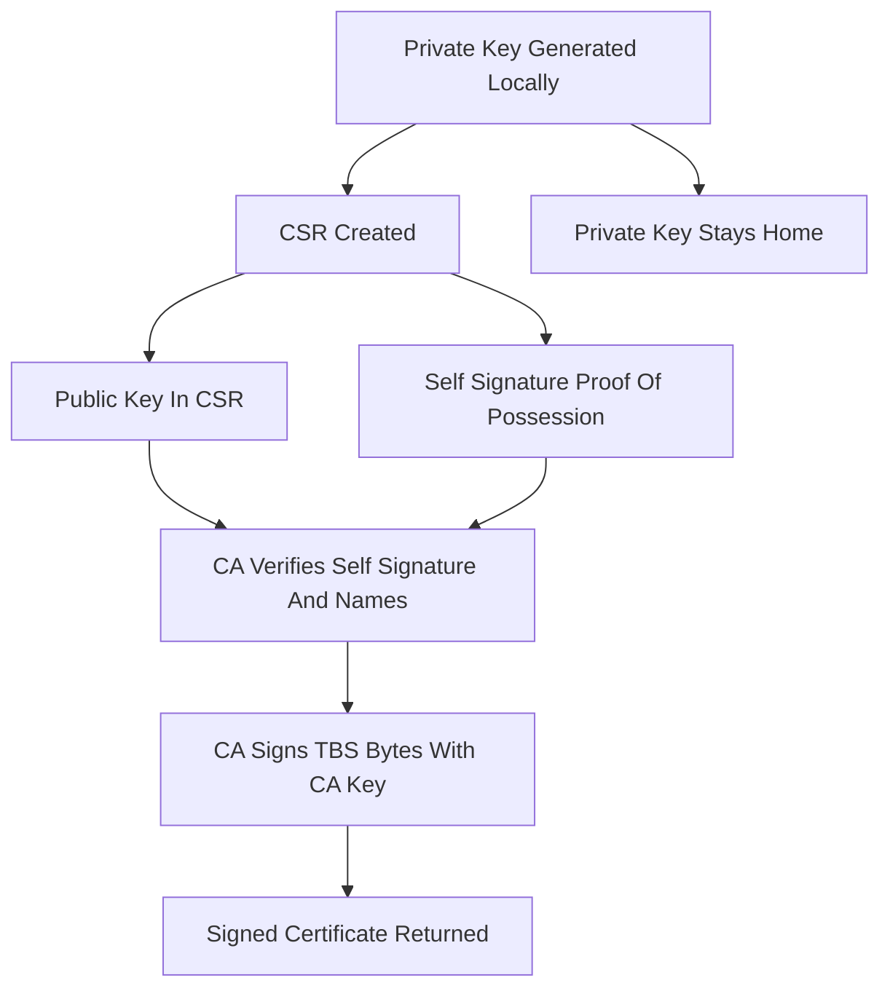

# Signing in the Browser Age: Why the CA Never Sees Your Private Key

## English

A frequent misconception is that the CA "signs your key" or that you send your private key to the CA for signing. In reality, the private key never leaves your control. The CSR (Certificate Signing Request) contains your public key and a self-signature made with the matching private key; that self-signature is the proof-of-possession that demonstrates you hold the private half. The CA verifies the self-signature, checks that the requested names are ones you are entitled to, and then issues a certificate whose SubjectPublicKeyInfo is a copy of your public key. The CA's own private key is used only to sign the TBS bytes of the new certificate. This separation is deliberate: if the CA ever held your private key, it could impersonate you, decrypt past traffic (in the case of RSA key exchange), and become a single point of catastrophic failure. It is also why the private key must be generated locally, ideally inside a hardware security module (HSM) or a trusted platform module (TPM), so that even the machine running the web server never exposes the raw key material. The CSR is therefore a one-way street: public key and proof of possession go out, a signed certificate comes back, and the private key stays home. Understanding this boundary is what makes the difference between a secure deployment and one where a single compromised CA or a misconfigured backup can undo everything.

## 中文

一個常見的誤解是：以為 CA 會「幫你的金鑰簽章」，或者以為你要把私鑰送給 CA 才能簽署。實際上，私鑰永遠不會離開你的掌控。CSR（憑證簽署請求）裡面裝的是你的公鑰，以及用對應私鑰產生的一個自我簽章；那個自我簽章就是「持有證明」（proof of possession），用來證明你確實握有私鑰那一半。CA 會驗證這個自我簽章、確認你申請的名稱是你有權使用的，然後簽發一張憑證，其 SubjectPublicKeyInfo 就是你公鑰的複本。CA 自己的私鑰只用在一個地方：對新憑證的 TBS 位元組簽章。這種分離是刻意設計的：如果 CA 曾經持有你的私鑰，它就能冒充你、解密過去的流量（在 RSA 金鑰交換的情況下），並且成為一個災難性的單點故障。這也是為什麼私鑰必須在本機產生，最好是在硬體安全模組（HSM）或受信任平台模組（TPM）之內產生，這樣即使是跑 Web 伺服器的那台機器，也從不暴露原始金鑰材料。因此 CSR 是一條單行道：公鑰與持有證明送出去，簽好的憑證送回來，而私鑰留在家裡。理解這條界線，正是「安全部署」與「一個被攻破的 CA 或一份設定錯誤的備份就能全盤皆輸」之間的差別。

## Key Takeaway

The CA signs a certificate about your public key; it never needs, and must never receive, your private key.

## Related Concepts
- Proof of possession in CSRs
- Hardware security modules and key custody

## Diagram

