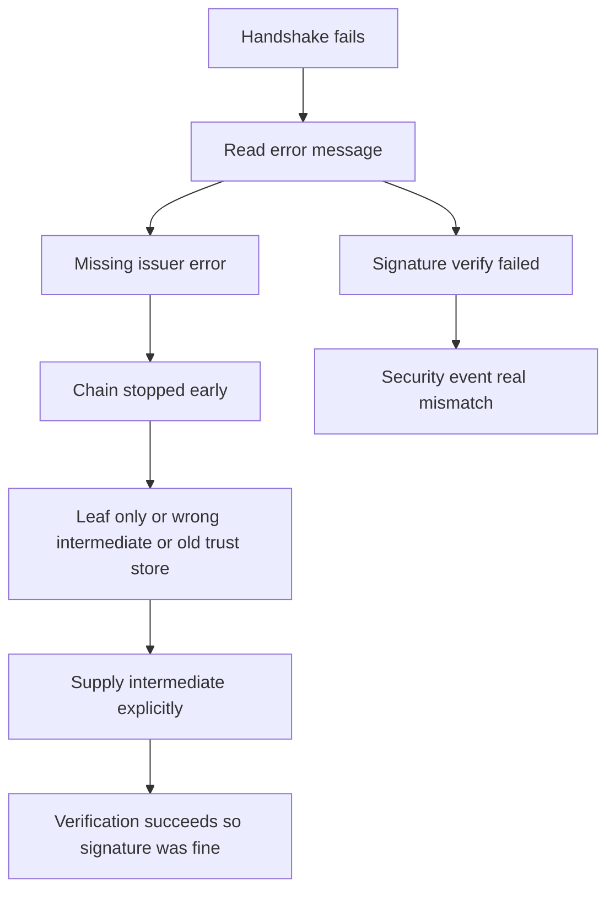

# What Happens When the CA's Signature Fails to Verify: Diagnosing a Broken Chain

## English

When a TLS handshake fails with an error like 'unable to get local issuer certificate' or 'certificate verify failed', the problem is almost never that the server's own signature is forged. The server certificate's signature was checked against the public key of whatever issuer the client was told to use, and that check succeeded or failed on its own. What usually breaks is the next link: the client could not find a trusted copy of the issuer's own certificate, so it had no public key to check against in the first place. The error is a statement about missing material, not about tampering.

The distinction matters because the two failures demand completely different fixes. A genuine signature mismatch means the bytes of the TBS (to-be-signed) portion no longer hash to the value inside the signature, or the signature was made with a key that does not correspond to the issuer named in the certificate. That is a security event. A missing-issuer error means the chain simply stopped early: the server sent a leaf and nothing else, or it sent the wrong intermediate, or the client's trust store is older than the CA hierarchy it is being asked to validate.

A practical way to separate them is to run a verification with the intermediate supplied explicitly. With OpenSSL you can point at a file containing the intermediate and root and ask for the chain to be built and checked; if that succeeds while the bare handshake fails, the signature was fine all along and only the delivery of intermediates was wrong. Reading the output line by line tells you which link failed, because OpenSSL reports the depth at which verification stopped. Depth 0 is the leaf, depth 1 is its issuer, and so on up to the root.

Another common variant is a chain that verifies but is rejected for a non-signature reason: an expired intermediate, a name constraint violated somewhere up the chain, or a certificate whose key usage forbids the purpose being attempted. These are all reported through the same broad 'verify failed' banner, which is why the error string alone is not a diagnosis. The habit worth building is to treat 'signature invalid' and 'chain incomplete' as two different worlds and to confirm which one you are in before changing anything.

Finally, remember that a client's trust store is a snapshot. A server can be perfectly configured and still fail for one client whose bundle predates a root rollover. When you debug, always state which trust store you are testing against, because 'it works in my browser' is a claim about one particular set of anchors, not about the certificate itself.

## 中文

當 TLS 握手失敗，出現「unable to get local issuer certificate」或「certificate verify failed」之類的錯誤時，問題幾乎從來不是伺服器本身的簽章被偽造。伺服器憑證的簽章，是拿客戶端被指示去使用的簽發者公鑰來驗證的，那個檢查本身成功或失敗是獨立的一件事。真正斷掉的通常是下一環：客戶端找不到它所信任的簽發者憑證副本，所以它從一開始就沒有公鑰可以拿去比對。這個錯誤講的是「材料缺失」，不是「有人動過手腳」。

這個區別很重要，因為兩種失敗需要完全不同的處理方式。真正的簽章不符，代表 TBS（to-be-signed，待簽署部分）的位元組算出來的雜湊，已經對不上簽章裡記錄的值，或者簽章是用一把與憑證所列簽發者不相對應的私鑰簽出來的。那是安全事件。而「找不到簽發者」的錯誤，只代表鏈提早結束：伺服器只送了 leaf 什麼都沒送、送錯了中繼憑證，或者客戶端的信任儲存比它被要求驗證的 CA 階層還要舊。

要分辨兩者，實務上可以把中繼憑證明確喂進去再驗一次。用 OpenSSL 可以指向一個含有中繼與根憑證的檔案，要求它建鏈並檢查；如果這樣會成功、而裸握手會失敗，那就表示簽章從頭到尾都沒問題，錯的只是中繼憑證的傳遞。逐行讀輸出可以告訴你是哪一環斷了，因為 OpenSSL 會回報驗證停在哪個 depth。Depth 0 是 leaf，depth 1 是它的簽發者，如此類推到根。

另一個常見的變體，是鏈其實驗得過、卻因為非簽章的理由被拒：某個中繼憑證過期、鏈上某處違反了名稱約束，或者某張憑證的 key usage 不允許當下想做的用途。這些全都會透過同一個籠統的「verify failed」訊息呈現，所以光看錯誤字串並不構成診斷。值得養成的習慣，是把「簽章無效」與「鏈不完整」當成兩個不同的世界，在動手改任何東西之前先確認自己身處哪一個。

最後要記得，客戶端的信任儲存只是一個快照。伺服器可以設定得完美無缺，卻仍然對某個根憑證輪替之前就打包好的客戶端失敗。除錯時永遠要講清楚你是對哪一個信任儲存做測試，因為「我的瀏覽器可以」講的是某一組特定的錨點，而不是憑證本身。

## Key Takeaway

Most 'certificate verify failed' errors mean the chain stopped early, not that a signature was forged, so confirm which link is missing before touching anything.

## Related Concepts
- Trust store anchors
- Chain building (depth 0 to root)

## Diagram

