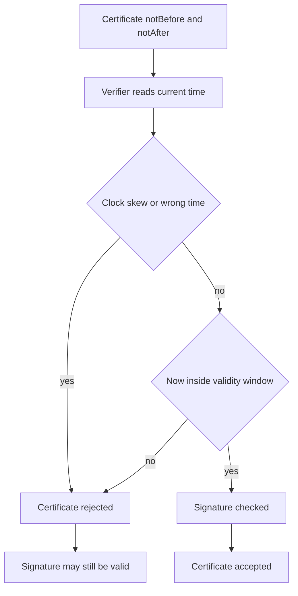

# Clock Skew and Validity Windows: Why a Correct Signature Can Still Be Rejected

## English

A certificate carries two timestamps, notBefore and notAfter, and a verifier checks the current time against them. The signature over those timestamps can be perfectly valid and the certificate still rejected, because validity is a statement about when the signature is allowed to count, not about whether it is genuine. This is the cleanest example of why 'signed' and 'acceptable right now' are separate properties.

The obvious cause is a wrong system clock. A machine whose clock drifted years forward will treat every freshly issued certificate as not yet valid; one drifted backward will treat everything as expired. This is common on embedded devices that boot without a real-time clock, on virtual machines resumed from a long-paused snapshot, and on systems whose NTP client cannot reach a server because the network it needs is behind the very TLS connection it is trying to establish. That last case is a genuine chicken-and-egg problem, and it is why captive portals and first-boot provisioning are so often painful.

The subtler issue is the boundary itself. Validity is normally treated as an inclusive interval, but implementations differ on whether the exact instant of notAfter counts as valid, and a certificate that expires at a whole second can fail on one client and pass on another within the same second. When you are debugging an expiry, do not trust a human-readable date; compare the raw epoch values and remember that the certificate's times are in UTC, while your terminal may be printing local time. A certificate that looks like it expires 'tomorrow morning' may already be dead depending on your timezone offset.

Long-lived signatures complicate this further. A signature made years ago may have been valid when made, and the certificate may since have expired, yet the signature itself is still mathematically sound. Whether that matters depends on what you are doing: verifying a live TLS session cares about 'now', while checking an archived signed document cares about the moment of signing. Systems that need the latter use a trusted timestamp from a time-stamping authority so the verification can be anchored to a point in the past rather than to the present.

A practical habit is to treat any clock-sensitive failure as two questions: is the certificate's window correct, and is my clock correct? Check both before assuming the CA issued something wrong. And when you build systems that must validate certificates, decide deliberately whether you are validating at 'now' or at a recorded time, because those two checks will give different answers for the same bytes.

## 中文

一張憑證帶著兩個時間戳，notBefore 與 notAfter，驗證方會拿目前時間去比對。簽在這些時間戳上的簽章可以完全有效，憑證卻依然被拒絕，因為有效期限講的是「這個簽章什麼時候才准算數」，而不是「它是不是真的」。這正是「已簽署」與「此刻可接受」為何是兩個獨立屬性的最乾淨例子。

最明顯的原因是系統時鐘錯了。時鐘往前飄了幾年的機器，會把每一張剛簽發的憑證都當成「尚未生效」；往後飄的則會把一切都當成過期。這在沒有即時時鐘、開機時才開始對時的嵌入式裝置上很常見，在從長時間暫停的快照回復的虛擬機上很常見，在 NTP 客戶端連不到伺服器（因為它需要的網路正好在那條它想建立的 TLS 連線後面）的系統上也很常見。最後這種是真正的雞生蛋問題，這也是為什麼強制入口網頁（captive portal）與首次開機佈建總是那麼痛苦。

更細微的問題在邊界本身。有效期限通常被當成閉區間處理，但各家實作對於 notAfter 那一瞬間到底算不算有效並不一致，一張剛好在整秒過期的憑證，可能在同一秒內對某個客戶端失敗、對另一個客戶端通過。當你在查過期問題時，不要相信人看得懂的日期字串；去比對原始的 epoch 數值，並且記得憑證裡的時間是 UTC，而你的終端機可能印的是本地時間。一張看起來「明天早上」才過期的憑證，依你的時區偏移，可能早就死了。

長壽命的簽章會讓這件事更複雜。幾年前做的一個簽章，當年做的時候有效，憑證如今可能已經過期，但簽章本身在數學上依然成立。這要不要緊，取決於你在做什麼：驗證一條即時的 TLS 連線在意的是「現在」，而查核一份封存的已簽署文件在意的是簽署的那一刻。需要後者的系統會使用時間戳權威機構提供的受信任時間戳，讓驗證可以錨定在過去的某個時點，而不是現在。

值得養成的習慣，是把任何對時鐘敏感的失敗都拆成兩個問題：憑證的有效區間對不對，以及我的時鐘對不對？兩者都查過，再來假設是 CA 簽錯了東西。而當你在打造必須驗證憑證的系統時，要刻意決定你是在「現在」驗證，還是在某個記錄下來的時點驗證，因為同一堆位元組，這兩種檢查會給你不同的答案。

## Key Takeaway

A valid signature over an expired window is still a valid signature; validity is about when the signature counts, not whether it is real.

## Related Concepts
- notBefore and notAfter
- Trusted timestamping

## Diagram

