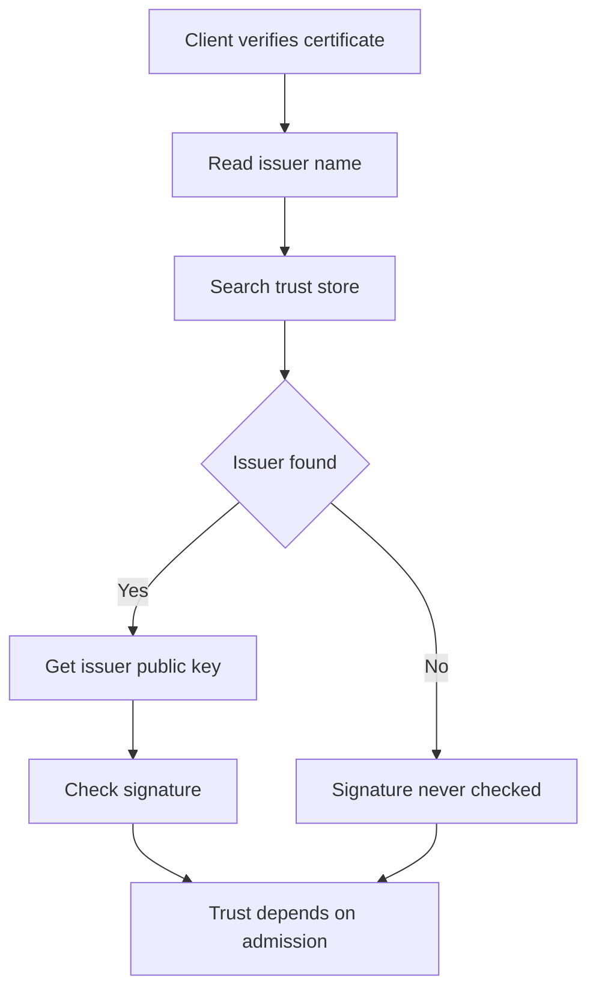

# Signing Is Cheap, Trust Is Expensive: Why a Perfect Signature Proves So Little

## English

Anyone with OpenSSL and five minutes can produce a certificate whose signature verifies flawlessly. The mathematics of signing is not a barrier; the barrier is being the entity whose signature a client is willing to check. This is the single most useful mental model for understanding why the whole PKI apparatus exists, and why a cryptographically perfect certificate can be worth nothing.

Think about what a verifier actually does. It looks at the issuer name in the certificate, searches its trust store for a certificate with that subject name, and if it finds one, uses that certificate's public key to check the signature. If the search fails, the signature is never even evaluated. So the real gate is a name lookup against a list the client already trusts. An attacker who signs their own certificate for any domain produces a signature that verifies against their own key, and that is exactly the point: it verifies against a key nobody trusts.

This is why the interesting part of certificate security is not the signing operation but the admission process. A CA's value is not that it can compute a signature, it is that browsers and operating systems ship with its root already installed, and that it follows rules about who it hands certificates to. Those rules are enforced socially and contractually, not mathematically. Nothing in the signature stops a CA from issuing a certificate for a domain it does not control; only its policies and the audits behind them do, which is why mis-issuance is a governance failure rather than a cryptographic one.

It also explains why self-signed certificates are perfectly fine in a lab and useless on the public internet. The signature is identical in structure; the difference is purely whether the verifier's trust store happens to contain the signer. When you install a self-signed certificate into a client's trust store, you are not making the signature stronger, you are adding a name to a list. That is a legitimate and common move inside an organisation, and it is also precisely what an attacker tries to trick a user into doing.

The practical consequence is that 'the certificate is valid' should always be read as shorthand for 'the certificate is valid relative to this particular trust store at this particular moment'. Change the store and the verdict changes. When reviewing any certificate setup, ask not just whether the signature verifies but whose signature it is, who decided to trust that signer, and how that decision gets revisited.

## 中文

任何人只要有 OpenSSL 和五分鐘，就能產出一張簽章驗得完美無瑕的憑證。簽章的數學不是門檻；門檻在於成為那個「客戶端願意去檢查其簽章」的實體。這是理解整個 PKI 機制為何存在、以及為何一張密碼學上完美的憑證可以一文不值，最有用的心智模型。

想想驗證方實際上做了什麼。它看憑證裡的簽發者名稱，在自己的信任儲存裡搜尋 subject 名稱相同的憑證，找到了，就用那張憑證的公鑰去檢查簽章。如果搜尋失敗，簽章根本不會被計算。所以真正的關卡，是拿一個名字去對照客戶端早就信任的清單。攻擊者為任何網域自簽一張憑證，會產出一個對自己的公鑰驗得過的簽章，而那正是重點所在：它是對一把沒有人信任的公鑰驗得過。

這就是為什麼憑證安全真正有趣的部分不是簽署動作，而是准入流程。一家 CA 的價值不在於它會算簽章，而在於瀏覽器與作業系統出廠時就已經裝好它的根憑證，而且它遵守「把憑證發給誰」的規則。那些規則靠社會與合約力量執行，不是靠數學。簽章本身攔不住一家 CA 去簽發某個它並不控制的網域的憑證；能攔住的只有它的政策與背後稽核，這也是為什麼誤發憑證是治理失敗，而不是密碼學失敗。

這也解釋了為什麼自簽憑證在實驗室裡完全夠用，在公網上卻毫無用處。簽章在結構上一模一樣；差別純粹在於驗證方的信任儲存裡剛好有沒有這個簽署者。當你把一張自簽憑證安裝進客戶端的信任儲存，你並不是讓簽章變強，你只是往清單裡加了一個名字。這在組織內部是正當且常見的做法，而這也恰恰是攻擊者會誘騙使用者去做的事。

實務上的結論是：「這張憑證有效」永遠該讀成「相對於這個特定的信任儲存、在這個特定的時刻，這張憑證有效」。換一個儲存，結論就換。審視任何憑證配置時，不要只問簽章驗不驗得過，要問那是誰的簽章、是誰決定信任那個簽署者、以及那個決定如何被重新檢視。

## Key Takeaway

A signature only means something relative to a trust store that already lists the signer, so the hard problem is admission, not arithmetic.

## Related Concepts
- Trust anchors
- Mis-issuance and governance

## Diagram

