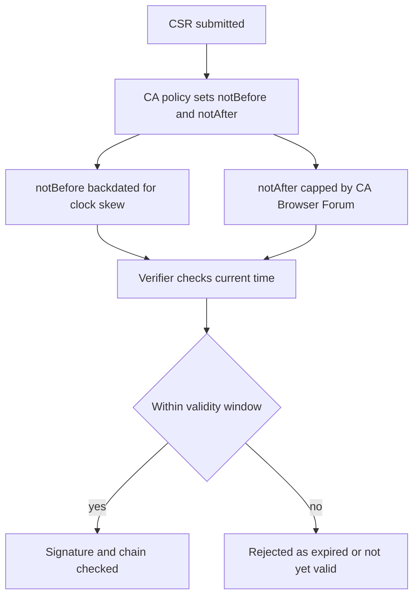

# The NotBefore and NotAfter Fields: Who Sets the Clock, and Why Your Server Can Be Right and Wrong at the Same Time

## English

Every X.509 certificate carries two timestamps, notBefore and notAfter, both encoded as UTCTime (for years up to 2049) or GeneralizedTime (from 2050 onward). A verifier checks the current time against these two bounds before it even looks at the signature. The subtle part is that the CA, not you, chooses these values. When you submit a CSR you cannot ask for a validity window; the CA's policy decides it, and the CA/Browser Forum Baseline Requirements cap the maximum lifetime of a publicly trusted TLS certificate. That cap has been shrinking over the years, which is why a certificate you issued two years ago may have a lifetime that would be illegal to issue today. The CA also backdates notBefore slightly, typically by an hour or so, to absorb clock skew between the CA's signing infrastructure and the rest of the world. Without that backdating, a client whose clock ran a few seconds fast would reject a brand-new certificate as 'not yet valid'.

This means the validity window is a policy artefact, not a statement about when the key was created. The key pair might be years old while the certificate is minutes old, or the certificate might be renewed long before the key is rotated. If you keep a private key and re-issue certificates around it, the timestamps move but the key does not, which is exactly the pattern that makes key rotation audits difficult.

The practical trap is that clock skew produces some of the most confusing error messages in TLS. A client with a clock set five minutes into the future will reject a valid certificate as 'expired' if the certificate expired four minutes ago in real time. A client ten minutes behind will reject a freshly issued certificate as 'not yet valid'. On Linux you can inspect the system clock with timedatectl and check whether NTP synchronisation is active; on servers, a container that inherits a stale clock from its host is a classic source of intermittent handshake failures that vanish when you retry on a different node. The error is not a lie: the verifier is being asked a question about time, and its answer depends on its own clock.

There is a second layer worth knowing: the validity window is checked against the verifier's clock, not the CA's, and not the server's. A certificate does not carry any proof that the server's clock is correct, and there is no handshake step that synchronises time. So the client is the sole arbiter. This is why monitoring systems should check certificate expiry from the client's perspective, not the server's, and why a certificate that looks fine on the box that serves it can still be rejected by every client that talks to it. If you are debugging an expiry problem, check the certificate with openssl x509 -noout -dates, then check the clock on the machine doing the verification, then check the clock on the machine serving the certificate. The order matters, because the first two are the ones that usually disagree.

Finally, remember that notAfter is not a promise that the certificate will be trusted until that moment. Revocation, policy changes, and trust store updates can make a certificate untrusted long before its notAfter date, and a certificate can be technically valid but useless if the CA is removed from a browser's root program. The dates are necessary conditions, not sufficient ones, which is a recurring theme in PKI: every field narrows the set of acceptable certificates, but none of them alone guarantees acceptance.

## 中文

每張 X.509 憑證都帶有兩個時間戳：notBefore 與 notAfter，兩者分別以 UTCTime（適用於 2049 年或以前）或 GeneralizedTime（2050 年起）編碼。驗證者在檢視簽章之前，會先將當前時間與這兩個界限比對。微妙之處在於：這兩個值由憑證授權機構（CA）決定，而不是由你決定。當你提交 CSR 時，你不能要求特定的有效期；CA 的政策決定它，而 CA/Browser Forum 的 Baseline Requirements 會為公開信任的 TLS 憑證設定最長有效期上限。這個上限多年來一直在縮短，所以兩年前簽發的憑證，其有效期在今天可能已屬違規。CA 也會把 notBefore 稍微回溯，通常約一小時，以吸收 CA 簽章基建與世界各地之間的時鐘偏差。沒有這個回溯，時鐘快了幾秒的使用者端就會把全新的憑證當作「尚未生效」而拒絕。

這意味著有效期是政策產物，而不是關於金鑰何時產生的陳述。金鑰對可能已存在多年，而憑證只是幾分鐘前簽發；又或者憑證在金鑰輪換之前很久就已續期。如果你保留私鑰並圍繞它重新簽發憑證，時間戳會移動，但金鑰不會，這正是令金鑰輪換審計變得困難的模式。

實際的陷阱是：時鐘偏差會產生一些最令人困惑的 TLS 錯誤訊息。時鐘快五分鐘的使用者端，會把一張在真實時間四分鐘前已過期的有效憑證當作「已過期」而拒絕。慢十分鐘的使用者端則會把剛簽發的憑證當作「尚未生效」而拒絕。在 Linux 上，你可以用 timedatectl 檢查系統時鐘，並檢視 NTP 同步是否啟用；在伺服器上，容器從主機繼承了過時時鐘，是間歇性握手失敗的典型來源，這些失敗在你於另一個節點重試時就會消失。錯誤並非謊言：驗證者被問了一個關於時間的問題，而它的答案取決於它自己的時鐘。

還有一層值得知道：有效期是對照驗證者的時鐘檢查，而不是 CA 的時鐘，也不是伺服器的時鐘。憑證不附帶任何證明伺服器時鐘正確的證據，握手過程中亦沒有同步時間的步驟。所以使用者端是唯一的裁決者。這就是為何監控系統應從使用者端角度檢查憑證到期，而不是從伺服器角度；也是為何一張在提供它的機器上看起來沒問題的憑證，仍可能被每一個與它通訊的使用者端拒絕。如果你在排查到期問題，先用 openssl x509 -noout -dates 檢查憑證，再檢查進行驗證那臺機器的時鐘，然後檢查提供憑證那臺機器的時鐘。次序很重要，因為頭兩者通常就是不一致的來源。

最後，請記住 notAfter 並不是承諾憑證在該時刻之前都會被信任。撤銷、政策變更與信任存放區更新，都可以令憑證在 notAfter 之前很久就不再受信任；而一張憑證即使技術上有效，若其 CA 被移出瀏覽器的根憑證計劃，也會變得毫無用處。日期是必要條件，而非充分條件，這是 PKI 中反覆出現的主題：每個欄位都收窄了可接受憑證的集合，但沒有一個欄位單獨保證接納。

## Key Takeaway

Validity dates are chosen by the CA and checked against the verifier's clock, so clock skew and policy caps—not the signature—are what usually decide whether a certificate is accepted right now.

## Related Concepts
- Clock skew and validity windows
- CA/Browser Forum Baseline Requirements

## Diagram

