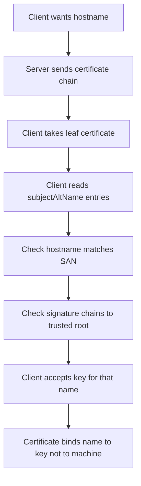

# The Certificate's Public Key Is Not the Server's Identity: Binding a Name to a Key, Not to a Machine

## English

A certificate is, at its core, a signed statement of the form 'the public key in this certificate belongs to this name'. Everything else—issuer, validity, extensions, key usage—modifies or constrains that statement. The crucial consequence is that a certificate binds a name to a key, not to a machine, an IP address, or a process. The same key pair can appear in many certificates with different names, issued at different times by different CAs, and all of them can be simultaneously valid. This is why a server can present a certificate for www.example.com, and the client's only job is to check that the name it wanted is actually covered by a subjectAltName entry in the certificate it received, and that the signature over that certificate chains to a trusted root.

The name-matching rules are more subtle than they look. Modern clients ignore the Common Name (CN) field entirely and look only at the subjectAltName extension, which is why a certificate with a correct CN but no SAN will fail in every current browser. SAN entries can be DNS names, IP addresses, or other name forms, and wildcard matching is deliberately restricted: a wildcard like *.example.com matches www.example.com but not a.b.example.com, and it does not match the bare example.com. There is also the question of whether the certificate must be the only one presented; a server can send a chain containing several certificates, but only the leaf is matched against the requested hostname.

The key point is that the binding is semantic, not physical. Nothing in the certificate says 'this key is installed on a machine at 203.0.113.7'. If you copy the private key to another server, the certificate still verifies, because the client has no way to tell which machine answered. This is why key compromise is so serious: the attacker does not need to steal the certificate, only the private key, and can then present the same certificate from anywhere. Certificate Transparency and revocation exist precisely because the binding cannot be enforced physically—they are the social and infrastructural mechanisms that try to detect and limit misuse of a key that has escaped.

A related confusion is the difference between the certificate's public key and the server's TLS session keys. The certificate's public key is used during the handshake to authenticate the server and to establish a shared secret (in TLS 1.2 with RSA key exchange, the client encrypts a premaster secret to it; in TLS 1.3 the certificate key signs the handshake transcript instead, and the actual session keys come from an ephemeral Diffie-Hellman exchange). The certificate key is long-lived and identity-bearing; the session keys are ephemeral and confidentiality-bearing. Mixing them up leads to the mistaken belief that rotating the certificate key changes the session encryption, or that a strong session cipher compensates for a weak certificate key.

Finally, the name in the certificate is not verified against the DNS at verification time. The client does not do a reverse lookup or a forward-confirmed reverse DNS check. It simply compares the hostname it typed against the SAN entries. That is why a certificate for a name you control can be used to impersonate that name even if the DNS record points elsewhere, and why DNS hijacking combined with a mis-issued certificate is such a potent attack. The certificate says 'this key is for this name'; it does not say 'this name resolves to this machine', and the gap between those two statements is where a great deal of real-world security engineering lives.

## 中文

憑證的核心，是一項經簽署的陳述，形式為「本憑證內的公鑰屬於這個名稱」。其他一切——簽發者、有效期、擴充套件、金鑰用途——都是在修飾或約束這項陳述。關鍵後果是：憑證把名稱繫結到金鑰，而不是繫結到機器、IP 位址或行程。同一對金鑰可以出現在多張名稱不同、由不同 CA 於不同時間簽發的憑證中，而它們可以同時有效。這就是為何伺服器可以出示一張 www.example.com 的憑證，而使用者端唯一的工作，就是檢查它想要的名稱是否真的被所收到憑證中的 subjectAltName 專案涵蓋，以及該憑證上的簽章是否鏈到受信任的根。

名稱比對規則比表面看來更微妙。現代使用者端完全忽略 Common Name（CN）欄位，只看 subjectAltName 擴充套件；這就是為何一張 CN 正確但沒有 SAN 的憑證，在所有現代瀏覽器中都會失敗。SAN 專案可以是 DNS 名稱、IP 位址或其他名稱形式，而萬用字元比對受到刻意限制：像 *.example.com 這樣的萬用字元可匹配 www.example.com，但不匹配 a.b.example.com，也不匹配裸名 example.com。還有一個問題：憑證是否必須是唯一出示的一張？伺服器可以送出包含多張憑證的鏈，但只有葉憑證會與所請求的主機名比對。

重點是：繫結是語意上的，而非物理上的。憑證中沒有任何內容說「此金鑰安裝在 203.0.113.7 這臺機器上」。如果你把私鑰複製到另一臺伺服器，憑證仍然驗證透過，因為使用者端無法分辨是哪臺機器回答。這就是為何金鑰洩漏如此嚴重：攻擊者不需要偷走憑證，只需偷走私鑰，然後就可以從任何地方出示同一張憑證。Certificate Transparency 與撤銷機制之所以存在，正因為繫結無法在物理上強制執行——它們是社會與基建機制，試圖偵測並限制已外洩金鑰被濫用。

相關的混淆，是憑證公鑰與伺服器 TLS 會話金鑰之間的差別。憑證公鑰在握手期間用於認證伺服器並建立共享秘密（在採用 RSA 金鑰交換的 TLS 1.2 中，使用者端用它加密 premaster secret；在 TLS 1.3 中，憑證金鑰改為簽署握手紀錄，而真正的會話金鑰來自臨時 Diffie-Hellman 交換）。憑證金鑰是長壽且承載身分的；會話金鑰是臨時且承載機密的。混淆兩者，會導致錯誤地以為輪換憑證金鑰會改變會話加密，或以為強大的會話密碼可以補償薄弱的憑證金鑰。

最後，憑證中的名稱在驗證時不會對照 DNS 核實。使用者端不會做反向查詢，也不會做正向確認的反向 DNS 檢查。它只是把它輸入的主機名與 SAN 專案比對。這就是為何一張你控制的名稱的憑證，即使 DNS 記錄指向別處，仍可用來冒充該名稱；也是為何 DNS 劫持結合誤簽發憑證，是如此強力的攻擊。憑證說「此金鑰屬於此名稱」；它沒有說「此名稱解析到這臺機器」，而這兩項陳述之間的落差，正是大量現實世界安全工程的所在。

## Key Takeaway

A certificate binds a name to a key, never to a machine, so the client's hostname match against the SAN is the only identity check—and DNS is a separate, unverified layer.

## Related Concepts
- Hostname verification
- Subject Alternative Name extension

## Diagram

