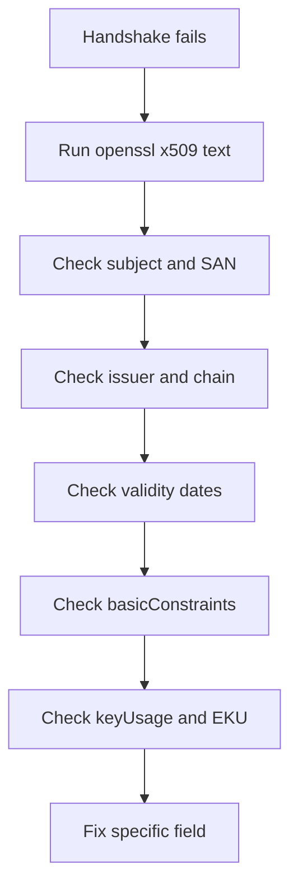

# Reading a Certificate Like a Log File: The Fields You Should Actually Check When Something Breaks

## English

When a TLS handshake fails, the useful question is rarely 'is the signature valid?' but 'which specific field did the verifier object to?'. A certificate is a structured record with a small number of diagnostic fields, and learning to read them in order turns a vague 'certificate error' into a specific fix. The single most useful command is openssl x509 -in cert.pem -noout -text, which prints the whole structure: version, serial number, signature algorithm, issuer, validity, subject, public key info, and the X.509v3 extensions. Read it top to bottom and you are effectively replaying the verifier's checklist.

Start with the subject and the subjectAltName extension. The subject is the human-readable name; the SAN is what clients actually match. If the SAN list does not contain the hostname the client requested, nothing else matters—the handshake fails regardless of how perfect the chain is. Next check the issuer and the chain. The issuer field of the leaf must match the subject field of the next certificate in the chain, and so on up to a root that the client trusts. A mismatch here usually means the server sent the wrong intermediate, or sent only the leaf. Then check the validity dates against the client's clock, not the server's, as discussed elsewhere.

The extensions section is where most subtle failures live. basicConstraints tells you whether a certificate is allowed to act as a CA (CA:TRUE) or is an end-entity certificate (CA:FALSE). If a leaf certificate is presented as an intermediate, path validation fails. keyUsage and extendedKeyUsage constrain what the key may be used for: a certificate with only serverAuth in its EKU cannot be used for client authentication, and a certificate with keyUsage that omits digitalSignature cannot be used to sign a TLS 1.3 handshake transcript. subjectKeyIdentifier and authorityKeyIdentifier help chain building but are not usually the cause of a failure. If the certificate has a nameConstraints extension, it may restrict which names the certificates beneath it can cover, which can produce surprising rejections in internal PKI.

The signature algorithm field deserves its own look. It tells you both the hash and the public-key algorithm used by the issuer (for example, ecdsa-with-SHA256 or sha256WithRSAEncryption). If a client rejects a certificate with 'unsupported signature algorithm', the problem is usually that the algorithm is deprecated or that the client is old, not that the signature bytes are wrong. Similarly, the public key info section tells you the key type and size; a 1024-bit RSA key or a curve the client does not support will cause a failure that has nothing to do with the signature itself.

Finally, the serial number and fingerprints are your identifiers. The serial number is unique within a given CA and is what revocation lists reference; the SHA-256 fingerprint is what you compare when you want to confirm that two files contain the same certificate. A practical habit: when you are handed a certificate and asked 'is this the right one?', compute openssl x509 -noout -fingerprint -sha256 and compare it to the fingerprint recorded where the certificate was issued. If they match, the file is the certificate; whether it is trusted is a separate question, answered by the chain and the client's trust store. Reading a certificate this way—field by field, in the order the verifier uses them—is the difference between guessing and diagnosing.

## 中文

當 TLS 握手失敗時，有用的問題很少是「簽章是否有效？」，而是「驗證者究竟反對哪個具體欄位？」。憑證是一份結構化記錄，只有少數幾個診斷欄位；學會按次序閱讀它們，就能把含糊的「憑證錯誤」變成具體的修正。最有用的一條命令是 openssl x509 -in cert.pem -noout -text，它會印出整個結構：版本、序號、簽章演算法、簽發者、有效期、主體、公鑰資訊，以及 X.509v3 擴展。由上而下閱讀，你實際上就是在重播驗證者的檢查清單。

先看主體（subject）與 subjectAltName 擴展。主體是人類可讀的名稱；SAN 才是用戶端實際比對的對象。如果 SAN 清單不包含用戶端所請求的主機名，其他一切都不重要——無論鏈有多完美，握手都會失敗。接著檢查簽發者與鏈。葉憑證的簽發者欄位必須匹配鏈中下一張憑證的主體欄位，如此類推，直到用戶端信任的根。此處不匹配，通常意味著伺服器送出了錯誤的中繼憑證，或只送了葉憑證。然後對照用戶端（而非伺服器）的時鐘檢查有效期，這點在別處已談過。

擴展部分是多數微妙失敗的所在。basicConstraints 告訴你一張憑證是否可充當 CA（CA:TRUE），還是終端實體憑證（CA:FALSE）。若把葉憑證當作中繼憑證出示，路徑驗證就會失敗。keyUsage 與 extendedKeyUsage 約束密鑰可用於什麼：EKU 只有 serverAuth 的憑證不能用於用戶端認證；keyUsage 缺少 digitalSignature 的憑證不能用於簽署 TLS 1.3 握手紀錄。subjectKeyIdentifier 與 authorityKeyIdentifier 有助建立鏈，但通常不是失敗的原因。若憑證帶有 nameConstraints 擴展，它可能限制其下憑證可涵蓋的名稱，在內部 PKI 中可造成令人意外的拒絕。

簽章演算法欄位值得獨立一看。它同時告訴你簽發者所用的雜湊與公鑰演算法（例如 ecdsa-with-SHA256 或 sha256WithRSAEncryption）。若用戶端以「不支援的簽章演算法」拒絕憑證，問題通常是演算法已棄用或用戶端太舊，而不是簽章位元組有錯。同樣，公鑰資訊部分告訴你密鑰類型與大小；1024 位元 RSA 密鑰或用戶端不支援的曲線，會造成與簽章本身無關的失敗。

最後，序號與指紋是你的識別碼。序號在給定 CA 內唯一，是撤銷清單引用的對象；SHA-256 指紋則是你在想確認兩個檔案是否含同一張憑證時所比對的。一個實用習慣：當有人交給你一張憑證並問「這張對不對？」時，計算 openssl x509 -noout -fingerprint -sha256，並與憑證簽發處所記錄的指紋比對。若相符，該檔案就是那張憑證；它是否受信任是另一個問題，由鏈與用戶端的信任存放區回答。以這種方式閱讀憑證——逐欄位、按驗證者使用的次序——就是猜測與診斷之間的差別。

## Key Takeaway

Diagnose certificate failures by walking the verifier's checklist in order—SAN, issuer chain, validity, extensions, then signature algorithm—rather than assuming the signature itself is at fault.

## Related Concepts
- openssl x509 inspection
- X.509v3 extensions

## Diagram

