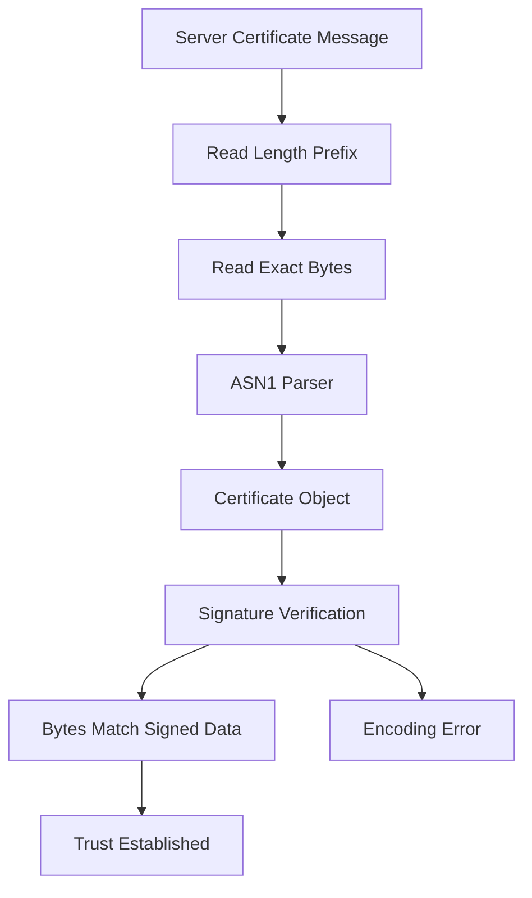

# The Signature Does Not Travel Alone: How the Signed Certificate Gets Delivered and Parsed

## English

A signature that verifies correctly is only useful if the bytes carrying it arrive intact and are parsed the same way by both sides. In practice a certificate almost never travels as a bare DER file over the wire. During a TLS handshake the server sends a Certificate message (defined in TLS 1.3 by RFC 8446) that contains a list of DER-encoded certificates, each prefixed by a 3-byte length field, and the whole message is itself length-prefixed. That means the receiver must first read a length, then read exactly that many bytes, then hand those bytes to an ASN.1 parser. If any layer miscounts, the parser may still succeed on a truncated or padded blob and produce a certificate object that looks plausible but is not the one that was signed.

This is why PEM exists as a transport wrapper. PEM (Privacy-Enhanced Mail, from RFC 7468) is base64 of the DER bytes wrapped in '-----BEGIN CERTIFICATE-----' and '-----END CERTIFICATE-----' lines. Base64 is forgiving in some ways (whitespace is usually ignored) and unforgiving in others (a single wrong character changes the decoded bytes completely). A very common real-world failure is a certificate file that was edited by hand, pasted through a chat application that inserted line breaks or smart quotes, or concatenated with a missing newline between blocks. The signature is untouched, but the bytes you are verifying are no longer the bytes that were signed, so verification fails with a message that sounds cryptographic but is actually a text-encoding problem.

A second subtlety is that parsers differ in strictness. DER (Distinguished Encoding Rules) demands a single canonical encoding for every value, but some libraries will happily accept BER-style variants such as indefinite lengths or non-minimal integer encodings. If a signer emits a non-canonical encoding and your verifier re-encodes the structure before checking, the bytes it hashes will differ from the bytes the CA hashed, and the signature check fails even though nothing is 'wrong' with the key. This is the practical reason certificate profiles insist on DER and why 're-encode then verify' is a bug pattern rather than a convenience.

A useful mental model: the signature is a seal on a specific physical document. If you photocopy the document at 97% scale, translate it, or retype it, the seal no longer matches the paper even though the words are the same. When a certificate 'fails to verify' but the chain and dates look fine, the first thing to check is whether the bytes you are feeding the verifier are byte-identical to what was issued. Comparing a SHA-256 fingerprint of your local file against the fingerprint the CA published is a fast way to answer that question before you start suspecting algorithms.

Finally, remember that the delivery channel itself is untrusted. TLS protects the handshake, but certificates also arrive by email, by configuration management, by container images, and by copy-paste. Each of those channels can mangle encoding, append a trailing newline, or silently convert CRLF to LF. Robust tooling treats certificate input as binary data with an expected fingerprint, not as text to be tidied up.

## 中文

一個簽章驗證正確，只有在承載它的位元組完整送達、而且雙方用相同方式解析時才有用。實務上，憑證幾乎不會以裸 DER 檔案的形式在網路上傳送。在 TLS 握手期間，伺服器會送出一個 Certificate 訊息（TLS 1.3 由 RFC 8446 定義），裡面是一串 DER 編碼的憑證，每個憑證前面有一個 3 位元組的長度欄位，整個訊息本身也有長度前綴。這代表接收方必須先讀長度，再精確讀取那麼多位元組，然後把這些位元組交給 ASN.1 解析器。只要任何一層算錯長度，解析器仍可能在截斷或補齊的資料上「成功」解析，產生一個看起來合理、但並不是當初被簽署的那個憑證物件。

這就是 PEM 存在的理由：它是一種傳輸包裝。PEM（Privacy-Enhanced Mail，出自 RFC 7468）就是把 DER 位元組做 base64，再用 '-----BEGIN CERTIFICATE-----' 與 '-----END CERTIFICATE-----' 包起來。Base64 在某些方面很寬容（空白通常被忽略），在另一些方面則毫不留情（一個字元錯了，解碼出來的位元組就完全不同）。真實世界很常見的故障是：憑證檔被手動編輯過、經過會插入換行或智慧引號的聊天軟體貼上、或在串接時兩個區塊之間少了換行。簽章本身沒動過，但你拿去驗證的位元組已經不是被簽署的位元組，於是驗證失敗，錯誤訊息聽起來像密碼學問題，實際上卻是文字編碼問題。

第二個微妙之處是解析器的嚴格程度不一。DER（Distinguished Encoding Rules）要求每個值只有唯一一種標準編碼，但有些函式庫會欣然接受 BER 風格的變體，例如不定長度或非最小整數編碼。如果簽署方產生了非標準編碼，而你的驗證器在檢查前先把結構重新編碼，它雜湊的位元組就會與 CA 當初雜湊的不同，簽章檢查便會失敗——即使金鑰本身毫無問題。這就是憑證設定檔堅持使用 DER 的實際原因，也是「先重新編碼再驗證」為何是 bug 模式而非便利功能。

一個好用的比喻：簽章是蓋在某份具體紙本文件上的封蠟。如果你把文件影印成 97% 大小、翻譯它、或重新打字，封蠟就不再吻合那張紙，即使文字一模一樣。當憑證「驗證失敗」但鏈與日期看起來都正常時，第一件該查的事，就是你餵給驗證器的位元組是否與核發時位元組完全相同。把你本機檔案的 SHA-256 指紋與 CA 公布的指紋比對，是在開始懷疑演算法之前快速回答這問題的方法。

最後，記得傳輸通道本身也不可信。TLS 保護握手，但憑證也會經由電子郵件、組態管理工具、容器映像檔、複製貼上等方式送達。每個通道都可能弄壞編碼、多出一個結尾換行、或悄悄把 CRLF 轉成 LF。穩健的工具會把憑證輸入當成帶有預期指紋的二進位資料，而不是待整理的文字。

## Key Takeaway

A valid signature only means something if the exact signed bytes reach the verifier unmodified — encoding, wrapping, and parsing are part of the security boundary.

## Related Concepts
- DER vs PEM encoding
- TLS handshake Certificate message

## Diagram

