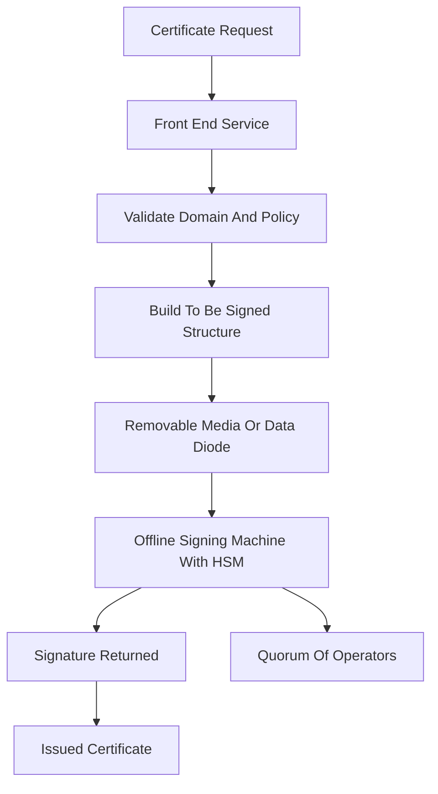

# Signing Offline: Why the Signing Key Is Kept in a Separate Room From the Internet

## English

The security of the entire PKI rests on a small number of signing keys, and the operational answer to 'how do you protect a key that must sign thousands of certificates a day' is usually: you don't let it near a network at all. Many CAs separate the act of signing from the act of deciding what to sign. A front-end service validates the request, checks domain control, applies policy, and produces a description of the certificate to be issued — the to-be-signed structure, or TBS. That description is then carried, often as a file on removable media or through a one-way data diode, to an offline signing machine or a hardware security module (HSM) that has never had a route to the public internet.

An HSM is a tamper-resistant device that stores private keys and performs cryptographic operations inside its own boundary. The key material is generated inside the device and, by design, cannot be exported in usable form. Software asks the HSM to sign a hash; the HSM returns a signature. This means a compromise of the front-end server yields no signing key at all — an attacker can only ask for signatures on whatever the HSM's access policy permits, and that policy is usually narrow: specific key, specific algorithm, specific rate, specific audit trail.

There is an important asymmetry to understand here. The CA's signing key is not used to encrypt anything and is not used to establish sessions; its only job is to produce signatures over TBS structures. So the threat model is not 'steal the key and decrypt traffic' but 'steal the key and mint certificates for any domain you like', which is far worse. That is why HSMs, quorum controls (multiple authorized operators required to activate signing), and split-knowledge procedures around the key are standard, and why a single administrator is usually not enough to bring the signing capability online.

Offline signing has real costs. Latency goes up because requests are batched; automation gets harder because the signing side cannot call out to the internet; and recovery from a hardware failure requires backups that are themselves high-value secrets. Organisations that run an internal CA often adopt a middle ground: the root key stays offline and signs only intermediate CA certificates, while the intermediate key lives in an HSM that is network-reachable but heavily restricted. This is the same leaf/intermediate/root hierarchy you already know, viewed from the operations side rather than the certificate side.

For anyone learning the flow, the practical lesson is that 'signing' and 'serving' are different jobs done by different machines with different trust levels. If you are building a test CA, you can collapse them into one box for convenience, but you should be able to describe which component holds which key and what an attacker gains by compromising each one. That description is the actual security design; the certificate chain is just its public face.

## 中文

整個 PKI 的安全，繫於少數幾把簽署金鑰；而對於「如何保護一把每天要簽數千張憑證的金鑰」這個問題，營運上的答案通常是：根本不讓它靠近網路。許多 CA 把「簽署」這個動作與「決定要簽什麼」這個動作分開。前端服務負責驗證請求、檢查網域控制權、套用政策，並產出待簽憑證的描述——也就是 to-be-signed 結構，簡稱 TBS。這份描述接著會被帶到（通常是以可移除媒體上的檔案，或透過單向資料二極體）一臺從未連線過公網的離線簽署機器或硬體安全模組（HSM）。

HSM 是一種防竄改裝置，把私鑰存放在裝置內部，並在自己的邊界內執行密碼學運算。金鑰材料在裝置內產生，而且依設計無法以可用形式匯出。軟體請 HSM 對一個雜湊值簽章；HSM 回傳一個簽章。這代表前端伺服器即使被攻破，也拿不到任何簽署金鑰——攻擊者只能要求 HSM 在它存取政策允許的範圍內簽章，而這政策通常很窄：特定金鑰、特定演演算法、特定速率、特定稽核軌跡。

這裡有個重要的不對稱性要理解。CA 的簽署金鑰不用來加密任何東西，也不用來建立連線；它唯一的工作，就是對 TBS 結構產生簽章。所以威脅模型不是「偷到金鑰就能解密流量」，而是「偷到金鑰就能為任何網域鑄造憑證」，後者嚴重得多。這就是為何 HSM、法定人數控制（需要多位授權操作員才能啟用簽章）、以及圍繞金鑰的分割知識程式是標準做法，也是為何通常單一管理員不足以讓簽章能力上線。

離線簽署有實際代價。延遲會上升，因為請求要批次處理；自動化更難，因為簽署端不能對外連網；而硬體故障後的復原，需要本身即為高價值機密的備份。執行內部 CA 的組織常採折衷方案：根金鑰保持離線，只簽中繼 CA 憑證；中繼金鑰則放在可連網但嚴格受限的 HSM 裡。這與你已熟悉的三層架構（leaf／intermediate／root）相同，只是從營運而非憑證的角度來看。

對正在學習整個流程的人來說，實用的教訓是：「簽署」與「服務」是不同機器、不同信任層級所做的不同工作。如果你在建立測試 CA，為了方便可以把兩者合併在一臺機器上，但你應該能夠描述哪個元件持有哪把金鑰，以及攻破每一個元件分別能讓攻擊者得到什麼。那份描述才是真正的安全設計；憑證鏈只是它對外呈現的面貌。

## Key Takeaway

The CA's signing key is protected by isolation and hardware, not by being secret in software — knowing which machine holds which key is the real security model.

## Related Concepts
- Hardware Security Module
- Offline root CA

## Diagram

