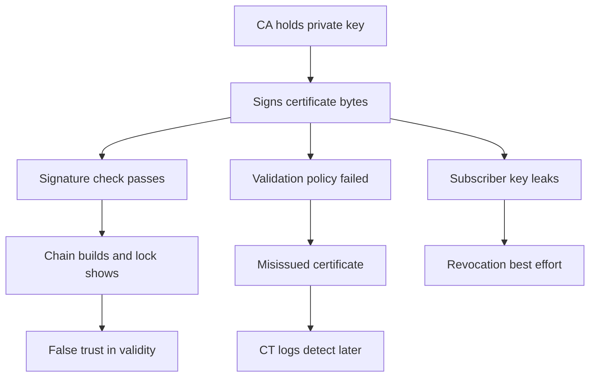

# What a Signature Cannot Fix: Compromised Keys, Mis-Issuance, and the Limits of Cryptographic Proof

## English

A certificate signature proves one narrow thing: that whoever holds the CA's private key produced these exact bytes. It says nothing about whether the CA was right to do so. If an attacker convinces a CA that they control a domain they do not control — through DNS hijacking, BGP route leaks, a compromised hosting account, or a social-engineering attempt on the validation team — the resulting certificate is cryptographically perfect and completely fraudulent. Every signature check will pass, every chain will build, and the browser will show a lock. The math did its job; the policy did not.

This is not a hypothetical. Mis-issuance has happened repeatedly throughout the history of public CAs, and it is the reason Certificate Transparency (CT) exists. CT requires CAs to submit every certificate they issue to public, append-only logs, and to include signed timestamps (SCTs) proving the submission. Browsers can then check that a certificate they see is in the logs, and domain owners can monitor the logs for certificates bearing their names. The signature on the certificate did not change; what changed is that the act of signing became observable after the fact. Detection, not prevention.

A second limit is key compromise on the subscriber side. If your server's private key leaks, the certificate remains valid and correctly signed — an attacker can simply present it. Revocation (CRL, OCSP) is the intended remedy, but it is best-effort: clients may fail open, may not check, or may be offline. Short validity periods (the trend toward 90 days and shorter) reduce the window in which a stolen key is useful, but they do not eliminate it. The signature never claimed the key was uncompromised; it only claimed the CA vouched for the binding at issuance time.

A third limit is that signatures are about identity binding, not about behaviour. A certificate for 'example.com' says the CA believes the entity holding that key is authorised to speak for that name. It does not say the server is honest, patched, or free of malware. A phishing site can hold a perfectly valid certificate for its own domain — the lock icon means 'this connection is encrypted and the name matches', not 'this site is trustworthy'. Conflating the two is one of the most persistent misunderstandings about TLS.

Finally, signatures age. Algorithms that were fine a decade ago (MD5, SHA-1) are now unacceptable, and a certificate signed with them may still verify mathematically while being rejected by policy. The signature is a statement made at a moment in time, under the assumptions of that moment. Reading a certificate well means asking not just 'does the signature verify?' but 'who signed it, under what policy, when, and what has changed since?'

## 中文

憑證簽章只證明一件很窄的事：持有 CA 私鑰的人，產生了這些確切的位元組。它完全沒說 CA 這樣做對不對。如果攻擊者透過 DNS 劫持、BGP 路由洩漏、被入侵的代管帳號，或對驗證團隊的社交工程，讓 CA 相信他們控制了一個其實不屬於他們的網域，那麼產出的憑證在密碼學上完美無瑕，卻完全造假。每個簽章檢查都會透過，每條鏈都會建立，瀏覽器也會顯示鎖頭。數學盡了本分；政策沒有。

這不是假設。公眾 CA 的歷史中，錯誤核發一再發生，這也是憑證透明度（Certificate Transparency，CT）存在的原因。CT 要求 CA 把它們核發的每一張憑證提交到公開、只能追加的日誌，並附上簽署的時間戳（SCT）以證明已提交。瀏覽器便可檢檢視到的憑證是否在日誌中，而網域擁有者則可監控日誌中是否有掛著自己名字的憑證。憑證上的簽章沒有改變；改變的是「簽署」這個行為在事後變成可觀察的。這是偵測，不是預防。

第二個限制是訂閱者端的金鑰外洩。如果伺服器的私鑰洩漏，憑證依然有效、簽章依然正確——攻擊者只要直接出示它就好。撤銷（CRL、OCSP）是預定的補救措施，但它是盡力而為：使用者端可能失敗開放、可能根本不檢查、也可能離線。較短的有效期（朝 90 天甚至更短的趨勢）縮小了被竊金鑰可用的時間窗，但並未消除它。簽章從未宣稱金鑰未被洩漏；它只宣稱 CA 在核發時為這個繫結背書。

第三個限制是：簽章談的是身分繫結，不是行為。一張 'example.com' 的憑證，說的是 CA 相信持有該金鑰的實體有權代表這個名字發言。它沒說這臺伺服器誠實、有修補、或沒有惡意軟體。釣魚網站可以為自己的網域持有一張完全有效的憑證——鎖頭圖示的意思是「這個連線已加密且名稱相符」，不是「這個網站值得信任」。把兩者混為一談，是關於 TLS 最常見的誤解之一。

最後，簽章會老化。十年前沒問題的演演算法（MD5、SHA-1）如今已不被接受，用它們簽的憑證在數學上仍可能驗證透過，卻被政策拒絕。簽章是在某個時間點、在某個時間點的假設下所做的陳述。好好閱讀一張憑證，意味著不只問「簽章驗證得過嗎？」，還要問「是誰簽的、依什麼政策、在何時、之後又改變了什麼？」

## Key Takeaway

A signature proves who signed and that the bytes are intact — it cannot prove the CA was right, the key is safe, or the site is honest.

## Related Concepts
- Certificate Transparency
- Certificate revocation

## Diagram

