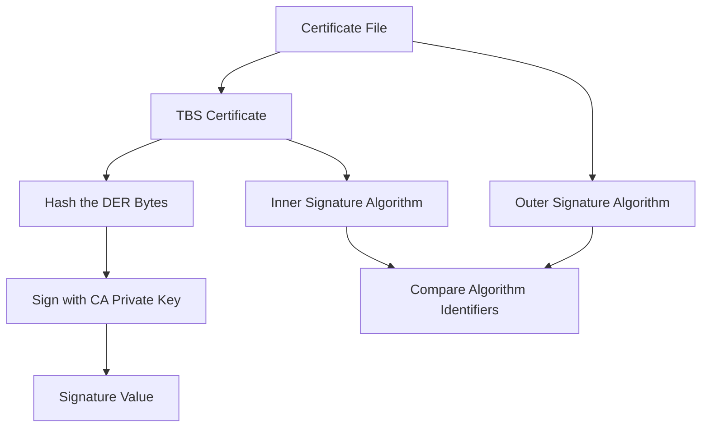

# What a CA Actually Signs: The TBS Certificate and the Signature Algorithm Field

## English

When a CA signs a certificate, it does not sign the whole file you download. It signs a structure called the TBS certificate — short for "to be signed" — which is the certificate with the signature field itself removed. In X.509, a certificate is a SEQUENCE of three things: the TBS certificate, a signatureAlgorithm identifier, and a signatureValue BIT STRING. The CA hashes the DER-encoded bytes of the TBS certificate and then applies its private key to that hash. The signatureAlgorithm field appears twice — once inside the TBS certificate and once outside it — and a verifier must check that the two match. This duplication is a historical quirk that prevents a class of attacks where an attacker swaps the outer algorithm identifier to confuse a parser into verifying with a weaker algorithm than the one the CA intended.

Because the signature is over exact bytes, even a single byte difference in the TBS certificate produces a completely different signature. This is why re-encoding a certificate — say, converting DER to PEM and back, or reformatting the ASN.1 structure — will not break the signature (PEM is just base64-wrapped DER), but editing any field, even whitespace inside a string, will. If you change the subject name or the validity dates, the signature no longer validates against the CA's public key. The signature is a cryptographic seal on the exact byte sequence, not on the human-readable meaning.

The signatureAlgorithm field itself is an OID (object identifier), a dotted numeric string like 1.2.840.113549.1.1.11, which in that case means sha256WithRSAEncryption. The OID tells the verifier which hash function to use and which signature scheme to apply — RSA PKCS#1 v1.5, RSA-PSS, ECDSA, Ed25519, and so on. Getting this wrong means the verifier either rejects the signature or, worse, accepts it under a different algorithm than the CA intended. This is why modern validators cross-check the inner and outer OIDs and refuse certificates where they disagree.

A practical way to see this: run `openssl asn1parse -in cert.pem` and you will see the nested structure. The outer SEQUENCE contains the tbsCertificate, then the algorithm identifier, then the BIT STRING holding the signature bytes. The signature is never inside the TBS certificate — that would be circular. If you ever see a certificate tool reporting "signature algorithm mismatch," it usually means the inner and outer OIDs disagree, or the certificate was hand-edited by a tool that did not recompute the signature.

So when you think about "certificate signing," picture the CA hashing a very specific byte blob and then signing that hash. Everything else — the PEM armor, the file extension, the human-readable fields — is packaging around those bytes. Understanding this makes it obvious why you cannot "fix" a certificate by editing a text field, and why tools like `openssl x509 -text` show you fields that are merely interpretations of the same DER structure.

## 中文

當憑證授權機構（CA）簽署憑證時，它簽的並不是你下載回來的那整個檔案，而是一個叫 TBS 憑證（to be signed certificate，待簽署憑證）的結構——也就是把簽章欄位本身拿掉之後的憑證。在 X.509 裡，一張憑證是一個 SEQUENCE，內含三樣東西：TBS 憑證、signatureAlgorithm 識別碼，以及 signatureValue 這個 BIT STRING。CA 會對 TBS 憑證的 DER 編碼位元組做雜湊，再用自己的私鑰對那個雜湊值簽章。signatureAlgorithm 欄位會出現兩次——一次在 TBS 憑證裡面，一次在外面——而驗證者必須檢查兩者是否一致。這個重複是歷史遺留的設計，用來防止一類攻擊：攻擊者把外層的演算法識別碼換掉，誘導解析器用比 CA 原意更弱的演算法去驗證。

因為簽章是針對精確的位元組，TBS 憑證裡只要差一個位元組，簽章就會完全不同。這就是為什麼重新編碼一張憑證——例如 DER 轉 PEM 再轉回來，或重新格式化 ASN.1 結構——不會破壞簽章（PEM 只是 base64 包裝的 DER），但只要你改動任何欄位，哪怕只是字串裡的空白，簽章就會失效。如果你改了主體名稱或有效期限，簽章就無法用 CA 的公鑰驗證通過。簽章是對精確位元組序列的密碼學封印，不是對人類可讀意義的封印。

signatureAlgorithm 欄位本身是一個 OID（object identifier，物件識別碼），是一串像 1.2.840.113549.1.1.11 這樣用點分隔的數字，在這個例子裡代表 sha256WithRSAEncryption。這個 OID 告訴驗證者該用哪個雜湊函數、該套用哪種簽章方案——RSA PKCS#1 v1.5、RSA-PSS、ECDSA、Ed25519 等等。這個欄位弄錯，驗證者要麼直接拒絕簽章，要麼更糟——用跟 CA 原意不同的演算法接受它。這就是為什麼現代驗證器會交叉比對內外層的 OID，遇到不一致就拒絕。

想實際看到這件事：執行 `openssl asn1parse -in cert.pem`，你會看到巢狀結構。外層 SEQUENCE 內含 tbsCertificate，接著是演算法識別碼，再接著是裝著簽章位元組的 BIT STRING。簽章永遠不會在 TBS 憑證裡面——那會變成循環。如果你看到某個憑證工具回報「signature algorithm mismatch」，通常代表內外層 OID 不一致，或者憑證被某個工具手動改過卻沒有重算簽章。

所以當你想到「憑證簽署」時，請想像 CA 對一個非常特定的位元組塊做雜湊，然後對那個雜湊值簽章。其他一切——PEM 包裝、副檔名、人類可讀的欄位——都只是這些位元組外面的包裝。理解這點，你就會明白為什麼不能靠編輯文字欄位來「修好」一張憑證，也會明白為什麼 `openssl x509 -text` 顯示的那些欄位，其實只是對同一份 DER 結構的詮釋。

## Key Takeaway

A CA signs the DER-encoded TBS certificate bytes, not the whole file, so any field edit invalidates the signature while mere re-encoding does not.

## Related Concepts
- TBS certificate
- signatureAlgorithm OID

## Diagram

