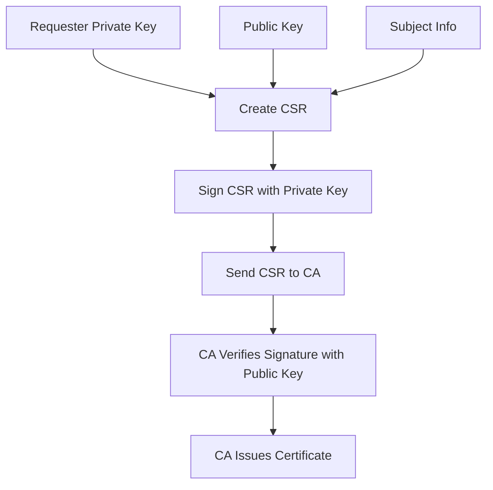

# Why the Private Key Never Leaves Your Machine (and What the CA Actually Receives)

## English

A common misconception is that certificate signing involves sending your private key to the CA. It does not, and it must not. What you send is a CSR (certificate signing request), which contains your public key, the subject information you want in the certificate, and a signature over those fields made with your private key. The CA uses that signature to prove you hold the corresponding private key — this is called proof of possession. The private key itself stays on your machine, in your HSM, or in your key store, and never travels over the network to the CA.

This design is not accidental. If the CA received your private key, it could impersonate you, sign arbitrary traffic as you, or leak the key in a breach. The whole point of public-key cryptography is that the private half is never shared. The CSR is a one-way handoff: the CA learns your public key and your asserted identity, and nothing else. It signs a new certificate that binds the two together, but the binding is only meaningful because the CA verified you hold the private key — otherwise anyone could submit a CSR with someone else's public key and get a certificate impersonating them.

Proof of possession works because only the holder of the private key can produce a valid signature over the CSR's contents. The CA runs the same verification a TLS client would: it hashes the CSR's certificationRequestInfo, applies your public key, and checks that the result matches the signature in the CSR. If it matches, the CA knows the requester controls the private key. This is also why a CSR is not secret — you can publish it, share it, or paste it into a ticket without leaking anything sensitive. It contains only public information and a signature that is useless without the private key.

What the CA does with the CSR is not just copy fields into a new certificate. It may reject the request (for example, if the requested name is not one you control), rewrite or add fields (such as adding SANs, EKUs, or the CA's own policy extensions), and set the validity window. The resulting certificate is a new object, not the CSR with a stamp on it. The CA's signature is over the new certificate's TBS bytes, not over the CSR. This is why you cannot "just sign" a CSR and expect the output to be identical to the input — the CA is producing a fresh certificate with the fields it chooses to include.

In practice, this means your operational security is about protecting the private key locally, not about trusting the CA with it. If your private key leaks, the attacker can impersonate you regardless of what the CA did. If the CA is compromised, the attacker can issue certificates for your name, but they still cannot decrypt past traffic without your private key. The two secrets — your private key and the CA's signing key — are independent, and that separation is what makes the system work.

## 中文

一個常見的誤解是：憑證簽署的過程要把你的私鑰寄給 CA。事實並非如此，也絕對不能這樣做。你送出的是 CSR（certificate signing request，憑證簽署請求），裡面包含你的公鑰、你希望寫進憑證的主體資訊，以及用你私鑰對這些欄位做出來的簽章。CA 用那個簽章來證明你確實持有對應的私鑰——這叫做持有證明（proof of possession）。私鑰本身留在你的機器、你的 HSM 或你的金鑰儲存區裡，永遠不會透過網路送到 CA。

這個設計不是偶然。如果 CA 拿到你的私鑰，它就能冒充你、以你的名義簽任意流量，或在資料外洩時把金鑰洩出去。公開金鑰密碼學的重點，就是私鑰那一半永遠不分享。CSR 是單向交付：CA 只學到你的公鑰和你宣稱的身分，其他什麼都沒有。它簽發一張新憑證把兩者綁在一起，但這個綁定之所以有意義，是因為 CA 驗證過你持有私鑰——否則任何人都能拿別人的公鑰送出一份 CSR，取得一張冒充別人的憑證。

持有證明之所以成立，是因為只有私鑰持有人能對 CSR 內容產生有效簽章。CA 做的驗證跟 TLS 用戶端一樣：它對 CSR 的 certificationRequestInfo 做雜湊，套用你的公鑰，檢查結果是否與 CSR 裡的簽章相符。相符的話，CA 就知道請求者掌控那把私鑰。這也是為什麼 CSR 不是祕密——你可以公開它、分享它，或貼進工單系統，都不會洩漏任何敏感資訊。它只包含公開資訊，以及一個沒有私鑰就毫無用處的簽章。

CA 拿到 CSR 之後，並不是把欄位照抄進新憑證。它可能拒絕請求（例如你要求的名稱並不是你控制的）、改寫或新增欄位（例如加上 SAN、EKU，或 CA 自己的政策擴充），並設定有效期限。產出的憑證是一個新物件，不是蓋了章的 CSR。CA 的簽章是蓋在新憑證的 TBS 位元組上，不是蓋在 CSR 上。這就是為什麼你不能「直接簽」一份 CSR 就期待輸出跟輸入一樣——CA 是在產出一張全新的憑證，欄位由它決定。

實務上，這代表你的營運安全重點在於本地保護私鑰，而不是把私鑰託付給 CA。私鑰外洩，攻擊者就能冒充你，不管 CA 做了什麼。CA 被入侵，攻擊者可以為你的名字簽發憑證，但沒有你的私鑰，他們仍然無法解密過去的流量。這兩個祕密——你的私鑰和 CA 的簽章金鑰——彼此獨立，而這個分離正是整套系統得以運作的關鍵。

## Key Takeaway

The CA receives only your public key and a proof-of-possession signature in the CSR; the private key never leaves your control, which is the whole point of the design.

## Related Concepts
- proof of possession
- CSR

## Diagram

