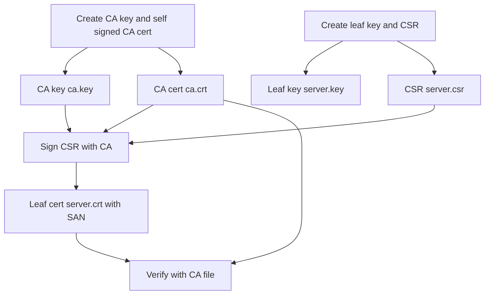

# Hands-On: Signing a CSR With Your Own Test CA and Verifying the Result

## English

The best way to understand certificate signing is to do it yourself with a local test CA. The flow has three steps: create a CA key and self-signed CA certificate, create a leaf key and CSR, then use the CA to sign the CSR into a leaf certificate. Every public CA does exactly this, just with more ceremony, more policy checks, and a hardware security module protecting the CA key. Doing it locally lets you see every intermediate file and every field the CA chooses to set.

First, create the CA: `openssl req -x509 -newkey rsa:2048 -nodes -keyout ca.key -out ca.crt -days 3650 -subj "/CN=Test Root CA"`. The `-x509` flag tells OpenSSL to produce a self-signed certificate directly from the request, and `-nodes` means "no encryption" — do not encrypt the private key with a passphrase, which is fine for a throwaway test CA. (OpenSSL 3.0 deprecated `-nodes` in favour of `-noenc`, which does exactly the same thing.) The `-subj` flag supplies the subject fields non-interactively. Next, create a leaf key and CSR: `openssl req -newkey rsa:2048 -nodes -keyout server.key -out server.csr -subj "/CN=www.example.test"`. Note the `.test` TLD — it is reserved by RFC 2606 for testing and will never collide with a real public name.

Now sign the CSR: `openssl x509 -req -in server.csr -CA ca.crt -CAkey ca.key -CAcreateserial -out server.crt -days 365 -extfile <(printf "subjectAltName=DNS:www.example.test")`. The `-CAcreateserial` flag creates a serial number file so each issued certificate gets a unique serial. The `-extfile` with a process substitution adds a SAN extension, because modern browsers ignore the CN field and require SANs for hostname matching. Without the SAN, the certificate will be technically valid but rejected by every browser. This is the same reason public CAs always include SANs even when the CN is set.

To verify the result, run `openssl verify -CAfile ca.crt server.crt`. You should see `server.crt: OK`. Then inspect it with `openssl x509 -in server.crt -text -noout` and check the issuer (should be Test Root CA), the subject (www.example.test), the serial number, the validity dates, the SAN extension, and the signature algorithm. You can also confirm that the leaf's public key matches the CSR's public key by comparing `openssl pkey -in server.key -pubout` with `openssl req -in server.csr -pubkey -noout` — they should be byte-identical. This is the same check a CA runs to confirm proof of possession.

A useful experiment: edit the CSR's subject with a text editor (do not do this on anything real) and try to sign it again. OpenSSL will fail because the CSR's own signature no longer verifies. Or sign the CSR twice with the same CA and notice that the two certificates differ — different serial numbers, different signing times, possibly different validity windows. The CA's output is not deterministic even for the same input, because the serial and timestamps are chosen by the CA. This exercise makes concrete what the previous articles described abstractly: signing is a byte-level operation on a specific TBS structure, and every field the CA sets is a policy decision, not a copy from the CSR.

## 中文

理解憑證簽署最好的方法，就是自己用本地測試 CA 做一次。整個流程有三步：先建立 CA 金鑰與自簽 CA 憑證，再建立葉端金鑰與 CSR，最後用 CA 把 CSR 簽成葉端憑證。每一家公開 CA 做的都是同一件事，只是儀式更多、政策檢查更多，並用硬體安全模組保護 CA 金鑰。在本地做，你能看到每一個中間檔案，以及 CA 選擇設定的每一個欄位。

首先建立 CA：`openssl req -x509 -newkey rsa:2048 -nodes -keyout ca.key -out ca.crt -days 3650 -subj "/CN=Test Root CA"`。`-x509` 旗標告訴 OpenSSL 直接從請求產生自簽憑證，而 `-nodes` 意思是「no encryption」——不用通關密語加密私鑰，對用完即丟的測試 CA 來說沒問題。（OpenSSL 3.0 已棄用 `-nodes`，改用效果相同的 `-noenc`。）`-subj` 旗標以非互動方式提供主體欄位。接著建立葉端金鑰與 CSR：`openssl req -newkey rsa:2048 -nodes -keyout server.key -out server.csr -subj "/CN=www.example.test"`。注意 `.test` 這個頂級網域——RFC 2606 保留它作為測試用途，永遠不會跟真實的公開名稱衝突。

現在簽署 CSR：`openssl x509 -req -in server.csr -CA ca.crt -CAkey ca.key -CAcreateserial -out server.crt -days 365 -extfile <(printf "subjectAltName=DNS:www.example.test")`。`-CAcreateserial` 旗標會建立序號檔，讓每張簽出的憑證都有唯一序號。`-extfile` 搭配行程替換（process substitution）加上 SAN 擴充，因為現代瀏覽器忽略 CN 欄位，主機名稱比對必須靠 SAN。沒有 SAN 的憑證在技術上有效，但會被所有瀏覽器拒絕。這也是公開 CA 即使設了 CN 也一定會加 SAN 的原因。

要驗證結果，執行 `openssl verify -CAfile ca.crt server.crt`，你應該看到 `server.crt: OK`。接著用 `openssl x509 -in server.crt -text -noout` 檢視，檢查簽發者（應該是 Test Root CA）、主體（www.example.test）、序號、有效期限、SAN 擴充，以及簽章演算法。你也可以比對 `openssl pkey -in server.key -pubout` 與 `openssl req -in server.csr -pubkey -noout`，確認葉端公鑰與 CSR 公鑰一致——兩者應該位元組完全相同。這正是 CA 用來確認持有證明的檢查。

一個有用的實驗：用文字編輯器改動 CSR 的主體（千萬不要對真實的東西這樣做），然後再試著簽一次。OpenSSL 會失敗，因為 CSR 自己的簽章已經驗不過了。或者用同一個 CA 對同一份 CSR 簽兩次，你會發現兩張憑證不一樣——序號不同、簽署時間不同、有效期限可能也不同。即使輸入相同，CA 的輸出也不是決定性的，因為序號與時間戳是由 CA 選的。這個練習把前面文章抽象描述的東西具體化：簽署是針對特定 TBS 結構的位元組層級操作，而 CA 設定的每一個欄位都是政策決定，不是從 CSR 照抄。

## Key Takeaway

Running a local test CA with OpenSSL — generating a CA, creating a CSR, signing it with SAN extensions, and verifying the chain — turns abstract signing theory into files you can inspect byte by byte.

## Related Concepts
- openssl x509 -req
- subjectAltName

## Diagram

