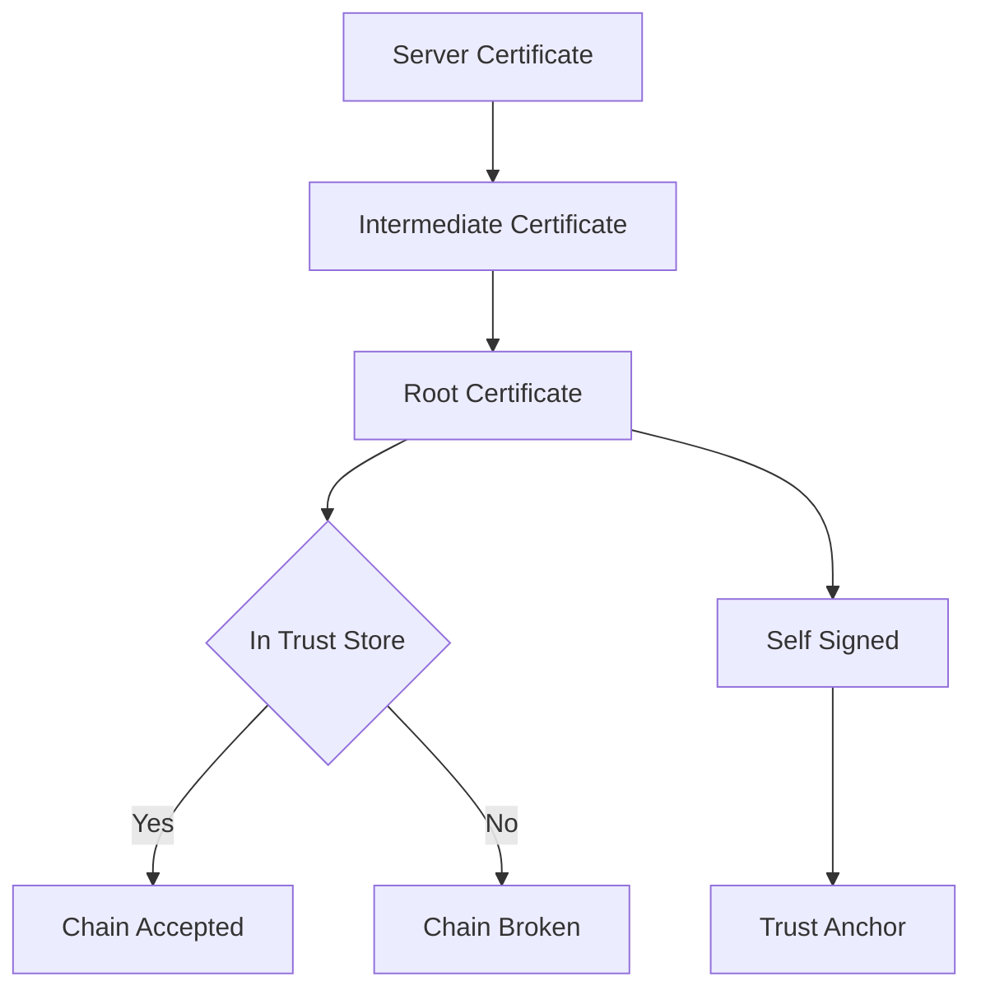

# The CA's Certificate: Who Signs the Signer?

## English

Every signed certificate ends in a chain that must terminate somewhere, and that somewhere is a root certificate that is self-signed: the issuer and the subject are the same entity, and the signature is made with the very key the certificate describes. This looks like a logical hole — a certificate that vouches for itself — and in a purely mathematical sense it is. Nothing inside the bytes proves the root deserves trust. The trust comes from outside the certificate entirely: the root is placed in your operating system or browser trust store by a vendor, an administrator, or a device manufacturer, and that placement is the act of trust. The signature on the root only serves to keep the certificate internally consistent and to make the chain terminate cleanly in software.

This is why the phrase 'trust anchor' is used rather than 'trusted certificate'. A trust anchor is a starting assumption, not a conclusion. When your browser validates a server certificate, it walks up the chain: server certificate signed by intermediate, intermediate signed by root. At the root it stops and asks a different question — is this root in my store, and is it permitted to issue for this purpose? If yes, the chain is accepted. If the root is absent, the chain is broken no matter how perfect every signature along the way is.

A useful analogy is a passport. The passport officer trusts your passport because they trust the issuing government, and they trust the government because their own government recognises it. At some point the recognition is a diplomatic decision, not a forensic one. The same is true here: the root's authority is a policy decision encoded in a file on your disk.

Because roots are so powerful, they are protected more heavily than anything else in the system. Root private keys are typically generated inside a hardware security module, used only to sign intermediate certificates (not end-entity certificates), and kept offline in physically controlled facilities with multi-person access ceremonies. The root certificate itself may be valid for twenty years or more, far longer than any leaf certificate, because replacing a root means coordinating with every vendor that ships a trust store.

When you build a local test CA, you are performing exactly this ceremony in miniature: you generate a key, self-sign a root certificate, and then add that root to your own trust store. The moment you do, every certificate your test CA signs becomes valid on your machine — which is a vivid demonstration that the signature was never the source of trust. The trust store was.

## 中文

每一張被簽署的憑證，最終都會連到一條憑證鏈，而這條鏈必須在某處終止；那個終止點就是自我簽署的根憑證：簽發者與主體是同一個實體，而簽章所用的金鑰，正是該憑證所描述的那把金鑰。這看起來像個邏輯漏洞——一張自己替自己背書的憑證——而在純數學意義上，它確實是。憑證位元組裡沒有任何東西能證明這個根值得信任。信任完全來自憑證之外：根憑證是由廠商、管理員或裝置製造商放進你的作業系統或瀏覽器信任儲存區的，而這個「放進去」的動作，本身就是信任的行為。根憑證上的簽章，只是讓憑證內部保持一致，並讓憑證鏈在軟件中能乾淨地終止。

這就是為什麼大家用「信任錨點」（trust anchor）這個詞，而不是「受信任憑證」。信任錨點是一個起點假設，不是結論。當你的瀏覽器驗證伺服器憑證時，它會沿著鏈往上走：伺服器憑證由中繼憑證簽署，中繼憑證由根憑證簽署。走到根的時候，它停下來，改問另一個問題——這個根在我的儲存區裡嗎？它被允許為這個用途簽發憑證嗎？如果是，整條鏈就被接受。如果根不在，那條鏈就是斷的，無論沿途每一個簽章多麼完美。

一個有用的類比是護照。護照官員信任你的護照，因為他們信任簽發護照的政府；而他們信任那個政府，是因為他們自己的政府承認它。到了某個點，承認是一個外交決定，而不是鑑識決定。這裡也一樣：根憑證的權威，是一個編碼在你磁碟上某個檔案裡的政策決定。

正因為根憑證如此強大，它們受到的保護比系統中任何其他東西都更嚴密。根私鑰通常在硬體安全模組（HSM）內生成，只用來簽發中繼憑證（而非終端實體憑證），並且離線保存在有實體管制、需要多人共同參與儀式的設施裡。根憑證本身的有效期可能長達二十年以上，遠超任何葉憑證，因為更換一個根，意味著要與每一個隨附信任儲存區的廠商協調。

當你建立本機測試 CA 時，你其實是在做同一套儀式的縮小版：你生成一把金鑰、自簽一張根憑證，然後把這個根加進你自己的信任儲存區。你一做這件事，你的測試 CA 所簽的每一張憑證，在你的機器上就都變成有效的了——這生動地示範了：簽章從來都不是信任的來源，信任儲存區才是。

## Key Takeaway

A root certificate's signature proves only internal consistency; the actual trust comes from a deliberate act of placing that root in a trust store.

## Related Concepts
- Trust anchor
- Self-signed certificate

## Diagram

