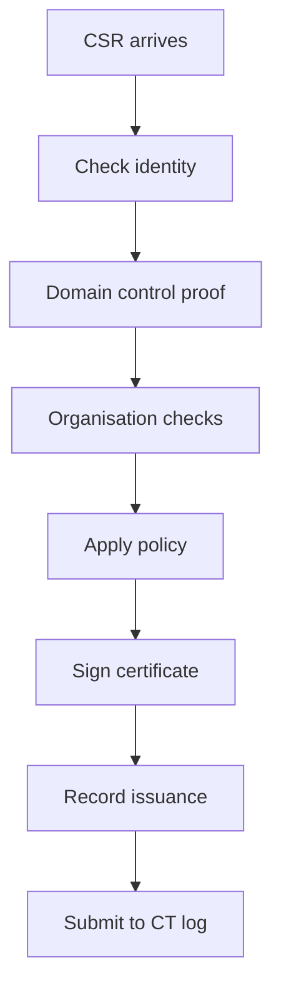

# What the CA Checks Before It Signs: Identity, Authority, and the Audit Trail

## English

A CSR is a request, not an order, and a CA does not sign whatever arrives in its inbox. Before a signature is applied, the CA performs a set of checks that vary by certificate type but always answer the same underlying question: is this requester entitled to a certificate naming these identifiers? For a domain-validated certificate, the check is control of the domain — proving you can publish a specific token at a specific path over HTTP, or create a specific DNS TXT record, or respond on a designated email address drawn from the domain's WHOIS data. For organisation-validated certificates, additional checks confirm the legal existence of the organisation and its connection to the domain.

Crucially, the CA does not verify that the requester is a good actor or that the server is secure. It verifies a narrow, formal claim: that this requester controls this name. This is why a certificate is often described as a statement of control, not of trustworthiness. A phishing site with a valid DV certificate is perfectly consistent with how the system works — the CA confirmed the attacker controlled the domain, and they did.

Each validation step is recorded. Modern CAs maintain detailed issuance records, and for publicly trusted certificates the resulting certificate is submitted to Certificate Transparency logs, which are append-only, publicly auditable ledgers. This means a mis-issued certificate cannot simply be hidden: anyone monitoring the logs for a domain can see a new certificate appear, even one they did not request. The audit trail is not a courtesy; it is a structural check on the CA itself.

The CA also applies policy at signing time. It decides which extensions go into the certificate — key usage, extended key usage, basic constraints, subject alternative names — based on its own profiles and the CA/Browser Forum Baseline Requirements. The requester's CSR may suggest values, but the CA is free to ignore, narrow, or add to them. Requesting a wildcard does not guarantee a wildcard; requesting a long validity period does not guarantee one.

For anyone operating a private CA, the same discipline applies and is easy to skip. A private CA that signs every CSR it receives without checking the requested names is functionally an oracle: anyone who can reach it can obtain a certificate for any internal hostname. The lesson from public CAs is that the signing step should be the last step, gated by a documented check, and that the record of what was checked should be retained.

## 中文

CSR 是一個請求，不是一道命令，CA 不會收到什麼就簽什麼。在蓋上簽章之前，CA 會執行一組檢查；這些檢查會依憑證類型而異，但始終回答同一個根本問題：這個請求者有資格取得一張載明這些識別名稱的憑證嗎？對於網域驗證（DV）憑證，檢查的是網域控制權——證明你能在特定路徑透過 HTTP 發布特定權杖，或建立特定的 DNS TXT 記錄，或在取自該網域 WHOIS 資料的指定電郵地址上回覆。對於組織驗證（OV）憑證，額外的檢查會確認該組織在法律上存在，以及它與該網域的關聯。

關鍵在於，CA 並不驗證請求者是不是好人，也不驗證伺服器是否安全。它驗證的是一個狹窄而形式化的主張：這個請求者控制這個名稱。這就是為什麼憑證常被形容為「控制權的陳述」，而不是「可信度的陳述」。一個持有有效 DV 憑證的釣魚網站，與這套系統的運作方式完全一致——CA 確認了攻擊者控制該網域，而他們確實控制了。

每一個驗證步驟都會被記錄。現代 CA 會保存詳細的簽發記錄；而對於公開信任的憑證，所產生的憑證會被提交到憑證透明度（Certificate Transparency）日誌，那是一份只可追加、可公開稽核的帳本。這意味著一張誤發的憑證無法簡單地被藏起來：任何監看某網域日誌的人，都能看到一張新憑證出現，即使那不是他們申請的。這條稽核軌跡不是客套，而是對 CA 本身的一種結構性檢查。

CA 也會在簽署當下套用政策。它決定憑證要放進哪些擴充欄位——金鑰用途、延伸金鑰用途、基本限制、主體別名——依據的是它自己的設定檔以及 CA/瀏覽器論壇的基準要求。請求者的 CSR 可以建議某些值，但 CA 有權忽略、收窄或增加。要求萬用字元，不保證給你萬用字元；要求較長的有效期，也不保證給你。

對於任何營運私有 CA 的人，同樣的紀律適用，而且很容易被略過。一個來者不拒、收到 CSR 就簽、也不檢查所要求名稱的私有 CA，功能上就是一個預言機：任何能接觸到它的人，都能取得任何內部主機名稱的憑證。公開 CA 給我們的教訓是：簽署步驟應該是最後一步，由一道有文件記錄的檢查把關，而檢查過什麼的記錄應該被保留。

## Key Takeaway

A CA's signature certifies that the requester controls the requested names, not that the requester is trustworthy — and every check it performs should leave a record.

## Related Concepts
- Domain validation
- Certificate Transparency

## Diagram

